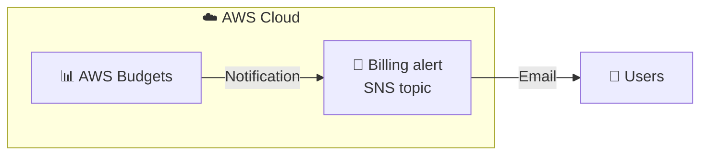

# 💰 AWS Budgets: Cost Control with Email Alerts

**Hands-on lab: creating a cost budget and automatic alerts on AWS**

   

  

---

## 📑 Table of Contents

- [📖 About the Project](#-about-the-project)
- [🎯 Objectives](#-objectives)
- [🧩 Scenario](#-scenario)
- [🏗️ Architecture](#️-architecture)
- [✅ Prerequisites](#-prerequisites)
- [📊 Result](#-result)
- [🔍 Validation](#-validation)
- [💡 Key Takeaways](#-key-takeaways)
- [🧹 Cleanup and Cost Notes](#-cleanup-and-cost-notes)
- [☁️ AWS Services Covered](#️-aws-services-covered)
- [👤 Author](#-author)

---

## 📖 About the Project

This project documents a hands-on lab completed during the **Escola da Nuvem** training program (**Class C10 OUT – DPCN 19**), part of my preparation for the **AWS Certified Solutions Architect – Associate** certification.

The lab walks through setting up a spending budget with **AWS Budgets**, including an **email alert** triggered by a usage threshold, and then verifying the resulting configuration.

> 💡 Cost visibility is a core part of well-architected workloads. A budget with alerts turns cost management from **reactive** (finding out at the end of the month) into **proactive** (acting while spending happens).

---

## 🎯 Objectives

- 🔎 Access **AWS Budgets** through the AWS Management Console
- 🛠️ Create a budget with a custom limit
- 📧 Configure email alerts based on usage percentage
- ✅ Validate the budget creation and the notification setup

---

## 🧩 Scenario

As a student using AWS for learning and experimentation, the goal is to avoid billing surprises and keep spending under control.

| Parameter | Value |
|---|---|
| 💵 Budget amount | **US$ 10.00** |
| 🔔 Alert threshold | **10%** of the budgeted amount (**US$ 1.00**) |
| 📊 Trigger type | **Actual** cost |
| 📬 Notification | Email |

---

## 🏗️ Architecture

When actual cost exceeds the configured threshold, AWS Budgets sends a notification through an SNS topic, which delivers the email to the registered recipient.

---

## ✅ Prerequisites

- ☁️ AWS account provided by Escola da Nuvem, with first access already configured
- 📧 A valid email address to receive alerts
- 🔐 Console login with the correct account (always check the account shown at the top right of the console)

> ⚠️ In the training environment, permissions are limited to what each lab requires. Errors may appear when accessing services or resources that are not enabled for the account.

---

## 📊 Result

### 💵 Budget created

Budget list in the **AWS Budgets** console, showing the lab budget, the defined amount, and the threshold status.

*Figure 1: budget listed in the AWS Budgets console, with a US$ 10.00 limit.*

---

## 🔍 Validation

In the budgets list, check that:

| ✔️ | Item | Expected |
|---|---|---|
| ☑️ | **Name** | `my-budget-<first-name-last-name>` |
| ☑️ | **Budget** | **US$ 10.00** |
| ☑️ | **Amount used** | Matches current spend (typically close to US$ 0.00 in a fresh account) |
| ☑️ | **Thresholds** | Status shown as **OK** while under the limit |

---

## 💡 Key Takeaways

- 🔔 **Alerts before overruns:** thresholds give you time to react before costs exceed your limit.
- 🕵️ **Investigate costs early:** a notification is the cue to find where spending comes from.
- 🧯 **Corrective action:** shut down unused resources and optimize services in time.
- 📉 **Avoid surprises:** monitor spending throughout the billing cycle, not only at its end.
- 🧠 **Exam relevance:** cost management and monitoring tools such as AWS Budgets are part of designing cost-optimized architectures.

---

## 🧹 Cleanup and Cost Notes

- ✅ Creating a budget in this lab is part of the course setup, and **the budget is kept** to monitor resources throughout the training.
- 🔌 When an alert arrives, check for **resources left running** to avoid unnecessary charges.
- 💲 Always review current AWS pricing and Free Tier terms for your account.

---

## ☁️ AWS Services Covered

  

| Service | Role in the lab |
|---|---|
| 📊 **AWS Budgets** | Creates the US$ 10.00 budget and sets the 10% alert threshold |
| 📣 **Amazon SNS** | Billing alert topic that delivers the email notification |
| 🖥️ **AWS Management Console** | Interface used to access and configure the services |

---

## 👤 Author

**Lucas Barretto**

---

☁️ Lab completed as part of the **Escola da Nuvem** program, Class **C10 OUT – DPCN 19** 🚀

