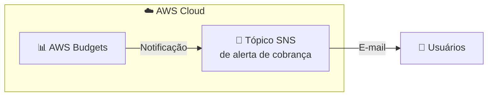
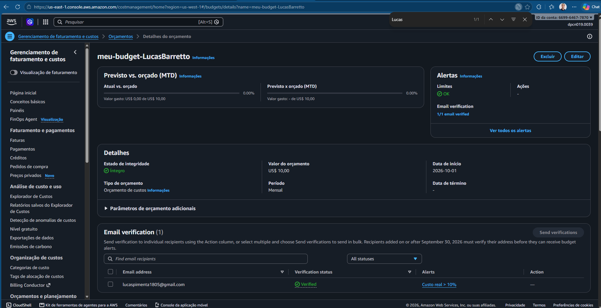

# 💰 AWS Budgets: Controle de Custos com Alertas por E-mail

**Laboratório prático: criando um orçamento de custos e alertas automáticos na AWS**

   

  -green?style=flat-square)

---

## 📑 Sumário

- [📖 Sobre o Projeto](#-sobre-o-projeto)
- [🎯 Objetivos](#-objetivos)
- [🧩 Cenário](#-cenário)
- [🏗️ Arquitetura](#️-arquitetura)
- [✅ Pré-requisitos](#-pré-requisitos)
- [📊 Resultado](#-resultado)
- [🔍 Validação](#-validação)
- [💡 Principais Aprendizados](#-principais-aprendizados)
- [🧹 Limpeza e Observações de Custo](#-limpeza-e-observações-de-custo)
- [☁️ Serviços Abordados](#️-serviços-abordados)
- [👤 Autor](#-autor)

---

## 📖 Sobre o Projeto

Este projeto documenta um laboratório prático realizado durante a capacitação da **Escola da Nuvem** (**Turma C10 OUT – DPCN 19**), como parte da minha preparação para a certificação **AWS Certified Solutions Architect – Associate**.

O laboratório mostra como configurar um orçamento de gastos com o **AWS Budgets**, incluindo um **alerta por e-mail** disparado por um limite de uso, e como verificar a configuração criada.

> 💡 Visibilidade de custos é parte essencial de cargas de trabalho bem arquitetadas. Um orçamento com alertas transforma o gerenciamento de custos de **reativo** (descobrir no fim do mês) em **proativo** (agir enquanto o gasto acontece).

---

## 🎯 Objetivos

- 🔎 Acessar o **AWS Budgets** pelo Console de Gerenciamento da AWS
- 🛠️ Criar um orçamento com limite personalizado
- 📧 Configurar alertas por e-mail com base em percentual de uso
- ✅ Validar a criação do orçamento e a configuração das notificações

---

## 🧩 Cenário

Como estudante que utiliza a AWS para aprender e testar, o objetivo é evitar surpresas na fatura e manter os gastos sob controle.

| Parâmetro | Valor |
|---|---|
| 💵 Valor do orçamento | **US$ 10,00** |
| 🔔 Limite do alerta | **10%** do valor orçado (**US$ 1,00**) |
| 📊 Tipo de acionador | Custo **real** |
| 📬 Notificação | E-mail |

---

## 🏗️ Arquitetura

Quando o custo real ultrapassa o limite configurado, o AWS Budgets envia uma notificação por meio de um tópico SNS, que entrega o e-mail ao destinatário cadastrado.

---

## ✅ Pré-requisitos

- ☁️ Conta AWS fornecida pela Escola da Nuvem, com o primeiro acesso já configurado
- 📧 Um endereço de e-mail válido para receber os alertas
- 🔐 Login no console com a conta correta (sempre confira a conta exibida no canto superior direito)

> ⚠️ No ambiente da capacitação, as permissões são limitadas ao necessário para cada laboratório. Mensagens de erro podem aparecer ao acessar serviços ou recursos não liberados para a conta.

---

## 📊 Resultado

*Figura 1: Orçamento listado no console do AWS Budgets.*

---

## 🔍 Validação

Na lista de orçamentos, verifique se:

| ✔️ | Item | Esperado |
|---|---|---|
| ☑️ | **Nome** | `meu-budget-<nome-sobrenome>` |
| ☑️ | **Orçamento** | **US$ 10,00** |
| ☑️ | **Valor usado** | Compatível com o gasto atual (geralmente próximo de US$ 0,00 em conta nova) |
| ☑️ | **Limites** | Status **OK** enquanto estiver abaixo do limite |

---

## 💡 Principais Aprendizados

- 🔔 **Alertas antes do estouro:** limites dão tempo para reagir antes que os custos ultrapassem o planejado.
- 🕵️ **Investigar cedo:** a notificação é o sinal para descobrir de onde vem o gasto.
- 🧯 **Ação corretiva:** desligar recursos sem uso e otimizar serviços a tempo.
- 📉 **Evitar surpresas:** acompanhar os gastos durante todo o ciclo de faturamento, e não só no final.
- 🧠 **Relevância para a prova:** ferramentas de gestão e monitoramento de custos, como o AWS Budgets, fazem parte do projeto de arquiteturas com custo otimizado.

---

## 🧹 Limpeza e Observações de Custo

- ✅ A criação do orçamento neste laboratório faz parte da configuração do curso, e **o orçamento é mantido** para monitorar recursos durante a capacitação.
- 🔌 Ao receber um alerta, verifique se há **recursos ligados** para evitar cobranças desnecessárias.
- 💲 Consulte sempre os preços atuais da AWS e as condições do nível gratuito da sua conta.

---

## ☁️ Serviços Abordados

  

| Serviço | Papel no laboratório |
|---|---|
| 📊 **AWS Budgets** | Criação do orçamento de US$ 10,00 e definição do limite de alerta em 10% |
| 📣 **Amazon SNS** | Tópico de alerta de cobrança que entrega a notificação por e-mail |
| 🖥️ **AWS Management Console** | Interface utilizada para acessar e configurar os serviços |

---

## 👤 Autor

**Lucas Barretto**

---

☁️ Laboratório realizado como parte do programa **Escola da Nuvem**, Turma **C10 OUT – DPCN 19** 🚀

