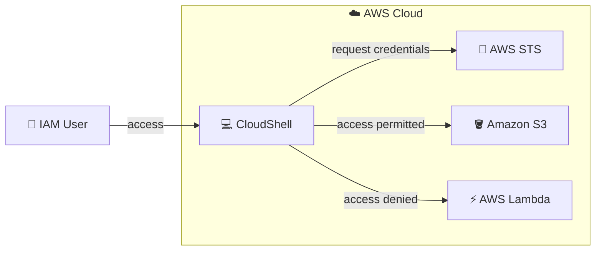

# 🔐 AWS STS: Temporary Credentials with IAM Roles

**Hands-on lab: assuming roles and generating temporary credentials with AWS Security Token Service**

   

  

---

## 📑 Table of Contents

- [📖 About the Project](#-about-the-project)
- [🎯 Objectives](#-objectives)
- [🧩 Scenario](#-scenario)
- [🏗️ Architecture](#️-architecture)
- [✅ Prerequisites](#-prerequisites)
- [📊 Result](#-result)
- [🔍 Validation](#-validation)
- [💡 Key Takeaways](#-key-takeaways)
- [🧹 Resource Cleanup](#-resource-cleanup)
- [☁️ AWS Services Covered](#️-aws-services-covered)
- [👤 Author](#-author)

---

## 📖 About the Project

This project documents a hands-on lab completed during the **Escola da Nuvem** training program (**Class C10 OUT – DPCN 19**), part of my preparation for the **AWS Certified Solutions Architect – Associate** certification.

The lab demonstrates how to use **temporary credentials** on AWS through **AWS Security Token Service (STS)**: creating and assuming an **IAM role** with restricted permissions, generating temporary credentials with a Python script in **CloudShell**, and validating allowed and denied access.

> 💡 Instead of relying on long-lived access keys, STS issues credentials that **expire on their own** and carry only the permissions of the assumed role, which reduces the impact of a potential leak.

---

## 🎯 Objectives

- 🎭 Create a temporary IAM role with the `AmazonS3FullAccess` policy
- 🔄 Switch to the role in the console and via CLI
- 🔑 Generate temporary credentials through STS
- 🧪 Configure and test the credentials in the AWS CLI
- ⏳ Simulate credential expiration
- 🤝 Understand the impact of the role's trust policy
- 🗑️ Delete all the resources created

---

## 🧩 Scenario

Acting as an **IAM user** (not root) with permission to create and assume roles, the lab goes through hands-on steps in the console and CloudShell to observe how the permissions of a temporary role behave.

| Parameter | Value |
|---|---|
| 👤 Source identity | IAM user |
| 🎭 Assumed role | Role with the `AmazonS3FullAccess` policy |
| 🤝 Who can assume it | Defined by the role's **trust policy** |
| ⏱️ Maximum session duration | **1 hour** (3600 seconds, default value) |
| 💻 Execution environment | AWS CloudShell with Python 3 and Boto3 |

---

## 🏗️ Architecture

The IAM user opens CloudShell, which requests temporary credentials from STS. With them, **S3 access is permitted** (the role has `AmazonS3FullAccess`) and **Lambda access is denied** (the role has no permissions for that service).

---

## ✅ Prerequisites

- ☁️ Access to the AWS Management Console with the account provided by Escola da Nuvem
- 👤 IAM user (not root) allowed to create and manage roles, use CloudShell, and assume roles
- 💻 Basic familiarity with the Linux command line and the AWS CLI

> ⚠️ In the training environment, permissions are limited to what each lab requires. Errors may appear when accessing services or resources that are not enabled for the account.

---

## 📊 Result

### 🪪 Identity verified in CloudShell

Output of the `aws sts get-caller-identity` command run in CloudShell, which returns the identity active in the session (user ID, account, and ARN).

*Figure 1: `aws sts get-caller-identity` in CloudShell, showing the IAM user ARN before assuming the temporary role.*

> 💡 After the temporary credentials are configured, the same command returns an ARN in the format `assumed-role/<role-name>/<session-name>`, as described in the validation section below.

---

## 🔍 Validation

| ✔️ | Test | Expected result |
|---|---|---|
| ☑️ | Console after switching to the role | **S3** access works and other services return **access denied** |
| ☑️ | `aws sts get-caller-identity` as the original user | ARN with `user/<your-user>` |
| ☑️ | Requesting a duration above the role maximum (e.g., 7200 s) | Error, since the default limit is 3600 s |
| ☑️ | `aws s3 ls` without the *session token* | Invalid credential error |
| ☑️ | `aws s3 ls` with all three credentials configured | Lists the S3 buckets |
| ☑️ | `aws sts get-caller-identity` with the temporary credentials | ARN with `assumed-role/<role-name>/<session-name>` |
| ☑️ | `aws lambda list-functions` | `AccessDeniedException` |
| ☑️ | `aws s3 ls` after the session ends | Expired token error (`ExpiredToken`) |
| ☑️ | Re-running the script after changing the trust policy | `AccessDenied` on the `AssumeRole` operation |

---

## 💡 Key Takeaways

- ⏱️ **Credentials with an expiry date:** STS credentials expire on their own, limiting the window of use if they leak.
- 🔑 **Three pieces, not two:** the access key and secret key alone do not work; the **session token** is also required.
- 🎭 **Role permissions define the reach:** with the role assumed, S3 worked and Lambda was denied, even though the source user was the same.
- 🤝 **Trust policy ≠ permissions policy:** one defines **who can assume** the role, the other defines **what the role can do**.
- 🚫 **Changing trust blocks access:** after replacing the principal in the trust policy, the original user could no longer assume the role.
- 🔐 **Best practices:** prefer roles over long-lived keys and apply least privilege. In this lab, `AmazonS3FullAccess` was used for demonstration only.
- 🧠 **Exam relevance:** `AssumeRole`, STS, roles, and trust policies are recurring exam topics.

---

## 🧹 Resource Cleanup

At the end, every resource created was removed:

- 🗑️ **CloudShell** environment deleted
- 🗑️ Lab **IAM role** deleted
- 🧽 Temporary credentials removed or commented out in the AWS CLI configuration files

---

## ☁️ AWS Services Covered

    

| Service | Role in the lab |
|---|---|
| 🔐 **AWS STS** | Issues the temporary credentials (access key, secret key, and *session token*) |
| 🎭 **AWS IAM** | Role creation, trust policy, and permissions policy attachment |
| 💻 **AWS CloudShell** | Terminal to run the Python script and AWS CLI commands |
| 🪣 **Amazon S3** | Service with **permitted** access for the role |
| ⚡ **AWS Lambda** | Service with **denied** access for the role |

---

## 👤 Author

**Lucas Barretto**

---

☁️ Lab completed as part of the **Escola da Nuvem** program, Class **C10 OUT – DPCN 19** 🚀

