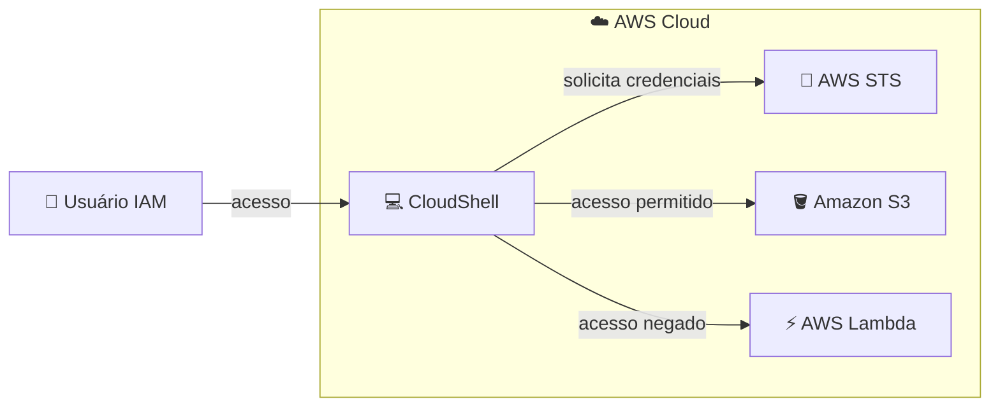
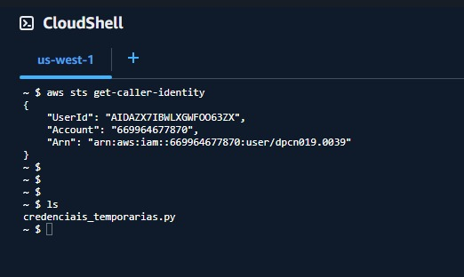

# 🔐 AWS STS: Credenciais Temporárias com IAM Roles

**Laboratório prático: assumindo roles e gerando credenciais temporárias com o AWS Security Token Service**

   

  -green?style=flat-square)

---

## 📑 Sumário

- [📖 Sobre o Projeto](#-sobre-o-projeto)
- [🎯 Objetivos](#-objetivos)
- [🧩 Cenário](#-cenário)
- [🏗️ Arquitetura](#️-arquitetura)
- [✅ Pré-requisitos](#-pré-requisitos)
- [📊 Resultado](#-resultado)
- [🔍 Validação](#-validação)
- [💡 Principais Aprendizados](#-principais-aprendizados)
- [🧹 Limpeza dos Recursos](#-limpeza-dos-recursos)
- [☁️ Serviços Abordados](#️-serviços-abordados)
- [👤 Autor](#-autor)

---

## 📖 Sobre o Projeto

Este projeto documenta um laboratório prático realizado durante a capacitação da **Escola da Nuvem** (**Turma C10 OUT – DPCN 19**), como parte da minha preparação para a certificação **AWS Certified Solutions Architect – Associate**.

O laboratório demonstra o uso de **credenciais temporárias** na AWS por meio do **AWS Security Token Service (STS)**: criação e assunção de uma **role IAM** com permissões restritas, geração de credenciais temporárias via script Python no **CloudShell** e validação de acessos permitidos e negados.

> 💡 Em vez de depender de chaves de acesso de longa duração, o STS entrega credenciais que **expiram sozinhas** e carregam apenas as permissões da role assumida, o que reduz o impacto de um eventual vazamento.

---

## 🎯 Objetivos

- 🎭 Criar uma role IAM temporária com a política `AmazonS3FullAccess`
- 🔄 Alternar para a role no console e via CLI
- 🔑 Gerar credenciais temporárias via STS
- 🧪 Configurar e testar as credenciais no AWS CLI
- ⏳ Simular a expiração das credenciais
- 🤝 Compreender o impacto da política de confiança da role
- 🗑️ Excluir todos os recursos criados

---

## 🧩 Cenário

Atuando como um **usuário IAM** (não o root) com permissão para criar e assumir roles, o laboratório percorre etapas práticas no console e no CloudShell para observar como as permissões de uma role temporária se comportam.

| Parâmetro | Valor |
|---|---|
| 👤 Identidade de origem | Usuário IAM |
| 🎭 Role assumida | Role com a política `AmazonS3FullAccess` |
| 🤝 Quem pode assumir | Definido pela **política de confiança** da role |
| ⏱️ Duração máxima da sessão | **1 hora** (3600 segundos, valor padrão) |
| 💻 Ambiente de execução | AWS CloudShell com Python 3 e Boto3 |

---

## 🏗️ Arquitetura

O usuário IAM acessa o CloudShell, que solicita credenciais temporárias ao STS. Com elas, o acesso ao **S3 é permitido** (a role tem `AmazonS3FullAccess`) e o acesso ao **Lambda é negado** (a role não tem nenhuma permissão para o serviço).

---

## ✅ Pré-requisitos

- ☁️ Acesso ao Console de Gerenciamento da AWS com a conta fornecida pela Escola da Nuvem
- 👤 Usuário IAM (não o root) com permissão para criar e gerenciar roles, usar o CloudShell e assumir roles
- 💻 Familiaridade básica com a linha de comando (Linux) e com o AWS CLI

> ⚠️ No ambiente da capacitação, as permissões são limitadas ao necessário para cada laboratório. Mensagens de erro podem aparecer ao acessar serviços ou recursos não liberados para a conta.

---

## 📊 Resultado

### 🪪 Identidade verificada no CloudShell

Saída do comando `aws sts get-caller-identity` executado no CloudShell, que retorna a identidade ativa na sessão (ID do usuário, conta e ARN).

*Figura 1: `aws sts get-caller-identity` no CloudShell, exibindo o ARN do usuário IAM antes de assumir a role temporária.*

> 💡 Após configurar as credenciais temporárias, o mesmo comando passa a retornar um ARN no formato `assumed-role/<nome-da-role>/<nome-da-sessão>`, como descrito na seção de validação abaixo.

---

## 🔍 Validação

| ✔️ | Teste | Resultado esperado |
|---|---|---|
| ☑️ | Console após alternar para a role | Acesso ao **S3** funciona e outros serviços retornam **acesso negado** |
| ☑️ | `aws sts get-caller-identity` com o usuário original | ARN com `user/<seu-usuario>` |
| ☑️ | Solicitar duração acima do máximo da role (ex.: 7200 s) | Erro, pois o limite padrão é 3600 s |
| ☑️ | `aws s3 ls` sem o *session token* | Erro de credencial inválida |
| ☑️ | `aws s3 ls` com as três credenciais configuradas | Lista os buckets do S3 |
| ☑️ | `aws sts get-caller-identity` com as credenciais temporárias | ARN com `assumed-role/<nome-da-role>/<nome-da-sessão>` |
| ☑️ | `aws lambda list-functions` | `AccessDeniedException` |
| ☑️ | `aws s3 ls` após o fim da sessão | Erro de token expirado (`ExpiredToken`) |
| ☑️ | Reexecutar o script após alterar a política de confiança | `AccessDenied` na operação `AssumeRole` |

---

## 💡 Principais Aprendizados

- ⏱️ **Credenciais com prazo de validade:** as credenciais do STS expiram sozinhas, o que limita a janela de uso em caso de vazamento.
- 🔑 **Três peças, não duas:** a chave de acesso e a chave secreta sozinhas não funcionam; o **session token** também é obrigatório.
- 🎭 **Permissões da role definem o alcance:** com a role assumida, o S3 funcionou e o Lambda foi negado, mesmo sendo o mesmo usuário de origem.
- 🤝 **Política de confiança ≠ política de permissões:** uma define **quem pode assumir** a role, a outra define **o que a role pode fazer**.
- 🚫 **Alterar a confiança bloqueia o acesso:** ao trocar o principal da política de confiança, o usuário original deixou de conseguir assumir a role.
- 🔐 **Boas práticas:** preferir roles a chaves de longa duração e aplicar o princípio do menor privilégio. Neste laboratório, `AmazonS3FullAccess` serviu apenas para demonstração.
- 🧠 **Relevância para a prova:** `AssumeRole`, STS, roles e políticas de confiança são conceitos recorrentes no exame.

---

## 🧹 Limpeza dos Recursos

Ao final, todos os recursos criados foram removidos:

- 🗑️ Ambiente do **CloudShell** excluído
- 🗑️ **Role IAM** do laboratório excluída
- 🧽 Credenciais temporárias removidas ou comentadas nos arquivos de configuração do AWS CLI

---

## ☁️ Serviços Abordados

    

| Serviço | Papel no laboratório |
|---|---|
| 🔐 **AWS STS** | Emissão das credenciais temporárias (chave de acesso, chave secreta e *session token*) |
| 🎭 **AWS IAM** | Criação da role, da política de confiança e vínculo da política de permissões |
| 💻 **AWS CloudShell** | Terminal para executar o script Python e os comandos do AWS CLI |
| 🪣 **Amazon S3** | Serviço com acesso **permitido** para a role |
| ⚡ **AWS Lambda** | Serviço com acesso **negado** para a role |

---

## 👤 Autor

**Lucas Barretto**

---

☁️ Laboratório realizado como parte do programa **Escola da Nuvem**, Turma **C10 OUT – DPCN 19** 🚀

