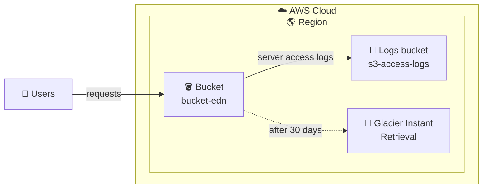

# 🪣 Amazon S3: Versioning, Lifecycle, and Access Logs

**Hands-on lab: organizing, protecting, and monitoring data in Amazon S3**

   

  

---

## 📑 Table of Contents

- [📖 About the Project](#-about-the-project)
- [🎯 Objectives](#-objectives)
- [🧩 Scenario](#-scenario)
- [🏗️ Architecture](#️-architecture)
- [✅ Prerequisites](#-prerequisites)
- [📊 Result](#-result)
- [🔍 Validation](#-validation)
- [💡 Key Takeaways](#-key-takeaways)
- [🧹 Resource Cleanup](#-resource-cleanup)
- [☁️ AWS Services Covered](#️-aws-services-covered)
- [👤 Author](#-author)

---

## 📖 About the Project

This project documents a hands-on lab completed during the **Escola da Nuvem** training program (**Class C10 OUT – DPCN 19**), part of my preparation for the **AWS Certified Solutions Architect – Associate** certification.

The lab explores **Amazon S3** features for organizing, securing, and efficiently managing data: object **versioning**, **lifecycle rules** to optimize costs, and **server access logging** to monitor requests made to the bucket.

> 💡 In S3, good storage practices are not just about where data lives, but also about **how it is protected, what it costs over time, and who accesses it**.

---

## 🎯 Objectives

- 🪣 Create a main bucket and a destination bucket for logs
- 🗂️ Enable **versioning** and observe an object's version history
- ♻️ Recover a previous version of an object
- ⏳ Create a **lifecycle rule** to transition objects between storage classes
- 📜 Enable **server access logging** on the bucket
- 🧹 Delete the resources created at the end

---

## 🧩 Scenario

As the person responsible for a company's cloud storage, the mission is to keep data **organized, secure, and cost-optimized**, applying versioning, storage rule automation, and access monitoring.

| Parameter | Value |
|---|---|
| 🌎 Region | US West (N. California), `us-west-1` |
| 🪣 Main bucket | `bucket-edn-<your-name>` |
| 📜 Logs bucket | `s3-access-logs-<your-name>` |
| 🗂️ Versioning | **Enabled** (MFA delete disabled) |
| ⏳ Lifecycle rule | `MoverParaGlacierApos30Dias`, scope: entire bucket |
| 🧊 Transition | **Glacier Instant Retrieval** after **30 days** |
| 🗑️ Expiration (current versions) | **31 days**, always 1 day after the transition |

---

## 🏗️ Architecture

Users access the main bucket. Each request is recorded in a **separate logs bucket**, and a lifecycle rule moves objects to a lower-cost storage class after 30 days.

---

## ✅ Prerequisites

- ☁️ Access to the AWS Management Console with the account provided by Escola da Nuvem
- 🗒️ A simple text file to test versioning (edited and re-uploaded to create a second version)
- 💻 Basic understanding of buckets and objects in S3

> ⚠️ In the training environment, permissions are limited to what each lab requires. Errors may appear when accessing services or resources that are not enabled for the account.

---

## 📊 Result

### 🪣 Buckets created

The two lab buckets, created in the same Region: the main one and the destination for access logs.

*Figure 1: `bucket-edn-<your-name>` and `s3-access-logs-<your-name>` listed in the S3 console (`us-west-1`).*

### 🗂️ Versioning enabled

**Properties** tab of the main bucket, with versioning turned on.

*Figure 2: **Bucket Versioning: Enabled** (MFA delete: Disabled).*

### ⏳ Lifecycle rule

**Management** tab of the bucket, with the `MoverParaGlacierApos30Dias` rule applied to the entire bucket.

*Figure 3: lifecycle rule with **Enabled** status, scoped to the entire bucket, with a transition to Glacier Instant Retrieval.*

### 📜 Server access logging

Logging configuration of the main bucket, pointing to the destination bucket.

*Figure 4: **Server access logging: Enabled**, with destination bucket `s3://s3-access-logs-<your-name>`.*

---

## 🔍 Validation

| ✔️ | Item | Expected |
|---|---|---|
| ☑️ | **Buckets** | Main bucket and logs bucket listed in the same Region |
| ☑️ | **Versioning** | Enabled on the main bucket |
| ☑️ | **Object versions** | With "Show versions" on, the file shows Version 1 and Version 2 |
| ☑️ | **Restored version** | Re-uploading the old version creates a new version, keeping the previous ones |
| ☑️ | **Lifecycle** | Rule with **Enabled** status, scoped to the entire bucket |
| ☑️ | **Access logs** | Enabled, with the logs bucket as destination |
| ☑️ | **Log delivery** | Log files show up in the destination bucket after some time |

---

## 💡 Key Takeaways

- 🗂️ **Versioning protects against accidental overwrites and deletions:** each new upload of the same object creates a new version, and the previous ones remain available.
- ♻️ **Restoring a version is a new upload:** downloading an old version does not make it the current one; it must be re-uploaded, and it gets a new version ID.
- ⏳ **Lifecycle automates savings:** moving less-accessed data to cheaper classes cuts costs without manual work.
- 💲 **Transitions are charged per request**, and by default there is a minimum object size (128 KB) to transition between classes.
- 🔢 **Expiration must come after the transition:** that is why the rule uses 30 days for the transition and 31 for expiration.
- 📜 **Access logs provide visibility:** they record requests to the bucket and are delivered to a separate bucket.
- 🕐 **Log delivery is not immediate:** it is eventual and, according to the lab, this interval cannot be configured or shortened.
- 🧠 **Exam relevance:** versioning, storage classes, lifecycle rules, and access logs are recurring exam topics.

---

## 🧹 Resource Cleanup

To avoid unnecessary charges, the resources created in the lab should be removed at the end:

- [ ] Empty and delete the **main bucket** (`bucket-edn-<your-name>`), including all object versions
- [ ] Empty and delete the **logs bucket** (`s3-access-logs-<your-name>`)

> 💡 In versioned buckets, old object versions must also be removed before the bucket can be deleted.

---

## ☁️ AWS Services Covered

    

| Feature | Role in the lab |
|---|---|
| 🪣 **Amazon S3 (buckets)** | Storage for the objects and the logs |
| 🗂️ **Versioning** | Keeping version history and enabling recovery |
| ⏳ **Lifecycle rules** | Automatic transition of objects to another storage class |
| 🧊 **S3 Glacier Instant Retrieval** | Lower-cost destination class for the transition |
| 📜 **Server access logging** | Recording requests made to the bucket |

---

## 👤 Author

**Lucas Barretto**

---

☁️ Lab completed as part of the **Escola da Nuvem** program, Class **C10 OUT – DPCN 19** 🚀

