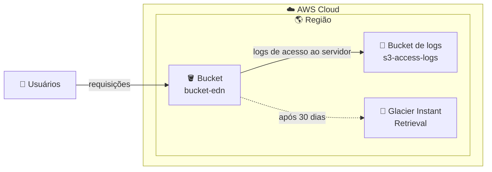
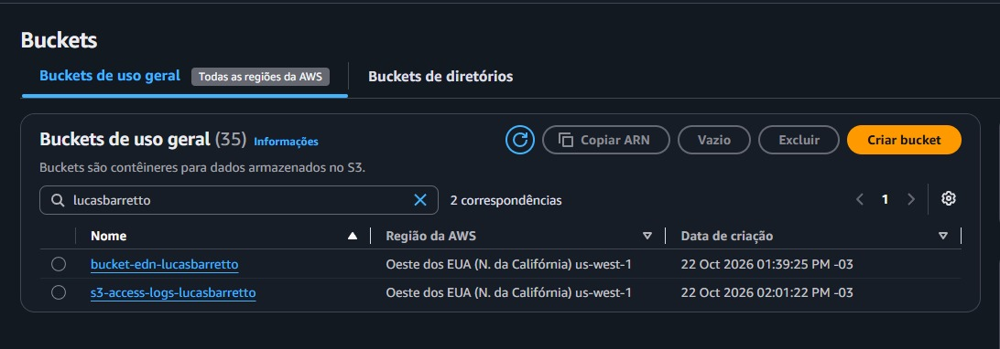

# 🪣 Amazon S3: Versionamento, Ciclo de Vida e Logs de Acesso

**Laboratório prático: organização, proteção e monitoramento de dados no Amazon S3**

   

  -green?style=flat-square)

---

## 📑 Sumário

- [📖 Sobre o Projeto](#-sobre-o-projeto)
- [🎯 Objetivos](#-objetivos)
- [🧩 Cenário](#-cenário)
- [🏗️ Arquitetura](#️-arquitetura)
- [✅ Pré-requisitos](#-pré-requisitos)
- [📊 Resultado](#-resultado)
- [🔍 Validação](#-validação)
- [💡 Principais Aprendizados](#-principais-aprendizados)
- [🧹 Limpeza dos Recursos](#-limpeza-dos-recursos)
- [☁️ Serviços Abordados](#️-serviços-abordados)
- [👤 Autor](#-autor)

---

## 📖 Sobre o Projeto

Este projeto documenta um laboratório prático realizado durante a capacitação da **Escola da Nuvem** (**Turma C10 OUT – DPCN 19**), como parte da minha preparação para a certificação **AWS Certified Solutions Architect – Associate**.

O laboratório explora recursos do **Amazon S3** voltados à organização, à segurança e ao gerenciamento eficiente de dados: **versionamento** de objetos, **regras de ciclo de vida** para otimizar custos e **registro em log de acesso ao servidor** para monitorar as requisições feitas ao bucket.

> 💡 No S3, boas práticas de armazenamento não são só sobre onde guardar os dados, mas também sobre **como protegê-los, quanto custam ao longo do tempo e quem os acessa**.

---

## 🎯 Objetivos

- 🪣 Criar um bucket principal e um bucket de destino para logs
- 🗂️ Habilitar o **versionamento** e observar o histórico de versões de um objeto
- ♻️ Recuperar uma versão anterior de um objeto
- ⏳ Criar uma **regra de ciclo de vida** para transição entre classes de armazenamento
- 📜 Ativar o **registro em log de acesso ao servidor** do bucket
- 🧹 Excluir os recursos criados ao final

---

## 🧩 Cenário

Como responsável pela gestão de armazenamento em nuvem de uma empresa, a missão é manter os dados **organizados, seguros e com custo otimizado**, aplicando versionamento, automação de regras de armazenamento e monitoramento de acessos.

| Parâmetro | Valor |
|---|---|
| 🌎 Região | Oeste dos EUA (N. da Califórnia), `us-west-1` |
| 🪣 Bucket principal | `bucket-edn-<seu-nome>` |
| 📜 Bucket de logs | `s3-access-logs-<seu-nome>` |
| 🗂️ Versionamento | **Habilitado** (exclusão com MFA desabilitada) |
| ⏳ Regra de ciclo de vida | `MoverParaGlacierApos30Dias`, escopo: todo o bucket |
| 🧊 Transição | **Glacier Instant Retrieval** após **30 dias** |
| 🗑️ Expiração (versões atuais) | **31 dias**, sempre 1 dia após a transição |

---

## 🏗️ Arquitetura

Os usuários acessam o bucket principal. Cada requisição é registrada em um **bucket separado** de logs, e uma regra de ciclo de vida move os objetos para uma classe de armazenamento mais econômica depois de 30 dias.

---

## ✅ Pré-requisitos

- ☁️ Acesso ao Console de Gerenciamento da AWS com a conta fornecida pela Escola da Nuvem
- 🗒️ Um arquivo de texto simples para testar o versionamento (editado e reenviado para gerar uma segunda versão)
- 💻 Conhecimento básico dos conceitos de buckets e objetos no S3

> ⚠️ No ambiente da capacitação, as permissões são limitadas ao necessário para cada laboratório. Mensagens de erro podem aparecer ao acessar serviços ou recursos não liberados para a conta.

---

## 📊 Resultado

### 🪣 Buckets criados

Os dois buckets do laboratório, criados na mesma região: o principal e o de destino dos logs de acesso.

*Figura 1: `bucket-edn-<seu-nome>` e `s3-access-logs-<seu-nome>` listados no console do S3 (`us-west-1`).*

### 🗂️ Versionamento habilitado

Aba **Propriedades** do bucket principal, com o versionamento ativo.

*Figura 2: **Versionamento de bucket: Habilitado** (exclusão com MFA: Desabilitado).*

### ⏳ Regra de ciclo de vida

Aba **Gerenciamento** do bucket, com a regra `MoverParaGlacierApos30Dias` aplicada a todo o bucket.

*Figura 3: regra de ciclo de vida com status **Enabled**, escopo em todo o bucket e transição para Glacier Instant Retrieval.*

### 📜 Registro em log de acesso ao servidor

Configuração de logs do bucket principal, apontando para o bucket de destino.

*Figura 4: **Registro em log de acesso ao servidor: Habilitado**, com o bucket de destino `s3://s3-access-logs-<seu-nome>`.*

---

## 🔍 Validação

| ✔️ | Item | Esperado |
|---|---|---|
| ☑️ | **Buckets** | Bucket principal e bucket de logs listados na mesma região |
| ☑️ | **Versionamento** | Habilitado no bucket principal |
| ☑️ | **Versões do objeto** | Com "Mostrar versões" ativo, o arquivo exibe a Versão 1 e a Versão 2 |
| ☑️ | **Versão restaurada** | O re-upload da versão antiga cria uma nova versão, mantendo as anteriores |
| ☑️ | **Ciclo de vida** | Regra com status **Enabled** e escopo em todo o bucket |
| ☑️ | **Logs de acesso** | Habilitado, com destino no bucket de logs |
| ☑️ | **Entrega dos logs** | Arquivos de log aparecem no bucket de destino depois de algum tempo |

---

## 💡 Principais Aprendizados

- 🗂️ **Versionamento protege contra sobrescritas e exclusões acidentais:** cada novo upload do mesmo objeto gera uma nova versão, e as anteriores continuam disponíveis.
- ♻️ **Restaurar uma versão é um novo upload:** baixar uma versão antiga não a torna a atual; é preciso reenviá-la, e ela recebe um novo ID de versão.
- ⏳ **Ciclo de vida automatiza a economia:** mover dados menos acessados para classes mais baratas reduz custos sem trabalho manual.
- 💲 **Transições têm custo por requisição**, e por padrão há um tamanho mínimo de objeto (128 KB) para transitar entre classes.
- 🔢 **A expiração precisa ser posterior à transição:** por isso a regra usa 30 dias para a transição e 31 para a expiração.
- 📜 **Logs de acesso dão visibilidade:** registram as requisições ao bucket e são entregues em um bucket separado.
- 🕐 **A entrega dos logs não é imediata:** é eventual e, segundo o laboratório, não dá para configurar ou reduzir esse intervalo.
- 🧠 **Relevância para a prova:** versionamento, classes de armazenamento, regras de ciclo de vida e logs de acesso são temas recorrentes no exame.

---

## 🧹 Limpeza dos Recursos

Para evitar custos desnecessários, os recursos criados no laboratório devem ser removidos ao final:

- [ ] Esvaziar e excluir o **bucket principal** (`bucket-edn-<seu-nome>`), incluindo todas as versões dos objetos
- [ ] Esvaziar e excluir o **bucket de logs** (`s3-access-logs-<seu-nome>`)

> 💡 Em buckets com versionamento, é preciso remover também as versões antigas dos objetos antes de excluir o bucket.

---

## ☁️ Serviços Abordados

    

| Recurso | Papel no laboratório |
|---|---|
| 🪣 **Amazon S3 (buckets)** | Armazenamento dos objetos e dos logs |
| 🗂️ **Versionamento** | Manter o histórico de versões e permitir a recuperação |
| ⏳ **Regras de ciclo de vida** | Transição automática dos objetos para outra classe de armazenamento |
| 🧊 **S3 Glacier Instant Retrieval** | Classe de destino da transição, de menor custo |
| 📜 **Registro em log de acesso ao servidor** | Registro das requisições feitas ao bucket |

---

## 👤 Autor

**Lucas Barretto**

---

☁️ Laboratório realizado como parte do programa **Escola da Nuvem**, Turma **C10 OUT – DPCN 19** 🚀

