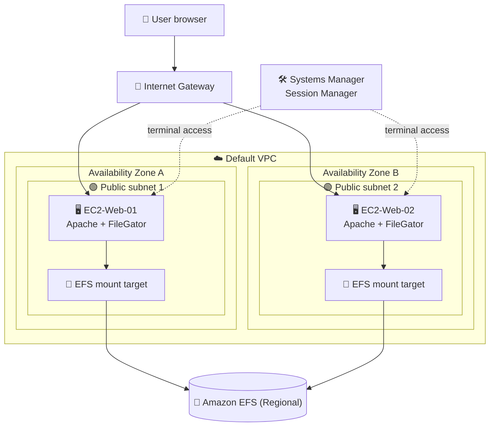

<h1 align="center">🗂️ Lab – Shared File System with Amazon EFS and FileGator</h1>

<b>Hands-on lab: one Amazon EFS file system shared by two EC2 instances running a web file manager</b>

     

  

---

## 📑 Table of Contents

- [📖 About the Project](#-about-the-project)
- [🎯 Objectives](#-objectives)
- [🧩 Scenario](#-scenario)
- [🏗 Architecture](#-architecture)
- [✅ Prerequisites](#-prerequisites)
- [📊 Result](#-result)
- [🔍 Validation](#-validation)
- [💡 Key Takeaways](#-key-takeaways)
- [🧹 Resource Cleanup](#-resource-cleanup)
- [☁ AWS Services Covered](#-aws-services-covered)
- [👤 Author](#-author)

---

## 📖 About the Project

This lab shows how a single Amazon EFS file system can act as a central storage point that several EC2 instances use at the same time. To make the exercise feel like a real workload, the instances run **FileGator**, an open-source, PHP-based web file manager, so files can be uploaded and downloaded from a browser while the data lives in EFS instead of on any one server.

FileGator is a third-party project; it is used here only as a teaching tool to demonstrate AWS concepts, and its rights belong to its authors under the project's open-source license.

> 💬 *When storage lives outside the instance, any server in the fleet sees the same files.*

---

## 🎯 Objectives

- 🧱 Understand the difference between block storage (EBS) and a network file system (EFS)
- 🔐 Chain security groups so only the application instances can reach NFS
- 🪪 Use an IAM role and Systems Manager Session Manager to reach servers without SSH keys or open admin ports
- 📁 Create an EFS file system and understand how mount targets work
- 🐧 Install an Apache and PHP stack on Amazon Linux 2023 with the `dnf` package manager
- 🔗 Create symbolic links and adjust POSIX ownership and permissions
- 🔄 Confirm that data is shared between two different servers through the same EFS

---

## 🧩 Scenario

Two EC2 instances are placed in different public subnets, each in its own Availability Zone, to simulate a distributed environment. Both mount the same EFS file system, and a web file manager on each instance stores its uploaded files there.

| Item | Value |
|---|---|
| Region | US East (N. Virginia), as shown in the console screenshot |
| Network | Default VPC, two public subnets in different AZs |
| Web security group | `SG-EC2-<Name>`: inbound HTTP (port 80) from anywhere (IPv4) |
| EFS security group | `SG-EFS-<Name>`: inbound NFS (port 2049) only from the web security group |
| IAM role | `Role-EC2-SSM-<Name>` with the `AmazonSSMManagedInstanceCore` managed policy |
| EFS file system | `EFS-<Name>`; Regional; automatic backups on; lifecycle transitions set to none; Bursting throughput |
| Mount targets | One per AZ/subnet, each using the EFS security group instead of the default one |
| Instances | `EC2-Web-01-<Name>` and `EC2-Web-02-<Name>`; Amazon Linux 2023; `t2.micro`; no key pair; public IP enabled; IAM role attached |
| EFS mount on the instances | `/mnt/efs`, configured during instance launch |
| Shared folder | `/mnt/efs/arquivos` |
| Application | FileGator served by Apache on port 80; its `repository` folder is a symbolic link to the shared EFS folder |
| Optional challenge | Create a custom AMI from the configured instance and launch a third instance from it |

---

## 🏗 Architecture

Users reach each instance through the internet gateway on port 80. On each server, Apache serves FileGator, and the FileGator `repository` path is redirected with a symbolic link to `/mnt/efs/arquivos`. That directory belongs to the EFS file system, which each instance reaches through the mount target in its own subnet, protected by a security group that only accepts NFS traffic from the web instances. Administrators open a terminal on the servers through Session Manager, so no SSH port or key pair is required.

---

## ✅ Prerequisites

- 🎓 An AWS account or lab environment provided by the Escola da Nuvem program
- 🧠 Basic Linux command-line knowledge and familiarity with EC2, VPC and IAM
- 🌐 A browser to reach the instances' public IP addresses
- 📂 A test file on your computer to upload through FileGator

> ⚠️ **Warning:** if the lab runs in a training environment, permissions may be limited and some actions (such as creating IAM roles) may be restricted or fail. Whatever the environment, avoid leaving open permissions such as `777` in real workloads.

---

## 📊 Result

### EFS file system created

The EFS details page confirms the file system was created and is ready to be mounted by the instances.

  

<i>Figure 1: Amazon EFS console showing the EFS-LucasBarretto file system in US East (N. Virginia), in the Available state, with General Purpose performance mode, Bursting throughput mode, Regional availability, lifecycle transitions set to None, automatic backups enabled and 2.05 MiB of metered size (the account ID was masked).</i>

### FileGator users panel

The FileGator administration area lists the application's user accounts.

  

<i>Figure 2: FileGator users page listing three accounts: a regular user and the admin, both with read, write, upload, download, batchdownload, zip and chmod permissions, and a guest account with no permissions.</i>

---

## 🔍 Validation

| ✔️ | Item | Expected result |
|---|---|---|
| ✔️ | Security groups | Web group allows HTTP; EFS group allows NFS only from the web group |
| ✔️ | IAM role | Role with the Systems Manager managed policy exists and is attached to both instances |
| ✔️ | EFS file system | Available, with a mount target in each AZ using the EFS security group |
| ✔️ | EFS mount on the server | `df -h` shows the file system mounted on `/mnt/efs` |
| ✔️ | Apache | Service enabled and reported as active (running) |
| ✔️ | Symbolic link | FileGator's `repository` entry points to `/mnt/efs/arquivos` |
| ✔️ | FileGator | Login page loads at the instance's public IP |
| ✔️ | Persistence | A file uploaded in the browser is listed in the EFS directory from the terminal |
| ✔️ | Sharing | The same file appears when logging in to FileGator on the second instance |

---

## 💡 Key Takeaways

- 💾 **EBS vs. EFS:** EBS is block storage attached to one instance; EFS is a shared NFS file system that many instances in different AZs can mount.
- 🔗 **Security group chaining:** referencing a security group as the source, instead of an IP range, restricts NFS to the intended instances only.
- 🪪 **No SSH needed:** an IAM role plus Session Manager gives terminal access without key pairs or an open port 22.
- 📍 **Mount targets:** they are network interfaces in each subnet, and their security group decides who can connect.
- 🔀 **Symlinks redirect I/O:** pointing the application's data folder to EFS made uploads land in shared storage with no code change.
- 🛡️ **Permissions in practice:** `777` is convenient for a lab but should be replaced by a specific owner and tighter permissions in production.
- 🧠 **Relevance for the exam:** choosing EFS vs. EBS vs. S3, EFS performance and throughput modes, Regional vs. One Zone, mount targets, security group design and Systems Manager access are common topics in the AWS Certified Solutions Architect – Associate exam.

---

## 🧹 Resource Cleanup

The resources created in this lab have not yet been confirmed as deleted. Checklist:

- [ ] Terminate the EC2 instances `EC2-Web-01` and `EC2-Web-02` (and the third one, if the optional challenge was done)
- [ ] If a custom AMI was created, deregister it and also delete its associated snapshots (they generate cost)
- [ ] Delete the EFS file system `EFS-<Name>`
- [ ] Delete the security groups `SG-EFS-<Name>` and `SG-EC2-<Name>` once nothing uses them
- [ ] Delete the IAM role `Role-EC2-SSM-<Name>`

---

## ☁ AWS Services Covered

   

| Service | Role in the lab |
|---|---|
| Amazon EFS | Shared, elastic NFS storage mounted by both instances |
| Amazon EC2 | Web servers running Apache and FileGator (security groups and AMI included) |
| AWS IAM | Role that lets the instances register with Systems Manager |
| AWS Systems Manager | Session Manager terminal access without SSH keys |

---

## 👤 Author

**Lucas Barretto**

 

---

Lab completed as part of the Escola da Nuvem program, Turma C10 OUT – DPCN 19 🚀

