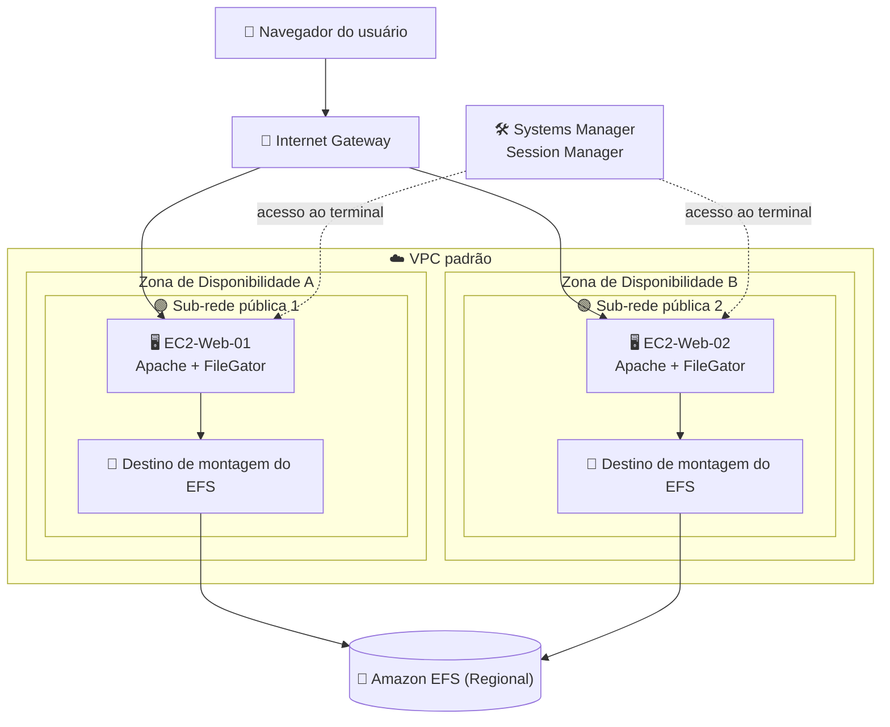
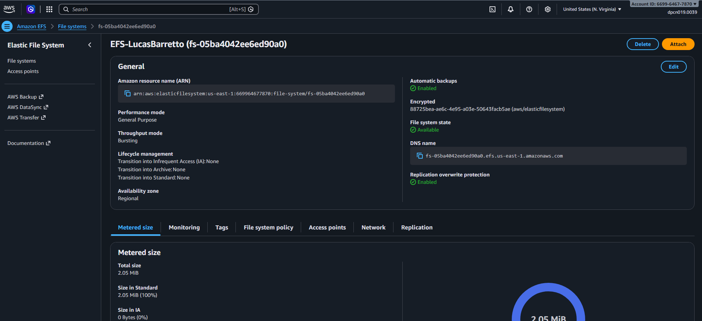
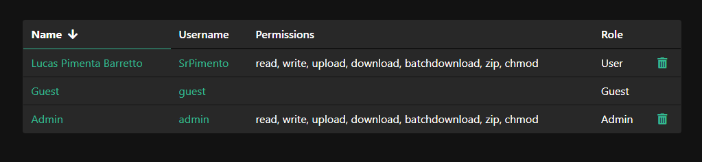

<h1 align="center">🗂️ Lab – Sistema de Arquivos Compartilhado com Amazon EFS e FileGator</h1>

<b>Laboratório prático: um sistema de arquivos Amazon EFS compartilhado por duas instâncias EC2 que rodam um gerenciador de arquivos web</b>

     

  

---

## 📑 Sumário

- [📖 Sobre o Projeto](#-sobre-o-projeto)
- [🎯 Objetivos](#-objetivos)
- [🧩 Cenário](#-cenário)
- [🏗 Arquitetura](#-arquitetura)
- [✅ Pré-requisitos](#-pré-requisitos)
- [📊 Resultado](#-resultado)
- [🔍 Validação](#-validação)
- [💡 Principais Aprendizados](#-principais-aprendizados)
- [🧹 Limpeza dos Recursos](#-limpeza-dos-recursos)
- [☁ Serviços Abordados](#-serviços-abordados)
- [👤 Autor](#-autor)

---

## 📖 Sobre o Projeto

Este laboratório mostra como um único sistema de arquivos Amazon EFS pode funcionar como ponto central de armazenamento usado por várias instâncias EC2 ao mesmo tempo. Para aproximar o exercício de uma carga de trabalho real, as instâncias executam o **FileGator**, um gerenciador de arquivos web de código aberto baseado em PHP, de modo que arquivos podem ser enviados e baixados pelo navegador enquanto os dados ficam no EFS, e não em um servidor específico.

O FileGator é um projeto de terceiros, usado aqui apenas como ferramenta didática para demonstrar conceitos da AWS; os direitos sobre ele pertencem aos seus autores, conforme a licença de código aberto do projeto.

> 💬 *Quando o armazenamento fica fora da instância, qualquer servidor da frota enxerga os mesmos arquivos.*

---

## 🎯 Objetivos

- 🧱 Entender a diferença entre armazenamento em blocos (EBS) e sistema de arquivos de rede (EFS)
- 🔐 Encadear grupos de segurança para que somente as instâncias da aplicação alcancem o NFS
- 🪪 Usar uma IAM Role e o Session Manager do Systems Manager para acessar servidores sem chaves SSH nem portas administrativas abertas
- 📁 Criar um sistema de arquivos EFS e entender como funcionam os destinos de montagem (mount targets)
- 🐧 Instalar uma pilha Apache e PHP no Amazon Linux 2023 com o gerenciador de pacotes `dnf`
- 🔗 Criar links simbólicos e ajustar proprietários e permissões POSIX
- 🔄 Confirmar que os dados são compartilhados entre dois servidores diferentes por meio do mesmo EFS

---

## 🧩 Cenário

Duas instâncias EC2 ficam em sub-redes públicas diferentes, cada uma em sua própria Zona de Disponibilidade, para simular um ambiente distribuído. As duas montam o mesmo sistema de arquivos EFS, e um gerenciador de arquivos web em cada instância guarda ali os arquivos enviados.

| Item | Valor |
|---|---|
| Região | US East (N. Virginia), conforme o print do console |
| Rede | VPC padrão, duas sub-redes públicas em AZs diferentes |
| Grupo de segurança web | `SG-EC2-<Nome>`: entrada HTTP (porta 80) de qualquer origem (IPv4) |
| Grupo de segurança do EFS | `SG-EFS-<Nome>`: entrada NFS (porta 2049) somente a partir do grupo de segurança web |
| IAM Role | `Role-EC2-SSM-<Nome>` com a política gerenciada `AmazonSSMManagedInstanceCore` |
| Sistema de arquivos EFS | `EFS-<Nome>`; Regional; backups automáticos ligados; transições de ciclo de vida em nenhum; throughput Bursting |
| Destinos de montagem | Um por AZ/sub-rede, cada um com o grupo de segurança do EFS no lugar do padrão |
| Instâncias | `EC2-Web-01-<Nome>` e `EC2-Web-02-<Nome>`; Amazon Linux 2023; `t2.micro`; sem par de chaves; IP público habilitado; IAM Role anexada |
| Montagem do EFS nas instâncias | `/mnt/efs`, configurada na criação da instância |
| Pasta compartilhada | `/mnt/efs/arquivos` |
| Aplicação | FileGator servido pelo Apache na porta 80; sua pasta `repository` é um link simbólico para a pasta compartilhada no EFS |
| Desafio opcional | Criar uma AMI personalizada a partir da instância configurada e iniciar uma terceira instância com ela |

---

## 🏗 Arquitetura

Os usuários chegam a cada instância pelo gateway da internet, na porta 80. Em cada servidor, o Apache serve o FileGator, e o caminho `repository` do FileGator é redirecionado por um link simbólico para `/mnt/efs/arquivos`. Esse diretório pertence ao sistema de arquivos EFS, que cada instância acessa pelo destino de montagem da própria sub-rede, protegido por um grupo de segurança que só aceita tráfego NFS vindo das instâncias web. Os administradores abrem um terminal nos servidores pelo Session Manager, sem porta SSH nem par de chaves.

---

## ✅ Pré-requisitos

- 🎓 Uma conta AWS ou ambiente de laboratório fornecido pelo programa Escola da Nuvem
- 🧠 Noções básicas de linha de comando Linux e familiaridade com EC2, VPC e IAM
- 🌐 Um navegador para acessar os IPs públicos das instâncias
- 📂 Um arquivo de teste no computador para enviar pelo FileGator

> ⚠️ **Atenção:** se o laboratório rodar em um ambiente de capacitação, as permissões podem ser limitadas e algumas ações (como criar IAM Roles) podem ser restritas ou falhar. Em qualquer ambiente, evite deixar permissões abertas como `777` em cargas de trabalho reais.

---

## 📊 Resultado

### Sistema de arquivos EFS criado

A página de detalhes do EFS confirma que o sistema de arquivos foi criado e está pronto para ser montado pelas instâncias.

  

<i>Figura 1: Console do Amazon EFS exibindo o sistema de arquivos EFS-LucasBarretto em US East (N. Virginia), no estado Available, com modo de desempenho General Purpose, modo de throughput Bursting, disponibilidade Regional, transições de ciclo de vida em None, backups automáticos habilitados e 2,05 MiB de tamanho medido (o ID da conta foi ocultado).</i>

### Painel de usuários do FileGator

A área administrativa do FileGator lista as contas de usuário da aplicação.

  

<i>Figura 2: Página de usuários do FileGator listando três contas: um usuário comum e o admin, ambos com as permissões read, write, upload, download, batchdownload, zip e chmod, e uma conta guest sem permissões.</i>

---

## 🔍 Validação

| ✔️ | Item | Resultado esperado |
|---|---|---|
| ✔️ | Grupos de segurança | O grupo web permite HTTP; o grupo do EFS permite NFS somente a partir do grupo web |
| ✔️ | IAM Role | A role com a política gerenciada do Systems Manager existe e está anexada às duas instâncias |
| ✔️ | Sistema de arquivos EFS | Disponível, com um destino de montagem em cada AZ usando o grupo de segurança do EFS |
| ✔️ | Montagem do EFS no servidor | `df -h` mostra o sistema de arquivos montado em `/mnt/efs` |
| ✔️ | Apache | Serviço habilitado e exibido como active (running) |
| ✔️ | Link simbólico | A entrada `repository` do FileGator aponta para `/mnt/efs/arquivos` |
| ✔️ | FileGator | A tela de login carrega no IP público da instância |
| ✔️ | Persistência | Um arquivo enviado pelo navegador aparece no diretório do EFS ao listar pelo terminal |
| ✔️ | Compartilhamento | O mesmo arquivo aparece ao entrar no FileGator da segunda instância |

---

## 💡 Principais Aprendizados

- 💾 **EBS vs. EFS:** o EBS é armazenamento em blocos ligado a uma instância; o EFS é um sistema de arquivos NFS compartilhado que várias instâncias de AZs diferentes podem montar.
- 🔗 **Encadeamento de grupos de segurança:** usar um grupo de segurança como origem, em vez de uma faixa de IPs, restringe o NFS apenas às instâncias pretendidas.
- 🪪 **SSH dispensável:** uma IAM Role com o Session Manager dá acesso ao terminal sem pares de chaves nem porta 22 aberta.
- 📍 **Destinos de montagem:** são interfaces de rede em cada sub-rede, e o grupo de segurança delas decide quem pode se conectar.
- 🔀 **Links simbólicos redirecionam a E/S:** apontar a pasta de dados da aplicação para o EFS fez os uploads irem para o armazenamento compartilhado sem alterar o código.
- 🛡️ **Permissões na prática:** `777` é cômodo em laboratório, mas em produção deve ser trocado por um proprietário específico e permissões mais restritas.
- 🧠 **Relevância para a prova:** escolha entre EFS, EBS e S3, modos de desempenho e throughput do EFS, Regional vs. One Zone, destinos de montagem, desenho de grupos de segurança e acesso via Systems Manager são temas comuns na prova AWS Certified Solutions Architect – Associate.

---

## 🧹 Limpeza dos Recursos

A exclusão dos recursos criados neste laboratório ainda não foi confirmada. Lista de tarefas:

- [ ] Encerrar as instâncias EC2 `EC2-Web-01` e `EC2-Web-02` (e a terceira, se o desafio opcional foi feito)
- [ ] Se uma AMI personalizada foi criada, cancelar o registro dela e excluir também os snapshots associados (geram custo)
- [ ] Excluir o sistema de arquivos EFS `EFS-<Nome>`
- [ ] Excluir os grupos de segurança `SG-EFS-<Nome>` e `SG-EC2-<Nome>` quando nada mais os usar
- [ ] Excluir a IAM Role `Role-EC2-SSM-<Nome>`

---

## ☁ Serviços Abordados

   

| Serviço | Papel no laboratório |
|---|---|
| Amazon EFS | Armazenamento NFS compartilhado e elástico montado pelas duas instâncias |
| Amazon EC2 | Servidores web com Apache e FileGator (incluindo grupos de segurança e AMI) |
| AWS IAM | Role que permite às instâncias se registrarem no Systems Manager |
| AWS Systems Manager | Acesso ao terminal via Session Manager, sem chaves SSH |

---

## 👤 Autor

**Lucas Barretto**

 

---

Laboratório realizado como parte do programa Escola da Nuvem, Turma C10 OUT – DPCN 19 🚀

