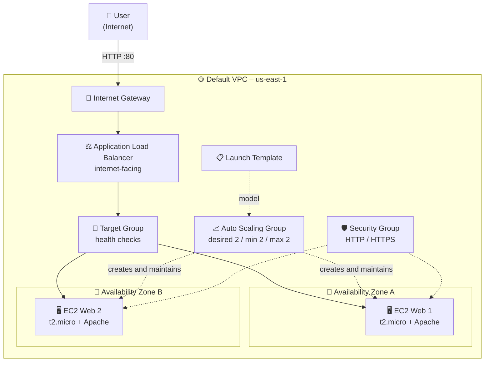
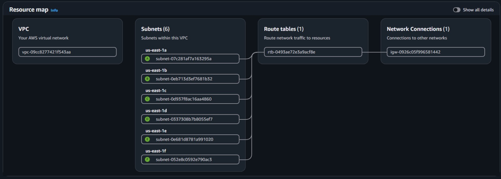
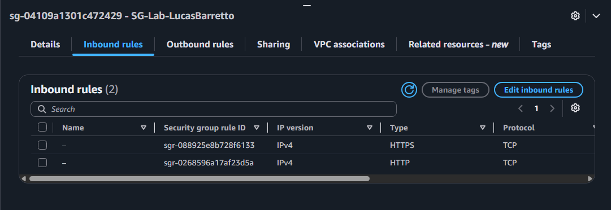
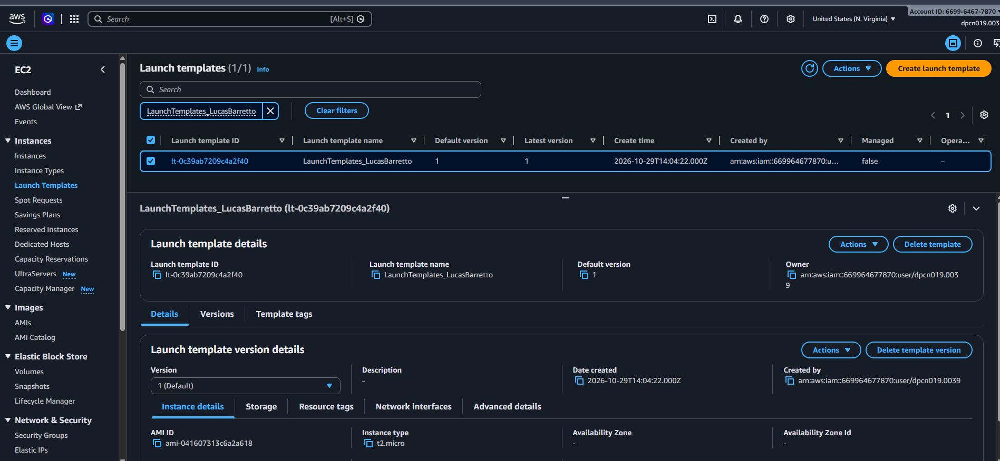
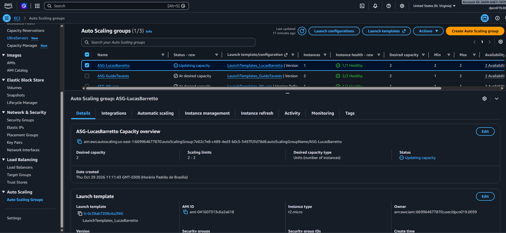
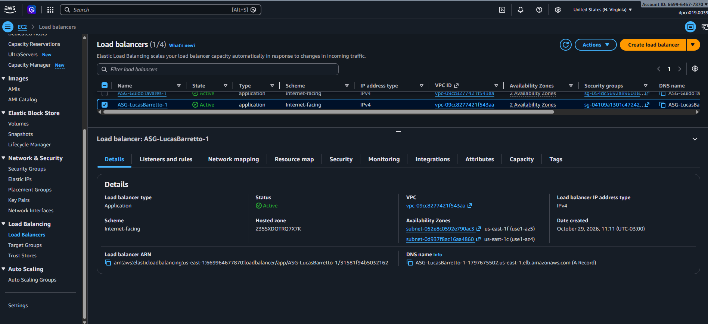
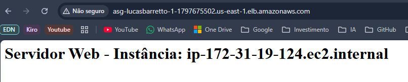

# ⚖️ Lab 05 – Auto Scaling and Elastic Load Balancer

**Hands-on lab: a highly available and scalable web environment with a Launch Template, Auto Scaling Group and Application Load Balancer**

    

  

---

## 📑 Table of Contents

- [📖 About the Project](#-about-the-project)
- [🎯 Objectives](#-objectives)
- [🧩 Scenario](#-scenario)
- [🏗️ Architecture](#-architecture)
- [✅ Prerequisites](#-prerequisites)
- [📊 Results](#-results)
- [🔍 Validation](#-validation)
- [💡 Key Takeaways](#-key-takeaways)
- [🧹 Resource Cleanup](#-resource-cleanup)
- [☁️ AWS Services Covered](#-aws-services-covered)
- [👤 Author](#-author)

---

## 📖 About the Project

This lab is part of my preparation for the **AWS Certified Solutions Architect – Associate** certification and was completed in the **Escola da Nuvem program (Class C10 OUT – DPCN 19)**. The goal is to build a basic web environment that stays online even when an instance fails or traffic changes, by combining three pieces: a **Launch Template** (the "recipe" for instances), an **Auto Scaling Group** (which creates and maintains the instances) and an **Application Load Balancer** (which spreads requests across them).

> 💬 **A single EC2 instance is a single point of failure; with Launch Template + ASG + ALB, the application recovers on its own and traffic is shared across instances.**

---

## 🎯 Objectives

- 🌐 Use the default VPC in `us-east-1` and confirm its public subnets.
- 🛡️ Create a Security Group allowing HTTP and HTTPS.
- 📋 Create a Launch Template with a startup script (User Data) that brings up a web server.
- 📈 Create an Auto Scaling Group spread across more than one Availability Zone.
- ⚖️ Create an internet-facing Application Load Balancer and integrate it with the ASG.
- 🧪 Test load balancing and check instance health.

---

## 🧩 Scenario

A web application must stay available even during traffic spikes or when individual instances fail. The solution defines the instance model once, lets the ASG keep the desired number of instances running, and puts the ALB in front to send traffic only to healthy instances.

| Parameter | Value |
|---|---|
| Region | `us-east-1` (N. Virginia) |
| Network | Default VPC, with public subnets in at least 2 AZs |
| Security Group | Name suggested by the lab: `SG-Lab-<NameSurname>`; inbound HTTP and HTTPS from Anywhere-IPv4; default outbound |
| Launch Template | `LaunchTemplates_LucasBarretto` (default version 1) |
| AMI / instance type | Amazon Linux 2023 (per the lab instructions) / `t2.micro` |
| Key pair | Not included in the template (no SSH access in this lab) |
| Storage | Default (8 GiB) |
| User Data | Updates packages, installs and enables Apache (httpd), and creates a page showing the instance hostname |
| Auto Scaling Group | `ASG-LucasBarretto` |
| Capacity (desired / min / max) | 2 / 2 / 2 |
| Scaling policies | None |
| Load Balancer | Application Load Balancer, internet-facing, HTTP:80 listener, new Target Group |
| Health checks | Elastic Load Balancing health checks turned on in the ASG |
| Instance tag | `Name = WebServer<NameSurname>` (per the lab instructions) |

---

## 🏗️ Architecture

Users reach the Application Load Balancer's DNS name over the internet. The ALB receives the request on the HTTP:80 listener and forwards it, through the Target Group, to one of the healthy instances. The instances are launched by the Auto Scaling Group from the Launch Template, in subnets of different Availability Zones: if an instance fails, the ASG replaces it, and the ALB stops sending traffic to it while the health check reports a problem. Each instance shows its own hostname, which makes the rotation visible when refreshing the page.

---

## ✅ Prerequisites

- ☁️ An active AWS account.
- 🔑 IAM permissions: `AmazonEC2FullAccess`, `AmazonEC2AutoScalingFullAccess` and `ElasticLoadBalancingFullAccess`.
- 🌍 AWS Console with the **N. Virginia (`us-east-1`)** region selected.
- 💻 A web browser.

> ⚠️ **Heads-up:** the lab was run in a training environment, whose permissions may be limited. Use only the resources and actions described in the lab. The AWS console may also change visually over time, but the concepts stay the same.

---

## 📊 Results

### 🌐 VPC and Subnets

The VPC *Resource map* used in the lab shows the network, its subnets, the route table and the internet connection.

*Figure 1: VPC resource map, with 6 subnets (us-east-1a to us-east-1f), 1 route table and 1 network connection (igw-…).*

### 🛡️ Security Group

### Security Group

*Figure 2: Security Group showing the HTTP and HTTPS inbound rules*

### 📋 Launch Template

The Launch Template was created with version 1 as default and defines the AMI and instance type used by the ASG.

*Figure 3: Launch Template `LaunchTemplates_LucasBarretto`, with default and latest version 1, an AMI set and instance type `t2.micro`.*

### 📈 Auto Scaling Group

The ASG was created with desired capacity 2 and scaling limits 2–2, using the Launch Template above.

*Figure 4: Auto Scaling Group `ASG-LucasBarretto`, captured with status "Updating capacity": desired capacity 2, limits 2–2 and 1 instance (1/1 healthy) already running.*

### ⚖️ Application Load Balancer

The Load Balancer was created together with the ASG, during the creation wizard.

*Figure 5: Load Balancer `ASG-LucasBarretto-1`, of type Application, internet-facing, with state Active, IPv4 and two Availability Zones (us-east-1f and us-east-1c).*

### 🧪 Load Balancing Test

*Browser accessing the Load Balancer's DNS name, showing the page served by the first instance.*

*Figure 7: Browser accessing the Load Balancer's DNS name after refreshing, showing the page served by a different instance.*

---

## 🔍 Validation

| ✔️ | Item | Expected result |
|---|---|---|
| ✔️ | Default VPC in `us-east-1` | Subnets across several AZs and a route to an Internet Gateway (Figure 1) |
| ✔️ | Security Group | HTTP and HTTPS inbound allowed from Anywhere-IPv4 |
| ✔️ | Launch Template | Created with default version 1 and a `t2.micro` instance (Figure 2) |
| ✔️ | Auto Scaling Group | Desired, minimum and maximum capacity all equal to 2 (Figure 3) |
| ✔️ | Instances | Healthy in the ASG and in the Target Group after about 5 minutes |
| ✔️ | Application Load Balancer | State Active, internet-facing, in 2 AZs (Figure 4) |
| ✔️ | Access through the ALB DNS name | The "Servidor Web" page is shown and the hostname changes on refresh |

---

## 💡 Key Takeaways

- 🏠 **Launch Template as a "recipe":** defines AMI, type, Security Group and User Data once, ensuring identical instances.
- 🔁 **ASG maintains capacity:** if an instance fails, it launches another; with equal minimum and maximum the group stays fixed, but is ready for scaling policies.
- 🌍 **Subnets in different AZs:** this is what delivers high availability, since losing one zone does not take everything down.
- ⚖️ **ALB distributes and checks health:** it only sends traffic to healthy targets registered in the Target Group.
- 🩺 **ELB health checks in the ASG:** let the load balancer tell the ASG to replace instances that stop responding.
- 🧰 **User Data automates setup:** every new instance is born with the web server ready.
- 🧠 **Relevance for the exam:** a recurring SAA theme — high availability and elasticity with ASG + ELB across multiple AZs, ALB for HTTP/HTTPS (layer 7) traffic with Target Groups and health checks, and Launch Templates to define the ASG's instances.

---

## 🧹 Resource Cleanup

The Load Balancer and running EC2 instances incur costs while they exist. Order recommended by the lab:

- [ ] Delete the **Auto Scaling Group** (this automatically terminates the EC2 instances it manages)
- [ ] Delete the **Load Balancer**
- [ ] Delete the **Target Group**
- [ ] Delete the **Launch Template**
- [ ] Delete the **Security Group**

---

## ☁️ AWS Services Covered

   

| Service | Role in the lab |
|---|---|
| Amazon EC2 | Runs the web servers and hosts Launch Templates and Security Groups |
| Amazon EC2 Auto Scaling | Creates and maintains the desired number of instances, replacing failed ones |
| Elastic Load Balancing (ALB) | Distributes traffic across healthy instances through a Target Group |
| Amazon VPC | Provides the default network, public subnets and internet access |

---

## 👤 Author

**Lucas Barretto**

 

---

Lab completed as part of the Escola da Nuvem program, Class C10 OUT – DPCN 19 🚀

