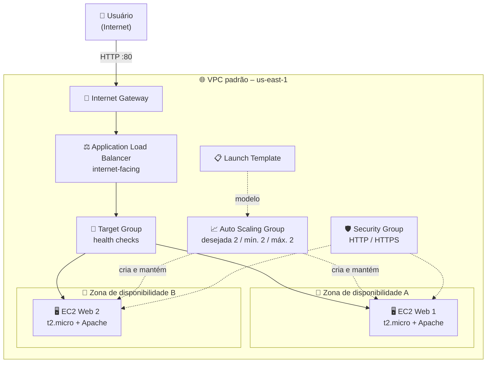

# ⚖️ Lab 05 – Auto Scaling e Elastic Load Balancer

**Laboratório prático: ambiente web altamente disponível e escalável com Launch Template, Auto Scaling Group e Application Load Balancer**

    

  -232F3E?style=flat-square)

---

## 📑 Sumário

- [📖 Sobre o Projeto](#-sobre-o-projeto)
- [🎯 Objetivos](#-objetivos)
- [🧩 Cenário](#-cenário)
- [🏗️ Arquitetura](#-arquitetura)
- [✅ Pré-requisitos](#-pré-requisitos)
- [📊 Resultado](#-resultado)
- [🔍 Validação](#-validação)
- [💡 Principais Aprendizados](#-principais-aprendizados)
- [🧹 Limpeza dos Recursos](#-limpeza-dos-recursos)
- [☁️ Serviços Abordados](#-serviços-abordados)
- [👤 Autor](#-autor)

---

## 📖 Sobre o Projeto

Este laboratório faz parte da minha preparação para a certificação **AWS Certified Solutions Architect – Associate** e foi realizado no programa **Escola da Nuvem (Turma C10 OUT – DPCN 19)**. A proposta é montar um ambiente web básico que continue no ar mesmo se uma instância falhar ou se o tráfego variar, combinando três peças: um **Launch Template** (a "receita" das instâncias), um **Auto Scaling Group** (quem cria e mantém as instâncias) e um **Application Load Balancer** (quem distribui as requisições entre elas).

> 💬 **Uma única instância EC2 é um ponto único de falha; com Launch Template + ASG + ALB, a aplicação passa a se recuperar sozinha e a espalhar o tráfego.**

---

## 🎯 Objetivos

- 🌐 Usar a VPC padrão da região `us-east-1` e confirmar suas sub-redes públicas.
- 🛡️ Criar um Security Group liberando HTTP e HTTPS.
- 📋 Criar um Launch Template com um script de inicialização (User Data) que sobe um servidor web.
- 📈 Criar um Auto Scaling Group distribuído em mais de uma zona de disponibilidade.
- ⚖️ Criar um Application Load Balancer voltado para a internet e integrá-lo ao ASG.
- 🧪 Testar o balanceamento e conferir a saúde das instâncias.

---

## 🧩 Cenário

Uma aplicação web precisa ficar sempre disponível, mesmo com picos de acesso ou queda de instâncias individuais. A solução é definir o modelo das instâncias uma única vez, deixar o ASG manter a quantidade desejada em execução e colocar o ALB à frente para enviar tráfego apenas às instâncias saudáveis.

| Parâmetro | Valor |
|---|---|
| Região | `us-east-1` (N. Virginia) |
| Rede | VPC padrão, com sub-redes públicas em pelo menos 2 AZs |
| Security Group | Nome sugerido no roteiro: `SG-Lab-<NomeSobrenome>`; entrada HTTP e HTTPS com origem Anywhere-IPv4; saída padrão |
| Launch Template | `LaunchTemplates_LucasBarretto` (versão padrão 1) |
| AMI / tipo de instância | Amazon Linux 2023 (conforme o roteiro) / `t2.micro` |
| Key pair | Não incluído no template (sem acesso SSH neste lab) |
| Armazenamento | Padrão (8 GiB) |
| User Data | Atualiza pacotes, instala e habilita o Apache (httpd) e cria uma página que exibe o hostname da instância |
| Auto Scaling Group | `ASG-LucasBarretto` |
| Capacidade (desejada / mín. / máx.) | 2 / 2 / 2 |
| Políticas de escala | Nenhuma |
| Load Balancer | Application Load Balancer, *internet-facing*, listener HTTP:80, novo Target Group |
| Health checks | Health checks do Elastic Load Balancing ativados no ASG |
| Tag das instâncias | `Name = WebServer<NomeSobrenome>` (conforme o roteiro) |

---

## 🏗️ Arquitetura

O usuário acessa o DNS do Application Load Balancer pela internet. O ALB recebe a requisição no listener HTTP:80 e a encaminha, via Target Group, para uma das instâncias saudáveis. As instâncias são criadas pelo Auto Scaling Group a partir do Launch Template, em sub-redes de zonas de disponibilidade diferentes: se uma instância falhar, o ASG a substitui, e o ALB deixa de enviar tráfego para ela enquanto o health check indicar problema. Cada instância exibe seu próprio hostname, o que permite perceber o revezamento ao atualizar a página.

---

## ✅ Pré-requisitos

- ☁️ Conta AWS ativa.
- 🔑 Permissões IAM: `AmazonEC2FullAccess`, `AmazonEC2AutoScalingFullAccess` e `ElasticLoadBalancingFullAccess`.
- 🌍 Console da AWS com a região **N. Virginia (`us-east-1`)** selecionada.
- 💻 Navegador web.

> ⚠️ **Atenção:** o laboratório foi feito em um ambiente de capacitação, cujas permissões podem ser limitadas. Use apenas os recursos e ações previstos no roteiro. O console da AWS também pode mudar visualmente ao longo do tempo, mas os conceitos permanecem.

---

## 📊 Resultado

### 🌐 VPC e sub-redes

O *Resource map* da VPC usada no laboratório mostra a rede, as sub-redes, a tabela de rotas e a conexão com a internet.

*Figura 1: Resource map da VPC, com 6 sub-redes (us-east-1a a us-east-1f), 1 tabela de rotas e 1 conexão de rede (igw-…).*

### 🛡️ Security Group

### Security Group

*Figura 2: Security Group com as regras de entrada para HTTP e HTTPS*

### 📋 Launch Template

O Launch Template foi criado com versão 1 como padrão e define a AMI e o tipo de instância usados pelo ASG.

*Figura 2: Launch Template `LaunchTemplates_LucasBarretto`, com versão padrão e mais recente 1, AMI definida e tipo de instância `t2.micro`.*

### 📈 Auto Scaling Group

O ASG foi criado com capacidade desejada 2 e limites de escala 2–2, usando o Launch Template acima.

*Figura 3: Auto Scaling Group `ASG-LucasBarretto`, capturado com status "Updating capacity": capacidade desejada 2, limites 2–2 e 1 instância (1/1 saudável) já em execução.*

### ⚖️ Application Load Balancer

O Load Balancer foi criado junto com o ASG, durante o assistente de criação.

*Figura 4: Load Balancer `ASG-LucasBarretto-1`, do tipo Application, internet-facing, com estado Active, IPv4 e duas zonas de disponibilidade (us-east-1f e us-east-1c).*

### 🧪 Teste de Balanceamento de Carga

*Navegador acessando o nome DNS do Load Balancer, mostrando a página servida pela primeira instância.*

*Figura 7: Navegador acessando o nome DNS do Load Balancer após atualizar, mostrando a página servida por uma instância diferente.*

---

## 🔍 Validação

| ✔️ | Item | Resultado esperado |
|---|---|---|
| ✔️ | VPC padrão em `us-east-1` | Sub-redes em várias AZs e rota para um Internet Gateway (Figura 1) |
| ✔️ | Security Group | Entrada HTTP e HTTPS liberada para Anywhere-IPv4 |
| ✔️ | Launch Template | Criado com versão padrão 1 e instância `t2.micro` (Figura 2) |
| ✔️ | Auto Scaling Group | Capacidade desejada, mínima e máxima iguais a 2 (Figura 3) |
| ✔️ | Instâncias | Saudáveis (*healthy*) no ASG e no Target Group, após cerca de 5 minutos |
| ✔️ | Application Load Balancer | Estado Active, *internet-facing*, em 2 AZs (Figura 4) |
| ✔️ | Acesso pelo DNS do ALB | A página "Servidor Web" é exibida e o hostname muda ao atualizar |

---

## 💡 Principais Aprendizados

- 🏠 **Launch Template como "receita":** define AMI, tipo, Security Group e User Data uma única vez, garantindo instâncias idênticas.
- 🔁 **ASG mantém a capacidade:** se uma instância falha, ele cria outra; com mínimo e máximo iguais, o grupo fica fixo, mas pronto para receber políticas de escala.
- 🌍 **Sub-redes em AZs diferentes:** é isso que dá alta disponibilidade, pois a queda de uma zona não derruba tudo.
- ⚖️ **ALB distribui e verifica a saúde:** só envia tráfego a alvos saudáveis, registrados no Target Group.
- 🩺 **Health checks do ELB no ASG:** permitem que o balanceador avise o ASG para substituir instâncias que não respondem.
- 🧰 **User Data automatiza a configuração:** cada instância nova já nasce com o servidor web pronto.
- 🧠 **Relevância para a prova:** tema recorrente no SAA — alta disponibilidade e elasticidade com ASG + ELB em múltiplas AZs, ALB para tráfego HTTP/HTTPS (camada 7) com Target Groups e health checks, e Launch Templates como forma de definir as instâncias do ASG.

---

## 🧹 Limpeza dos Recursos

Load Balancer e instâncias EC2 geram custo enquanto existirem. Ordem recomendada pelo roteiro:

- [ ] Excluir o **Auto Scaling Group** (isso encerra automaticamente as instâncias EC2 gerenciadas por ele)
- [ ] Excluir o **Load Balancer**
- [ ] Excluir o **Target Group**
- [ ] Excluir o **Launch Template**
- [ ] Excluir o **Security Group**

---

## ☁️ Serviços Abordados

   

| Serviço | Papel no laboratório |
|---|---|
| Amazon EC2 | Executa os servidores web e abriga Launch Templates e Security Groups |
| Amazon EC2 Auto Scaling | Cria e mantém o número desejado de instâncias, substituindo as que falham |
| Elastic Load Balancing (ALB) | Distribui o tráfego entre as instâncias saudáveis via Target Group |
| Amazon VPC | Fornece a rede padrão, as sub-redes públicas e a saída para a internet |

---

## 👤 Autor

**Lucas Barretto**

 

---

Laboratório realizado como parte do programa Escola da Nuvem, Turma C10 OUT – DPCN 19 🚀

