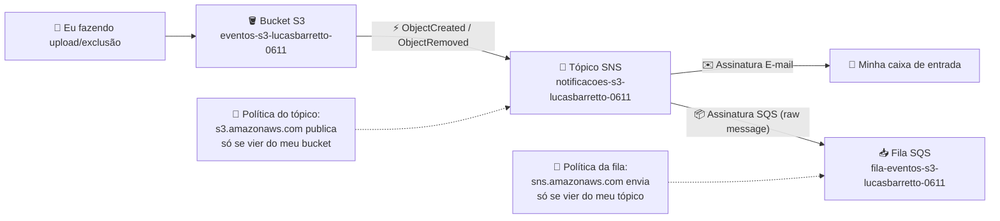

<h1>📬 Notificações de Upload/Exclusão no S3 com SNS e SQS</h1>

**Laboratório prático: eventos do S3 distribuídos por e-mail e fila usando o padrão fan-out**

-2E7D32?style=flat-square)

---

## 📑 Sumário

- [📖 Sobre o Projeto](#-sobre-o-projeto)
- [🎯 Objetivos](#-objetivos)
- [🧩 Cenário](#-cenário)
- [🏗️ Arquitetura](#%EF%B8%8F-arquitetura)
- [✅ Pré-requisitos](#-pré-requisitos)
- [📊 Resultado](#-resultado)
- [🔍 Validação](#-validação)
- [💡 Principais Aprendizados](#-principais-aprendizados)
- [🧹 Limpeza dos Recursos](#-limpeza-dos-recursos)
- [☁️ Serviços Abordados](#%EF%B8%8F-serviços-abordados)
- [👤 Autor](#-autor)

---

## 📖 Sobre o Projeto

Neste laboratório, eu montei uma solução de monitoramento para um bucket do Amazon S3 que simula o armazenamento de imagens e vídeos de uma empresa de mídia. A ideia era que qualquer upload ou exclusão de objeto gerasse, ao mesmo tempo, um alerta no meu e-mail e um registro numa fila para consulta posterior.

Para isso, coloquei o Amazon SNS entre o S3 e os destinos. Configurei o bucket para publicar os eventos num tópico, assinei meu e-mail e uma fila SQS nesse tópico e ajustei as políticas de acesso baseadas em recurso para que cada serviço só aceitasse mensagens da origem esperada.

> 💬 *Aprendi na prática que o SNS no meio do caminho permite adicionar novos destinos sem tocar na configuração do S3, e que sem as políticas de recurso corretas nada é entregue.*

---

## 🎯 Objetivos

1. 🪣 Criar um bucket S3 na região `us-east-1` como origem dos eventos.
2. 📣 Criar um tópico SNS padrão e assinar meu e-mail, confirmando a assinatura.
3. 📥 Criar uma fila SQS padrão para guardar o histórico dos eventos.
4. 🔐 Escrever as políticas de acesso do tópico e da fila, restringindo a origem pelo ARN.
5. ⚡ Habilitar notificações de evento no S3 para criação e remoção de objetos.
6. 🔀 Assinar a fila SQS no tópico SNS e ativar a entrega de mensagem bruta (*raw message delivery*).
7. ✔️ Testar o fluxo de ponta a ponta com um upload e conferir o e-mail recebido.

---

## 🧩 Cenário

Eu assumi o papel de responsável por uma empresa de mídia cujos arquivos ficam num bucket S3. Para fins de auditoria e segurança, eu precisava ser avisado por e-mail a cada upload ou exclusão e, ao mesmo tempo, manter um log desses eventos numa fila para análises e integrações futuras.

| Parâmetro | Valor |
|---|---|
| Região AWS | US East (N. Virginia) – `us-east-1` |
| Bucket S3 | `eventos-s3-lucasbarretto-0611` |
| Tópico SNS (tipo Standard) | `notificacoes-s3-lucasbarretto-0611` |
| Fila SQS (tipo Standard) | `fila-eventos-s3-lucasbarretto-0611` |
| Nome da notificação no S3 | `NotificarPutDelete` |
| Eventos monitorados | `s3:ObjectCreated:*` e `s3:ObjectRemoved:*` |
| Assinatura 1 do tópico | Protocolo E-mail (status Confirmado) |
| Assinatura 2 do tópico | Protocolo SQS, com mensagem bruta habilitada (status Confirmado) |
| Criptografia da fila | SSE-SQS (chave gerenciada pelo SQS) |
| ID da conta AWS | `XXXX-XXXX-XXXX` (mascarado) |

---

## 🏗️ Arquitetura

Eu estruturei o fluxo em três camadas. O S3 é a origem e dispara a notificação de evento assim que um objeto é criado ou removido. O SNS recebe essa mensagem e a replica, em paralelo, para os dois assinantes: o e-mail, que me avisa na hora, e a fila SQS, que guarda o evento até eu consultá-lo. As duas linhas pontilhadas representam as políticas de recurso que escrevi: no tópico, autorizei o serviço do S3 a publicar apenas quando o ARN de origem fosse o do meu bucket; na fila, autorizei o serviço do SNS a enviar mensagens apenas quando o ARN de origem fosse o do meu tópico.

---

## ✅ Pré-requisitos

- Conta AWS ativa.
- Permissões IAM para trabalhar com S3, SNS e SQS.
- Um endereço de e-mail válido para receber e confirmar a assinatura.
- Todos os recursos criados na mesma região (`us-east-1`).

> ⚠️ **Nota:** Ambiente de capacitação com permissões IAM restritas.

---

## 📊 Resultado

### Fila SQS criada com meu nome

Nesta etapa, confirmei a criação da fila padrão `fila-eventos-s3-lucasbarretto-0611` em `us-east-1`. Na tela de detalhes, conferi o tipo Standard, a criptografia SSE-SQS, o ARN e a URL da fila (com o ID da conta mascarado) e a aba de política de acesso, onde apliquei a permissão para o SNS enviar mensagens.

*Figura 1: Página de detalhes da fila SQS `fila-eventos-s3-lucasbarretto-0611`, com tipo Standard, criptografia SSE-SQS e a aba Queue policies aberta.*

### Tópico SNS criado com meu nome

Aqui validei o tópico `notificacoes-s3-lucasbarretto-0611` do tipo Standard e as duas assinaturas que configurei nele: uma por e-mail e outra pela fila SQS, ambas com o status **Confirmed**. Essa tela comprova que o fan-out ficou montado com dois destinos para a mesma publicação.

*Figura 2: Página do tópico SNS com duas assinaturas confirmadas, uma do protocolo EMAIL e outra do protocolo SQS.*

### E-mail de notificação recebido após evento no bucket

Nesta etapa, abri minha caixa de entrada e confirmei o recebimento de dois e-mails do remetente AWS Notifications com o assunto "Amazon S3 Notification". O primeiro é um evento de teste (`s3:TestEvent`) que o S3 envia ao salvar a configuração de notificação. O segundo é o evento real `ObjectCreated:Put`, gerado pelo upload do arquivo `banner.jpg` no bucket, pela configuração `NotificarPutDelete`.

*Figura 3: Caixa de entrada com os e-mails "Amazon S3 Notification": o evento de teste e o evento ObjectCreated:Put do objeto `banner.jpg`.*

---

## 🔍 Validação

| Status | Item Testado | Resultado Observado |
|---|---|---|
| ✅ | Fila SQS criada com o meu nome | Fila Standard `fila-eventos-s3-lucasbarretto-0611` visível no console em `us-east-1` |
| ✅ | Tópico SNS criado com o meu nome | Tópico Standard visível com a assinatura de e-mail e a de SQS |
| ✅ | Assinatura de e-mail confirmada | Status **Confirmed** no tópico |
| ✅ | Assinatura SQS no tópico | Status **Confirmed** para o protocolo SQS |
| ✅ | Evento de teste do S3 | E-mail com `s3:TestEvent` recebido, indicando que o S3 conseguiu publicar no tópico |
| ✅ | Evento de upload | E-mail com `ObjectCreated:Put` do objeto `banner.jpg` recebido |
| ⚠️ | Mensagem na fila SQS | Sem print da consulta de mensagens na fila (não evidenciado nesta documentação) |
| ⚠️ | Evento de exclusão | Sem print do e-mail de `ObjectRemoved` (não evidenciado nesta documentação) |

---

## 💡 Principais Aprendizados

- 🔀 **Aprendi na prática o fan-out:** uma única publicação no SNS chegou ao e-mail e à fila sem precisar reconfigurar o S3 a cada novo destino.
- 🔐 **Compreendi a importância das políticas baseadas em recurso:** S3 e SNS não têm permissão automática para publicar em outros serviços, mesmo na mesma conta, e usar `aws:SourceArn` evita que recursos de terceiros publiquem no meu tópico ou na minha fila.
- ✉️ **Entendi que a confirmação da assinatura é obrigatória:** enquanto o link do e-mail não é confirmado, nenhuma notificação é entregue.
- 📦 **Analisei o efeito da mensagem bruta (*raw message delivery*):** ela entrega na fila o JSON original do S3, sem o envelope extra do SNS, o que facilita o processamento posterior.
- 🧪 **Percebi o papel do evento de teste:** o `s3:TestEvent` chegou logo após salvar a configuração e serviu como confirmação rápida de que as permissões estavam corretas.
- 🧠 **Relevância para a prova:** o SAA-C03 cobra arquiteturas desacopladas e orientadas a eventos; saber quando usar SNS (pub/sub, fan-out) e SQS (fila durável para consumo posterior), além de como as políticas de recurso autorizam o acesso entre serviços, aparece com frequência em questões de resiliência e desacoplamento.

---

## ☁️ Serviços Abordados

| Serviço | Papel no Laboratório |
|---|---|
| Amazon S3 | Armazena os arquivos e dispara as notificações de criação e remoção de objetos |
| Amazon SNS | Recebe os eventos do S3 e os distribui para o e-mail e para a fila (fan-out) |
| Amazon SQS | Guarda os eventos como registro para consulta e integrações futuras |

---

## 👤 Autor

**Lucas Barretto**

---

Laboratório realizado como parte do programa Escola da Nuvem, Turma C10 OUT – DPCN 19 🚀

