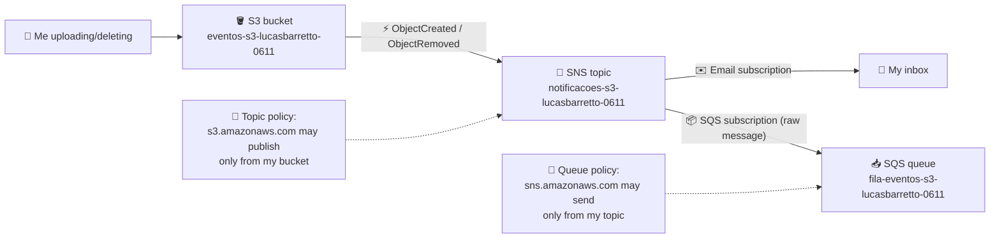

<h1>📬 S3 Upload/Delete Notifications with SNS and SQS</h1>

**Hands-on lab: S3 events delivered to email and a queue using the fan-out pattern**

---

## 📑 Table of Contents

- [📖 About the Project](#-about-the-project)
- [🎯 Objectives](#-objectives)
- [🧩 Scenario](#-scenario)
- [🏗️ Architecture](#%EF%B8%8F-architecture)
- [✅ Prerequisites](#-prerequisites)
- [📊 Results](#-results)
- [🔍 Validation](#-validation)
- [💡 Key Takeaways](#-key-takeaways)
- [☁️ AWS Services Covered](#%EF%B8%8F-aws-services-covered)
- [👤 Author](#-author)

---

## 📖 About the Project

In this lab, I built a monitoring solution for an Amazon S3 bucket that simulates the media storage of a company. My goal was for every object upload or deletion to trigger an alert in my inbox and, at the same time, leave a record in a queue for later review.

To get there, I placed Amazon SNS between S3 and the destinations. I configured the bucket to publish its events to a topic, subscribed both my email and an SQS queue to that topic, and tuned the resource-based access policies so each service only accepts messages from the expected source.

> 💬 *I learned firsthand that SNS in the middle lets me add new destinations without touching the S3 configuration, and that nothing is delivered unless the resource policies are correct.*

---

## 🎯 Objectives

1. 🪣 Create an S3 bucket in `us-east-1` as the event source.
2. 📣 Create a standard SNS topic and subscribe my email, confirming the subscription.
3. 📥 Create a standard SQS queue to keep a history of the events.
4. 🔐 Write the topic and queue access policies, restricting the source by ARN.
5. ⚡ Enable S3 event notifications for object creation and removal.
6. 🔀 Subscribe the SQS queue to the SNS topic and enable raw message delivery.
7. ✔️ Test the flow end to end with an upload and check the email received.

---

## 🧩 Scenario

I took the role of the person responsible for a media company whose files live in an S3 bucket. For auditing and security, I needed to be alerted by email on every upload or deletion while also keeping a log of those events in a queue for future analysis and integrations.

| Parameter | Value |
|---|---|
| AWS Region | US East (N. Virginia) – `us-east-1` |
| S3 bucket | `eventos-s3-lucasbarretto-0611` |
| SNS topic (Standard) | `notificacoes-s3-lucasbarretto-0611` |
| SQS queue (Standard) | `fila-eventos-s3-lucasbarretto-0611` |
| S3 notification name | `NotificarPutDelete` |
| Monitored events | `s3:ObjectCreated:*` and `s3:ObjectRemoved:*` |
| Topic subscription 1 | Email protocol (status Confirmed) |
| Topic subscription 2 | SQS protocol, raw message delivery enabled (status Confirmed) |
| Queue encryption | SSE-SQS (SQS-managed key) |
| AWS account ID | `XXXX-XXXX-XXXX` (masked) |

---

## 🏗️ Architecture

I structured the flow in three layers. S3 is the source and fires the event notification as soon as an object is created or removed. SNS receives that message and replicates it in parallel to its two subscribers: the email, which alerts me right away, and the SQS queue, which holds the event until I read it. The two dotted lines are the resource policies I wrote: on the topic, I allowed the S3 service to publish only when the source ARN is my bucket; on the queue, I allowed the SNS service to send messages only when the source ARN is my topic.

---

## ✅ Prerequisites

- An active AWS account.
- IAM permissions to work with S3, SNS and SQS.
- A valid email address to receive and confirm the subscription.
- All resources created in the same Region (`us-east-1`).

> ⚠️ **Note:** Training environment with restricted IAM permissions.

---

## 📊 Results

### SQS queue created with my name

At this stage, I confirmed the creation of the standard queue `fila-eventos-s3-lucasbarretto-0611` in `us-east-1`. On the details page, I checked the Standard type, SSE-SQS encryption, the queue ARN and URL (account ID masked) and the access policy tab, where I applied the permission for SNS to send messages.

*Figure 1: Details page of the SQS queue `fila-eventos-s3-lucasbarretto-0611`, showing Standard type, SSE-SQS encryption and the Queue policies tab open.*

### SNS topic created with my name

Here I validated the Standard topic `notificacoes-s3-lucasbarretto-0611` and the two subscriptions I set up on it: one by email and one for the SQS queue, both with status **Confirmed**. This screen shows the fan-out is in place, with two destinations for the same publication.

*Figure 2: SNS topic page with two confirmed subscriptions, one using the EMAIL protocol and one using the SQS protocol.*

### Notification email received after a bucket event

At this stage, I opened my inbox and confirmed two emails from AWS Notifications titled "Amazon S3 Notification". The first is a test event (`s3:TestEvent`) that S3 sends when the notification configuration is saved. The second is the real `ObjectCreated:Put` event, generated by uploading the file `banner.jpg` to the bucket, through the `NotificarPutDelete` configuration.

*Figure 3: Inbox showing the "Amazon S3 Notification" emails: the test event and the ObjectCreated:Put event for the object `banner.jpg`.*

---

## 🔍 Validation

| Status | Item Tested | Observed Result |
|---|---|---|
| ✅ | SQS queue created with my name | Standard queue `fila-eventos-s3-lucasbarretto-0611` visible in the console in `us-east-1` |
| ✅ | SNS topic created with my name | Standard topic visible with the email and SQS subscriptions |
| ✅ | Email subscription confirmed | Status **Confirmed** on the topic |
| ✅ | SQS subscription on the topic | Status **Confirmed** for the SQS protocol |
| ✅ | S3 test event | Email with `s3:TestEvent` received, showing S3 could publish to the topic |
| ✅ | Upload event | Email with `ObjectCreated:Put` for the object `banner.jpg` received |
| ⚠️ | Message in the SQS queue | No screenshot of polling the queue (not evidenced in this documentation) |
| ⚠️ | Delete event | No screenshot of the `ObjectRemoved` email (not evidenced in this documentation) |

---

## 💡 Key Takeaways

- 🔀 **I learned fan-out in practice:** a single SNS publication reached both the email and the queue without reconfiguring S3 for each new destination.
- 🔐 **I understood why resource-based policies matter:** S3 and SNS have no automatic permission to publish to other services, even in the same account, and using `aws:SourceArn` prevents third-party resources from publishing to my topic or queue.
- ✉️ **I realized the subscription confirmation is mandatory:** until I clicked the link in the email, no notification was delivered.
- 📦 **I analyzed the effect of raw message delivery:** it hands the queue the original S3 JSON without the extra SNS envelope, which makes later processing easier.
- 🧪 **I noticed the role of the test event:** `s3:TestEvent` arrived right after saving the configuration and acted as a quick confirmation that the permissions were right.
- 🧠 **Relevance for the exam:** SAA-C03 tests decoupled, event-driven architectures; knowing when to use SNS (pub/sub, fan-out) versus SQS (durable queue for later consumption), and how resource policies authorize cross-service access, shows up often in resilience and decoupling questions.

---

## ☁️ AWS Services Covered

| Service | Role in the Lab |
|---|---|
| Amazon S3 | Stores the files and fires notifications for object creation and removal |
| Amazon SNS | Receives the S3 events and distributes them to the email and the queue (fan-out) |
| Amazon SQS | Keeps the events as a record for later review and future integrations |

---

## 👤 Author

**Lucas Barretto**

---

Lab completed as part of the Escola da Nuvem program, Turma C10 OUT – DPCN 19 🚀

