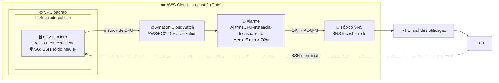

<div align="center">

<h1>📈 Monitoramento com CloudWatch</h1>

**Laboratório prático: alarme de CPU em uma instância EC2 com alerta por e-mail via SNS**


-2E7D32?style=flat-square)

</div>

---

## 📑 Sumário

- [📖 Sobre o Projeto](#-sobre-o-projeto)
- [🎯 Objetivos](#-objetivos)
- [🧩 Cenário](#-cenário)
- [🏗️ Arquitetura](#%EF%B8%8F-arquitetura)
- [✅ Pré-requisitos](#-pré-requisitos)
- [📊 Resultado](#-resultado)
- [🔍 Validação](#-validação)
- [☁️ Serviços Abordados](#%EF%B8%8F-serviços-abordados)
- [👤 Autor](#-autor)

---

## 📖 Sobre o Projeto

Neste laboratório, eu montei uma observabilidade básica para uma instância EC2: criei um alarme no Amazon CloudWatch que acompanha a utilização de CPU e, ao ultrapassar um limite, me avisa por e-mail através do Amazon SNS. Para provar que o alarme funciona, eu mesmo gerei carga na máquina com a ferramenta `stress-ng` e acompanhei a mudança de estado até receber a notificação.

O ponto central foi ligar as peças de ponta a ponta: métrica da instância, regra de avaliação, ação de alarme e canal de entrega. Cada uma delas precisou estar correta para o alerta chegar na minha caixa de entrada.

> 💬 *Aprendi na prática que monitorar não é só olhar um gráfico: um alarme bem configurado transforma uma métrica em ação, e eu só sei que ele funciona quando o forço a disparar.*

---

## 🎯 Objetivos

1. 🖥️ Provisionar uma instância EC2 (Amazon Linux 2023, `t2.micro`) com grupo de segurança restrito.
2. 🔥 Instalar o `stress-ng` e gerar carga de CPU controlada.
3. ⏰ Criar um alarme do CloudWatch sobre a métrica `CPUUtilization` com limite de 70%.
4. 📣 Criar um tópico SNS, assinar meu e-mail e vinculá-lo à ação de estado **In alarm**.
5. 👀 Acompanhar a mudança de estado do alarme de **OK** para **In alarm**.
6. ✉️ Confirmar o recebimento da notificação enviada pelo SNS.

---

## 🧩 Cenário

Eu precisava ser alertado sobre alta utilização de CPU em uma instância EC2, como primeiro passo de observabilidade da infraestrutura. Em vez de esperar o problema acontecer, simulei o pico de carga para validar o alarme e o canal de notificação.

| Parâmetro | Valor |
|---|---|
| Região AWS | US East (Ohio) – `us-east-2` |
| Instância EC2 | Amazon Linux 2023, `t2.micro` (ID `i-0634c4ce2224a3547`) |
| Rede | VPC padrão, sub-rede pública, IP público habilitado |
| Grupo de segurança | Entrada SSH (porta 22) restrita ao meu IP |
| Ferramenta de carga | `stress-ng` 0.15.05 (8 processos de CPU por 600 s) |
| Namespace / Métrica | `AWS/EC2` / `CPUUtilization` |
| Estatística / Período | Média / 300 segundos (5 minutos) |
| Condição | Estático, maior que `70` |
| Pontos para alarmar | 1 de 1 |
| Dados ausentes | Tratar como bom (*notBreaching*) |
| Alarme | `AlarmeCPU-Instancia-lucasbarretto` |
| Tópico SNS | `SNS-lucasbarretto` (ação no estado ALARM) |
| ID da conta AWS | `XXXX-XXXX-XXXX` (mascarado) |

---

## 🏗️ Arquitetura



Eu desenhei o fluxo para que cada componente tivesse uma única responsabilidade. A instância EC2, dentro da sub-rede pública da VPC padrão, publica a métrica `CPUUtilization` no CloudWatch. O alarme avalia a média de cada período de 5 minutos e, quando ela passa de 70%, muda para **In alarm** e executa a ação configurada: publicar no tópico SNS. O tópico entrega a mensagem ao meu e-mail assinado. A linha pontilhada mostra o meu acesso ao terminal da instância, que usei só para disparar a carga de CPU.

---

## ✅ Pré-requisitos

- Primeiro acesso da conta fornecida pela Escola da Nuvem já configurado.
- Permissões para EC2, CloudWatch e SNS.
- Par de chaves para acessar a instância EC2.
- Um e-mail válido para assinar e confirmar o tópico SNS.

> ⚠️ **Nota:** Ambiente de capacitação com permissões IAM restritas.

---

## 📊 Resultado

### Instalação do stress-ng e geração de carga de CPU

Nesta etapa, abri o terminal da instância e preparei a carga de CPU. O ambiente já estava atualizado, então a primeira atualização terminou sem nada a fazer. Em seguida instalei o `stress-ng` (versão 0.15.05 para Amazon Linux 2023), que trouxe três dependências: `Judy`, `libbsd` e `lksctp-tools`.

```bash
# 1) Atualizo os pacotes da instância
sudo dnf update -y

# 2) Instalo o stress-ng (e suas dependências) pelo gerenciador de pacotes
sudo dnf install stress-ng -y

# 3) Gero carga em 8 processos de CPU por 10 minutos, exibindo métricas ao final
sudo stress-ng --cpu 8 --timeout 600s --metrics
```

Ao rodar o terceiro comando sem `sudo`, o `stress-ng` abortou duas vezes com a mensagem de que o diretório temporário `.` precisava ser legível e gravável. Eu estava num diretório sem permissão de escrita para o meu usuário, e executar o comando com `sudo` resolveu: o `stress-ng` passou a rodar por 600 segundos com 8 processos de CPU ativos.

```bash
# Erro que recebi ao executar sem privilégios:
stress-ng --cpu 8 --timeout 600s --metrics
# aborting: temp-path '.' must be readable and writeable

# Correção: executar com sudo
sudo stress-ng --cpu 8 --timeout 600s --metrics
```

Para interromper a carga antes do tempo limite, basta pressionar `Ctrl+C` no terminal.

### Alarme do CloudWatch em estado "In alarm"

Nesta etapa, voltei ao CloudWatch e confirmei que o alarme `AlarmeCPU-Instancia-lucasbarretto` mudou para **In alarm**. No gráfico de `CPUUtilization`, a curva sobe a partir das 22:15 (UTC) e cruza a linha vermelha do limite de 70, e a barra de estados mostra a faixa verde (OK) passando para vermelho (In alarm) no final. Nos detalhes conferi o tipo *Metric alarm*, o namespace `AWS/EC2`, 1 ponto de dados de 1 e o tratamento de dados ausentes como "bom".

<div align="center"></div>

*Figura 1: Alarme `AlarmeCPU-Instancia-lucasbarretto` em estado **In alarm**, com o gráfico de CPUUtilization cruzando o limite de 70%.*

### E-mail de notificação enviado pelo SNS

Aqui validei a ponta final da cadeia: o e-mail do remetente AWS Notifications informando que o alarme entrou no estado **ALARM**. A mensagem registra a transição OK → ALARM em 06/11/2026 às 22:30:27 UTC, com o ponto de dados de cerca de 74,84% (acima do limite de 70), a métrica `CPUUtilization` do namespace `AWS/EC2`, estatística média, período de 300 segundos e a ação de alarme apontando para o tópico `SNS-lucasbarretto`.

<div align="center"></div>

*Figura 2: E-mail de notificação do SNS com os detalhes do alarme, a mudança de estado OK → ALARM e a métrica monitorada.*

---

## 🔍 Validação

| Status | Item Testado | Resultado Observado |
|---|---|---|
| ✅ | Instalação do `stress-ng` | Pacote `stress-ng` 0.15.05 instalado com 3 dependências (4 pacotes no total) |
| ✅ | Execução da carga de CPU | Com `sudo`, o `stress-ng` rodou 8 processos de CPU por 600 s |
| ✅ | Alarme criado com os parâmetros do lab | Média, 5 min, `> 70`, 1 de 1 ponto, dados ausentes como "bom" |
| ✅ | Alarme associado à instância | Dimensão `InstanceId` = `i-0634c4ce2224a3547` na notificação |
| ✅ | Mudança de estado | Estado **In alarm** exibido no console e transição OK → ALARM registrada |
| ✅ | Notificação por e-mail via SNS | E-mail recebido às 22:30:27 UTC com ponto de dados de ~74,84% |


---

## 💡 Principais Aprendizados

- 📈 **Aprendi na prática a anatomia de um alarme:** métrica, estatística, período, limite e quantidade de pontos para alarmar juntos definem quando e com que sensibilidade ele dispara.
- 🕳️ **Compreendi o tratamento de dados ausentes:** tratar dados ausentes como "bom" evita que um alarme dispare só porque a métrica parou de ser enviada.
- 📣 **Entendi o papel do SNS como canal de ação:** o alarme não envia e-mail sozinho, ele publica no tópico e é a assinatura confirmada que entrega a mensagem.
- 🔐 **Percebi como as permissões do Linux afetam ferramentas de teste:** o `stress-ng` abortou por não conseguir usar o diretório atual e funcionou ao executá-lo com `sudo`.
- ⏱️ **Analisei a latência natural do monitoramento:** com período de 5 minutos, o alarme só mudou de estado depois que a média do período ultrapassou o limite, e não no primeiro instante da carga.
- 🧠 **Relevância para a prova:** o SAA-C03 cobra observabilidade e operações; saber que métricas de EC2 como `CPUUtilization` vêm por padrão a cada 5 minutos, como configurar alarmes com ações SNS e como isso se relaciona a Auto Scaling e a respostas automáticas a eventos aparece com frequência nas questões.

---

## ☁️ Serviços Abordados


| Serviço | Papel no Laboratório |
|---|---|
| Amazon EC2 | Hospeda a instância monitorada e executa a carga de CPU com `stress-ng` |
| Amazon CloudWatch | Coleta a métrica `CPUUtilization` e avalia o alarme com limite de 70% |
| Amazon SNS | Recebe a ação do alarme e entrega a notificação por e-mail |

---

## 👤 Autor

**Lucas Barretto**

[](https://www.linkedin.com/in/lucaspimentabarretto)
[](https://github.com/lbarretto)

---

<p align="center">Laboratório realizado como parte do programa Escola da Nuvem, Turma C10 OUT – DPCN 19 🚀</p>
