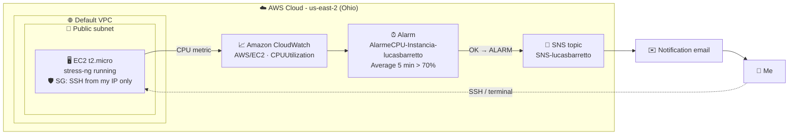

<div align="center">

<h1>📈 Monitoring with CloudWatch</h1>

**Hands-on lab: CPU alarm on an EC2 instance with an email alert through SNS**


</div>

---

## 📑 Table of Contents

- [📖 About the Project](#-about-the-project)
- [🎯 Objectives](#-objectives)
- [🧩 Scenario](#-scenario)
- [🏗️ Architecture](#%EF%B8%8F-architecture)
- [✅ Prerequisites](#-prerequisites)
- [📊 Results](#-results)
- [🔍 Validation](#-validation)
- [💡 Key Takeaways](#-key-takeaways)
- [☁️ AWS Services Covered](#%EF%B8%8F-aws-services-covered)
- [👤 Author](#-author)

---

## 📖 About the Project

In this lab, I built basic observability for an EC2 instance: I created an Amazon CloudWatch alarm that tracks CPU utilization and, when it crosses a threshold, notifies me by email through Amazon SNS. To prove the alarm works, I generated load on the machine myself with the `stress-ng` tool and followed the state change until the notification arrived.

The key was wiring every piece end to end: instance metric, evaluation rule, alarm action and delivery channel. Each one had to be right for the alert to reach my inbox.

> 💬 *I learned firsthand that monitoring is more than watching a graph: a well-configured alarm turns a metric into action, and I only know it works when I force it to fire.*

---

## 🎯 Objectives

1. 🖥️ Provision an EC2 instance (Amazon Linux 2023, `t2.micro`) with a restricted security group.
2. 🔥 Install `stress-ng` and generate controlled CPU load.
3. ⏰ Create a CloudWatch alarm on the `CPUUtilization` metric with a 70% threshold.
4. 📣 Create an SNS topic, subscribe my email and link it to the **In alarm** state action.
5. 👀 Watch the alarm state change from **OK** to **In alarm**.
6. ✉️ Confirm the notification sent by SNS arrived.

---

## 🧩 Scenario

I needed to be alerted about high CPU utilization on an EC2 instance as a first step toward infrastructure observability. Instead of waiting for a real problem, I simulated a load spike to validate both the alarm and the notification channel.

| Parameter | Value |
|---|---|
| AWS Region | US East (Ohio) – `us-east-2` |
| EC2 instance | Amazon Linux 2023, `t2.micro` (ID `i-0634c4ce2224a3547`) |
| Network | Default VPC, public subnet, public IP enabled |
| Security group | Inbound SSH (port 22) restricted to my IP |
| Load tool | `stress-ng` 0.15.05 (8 CPU workers for 600 s) |
| Namespace / Metric | `AWS/EC2` / `CPUUtilization` |
| Statistic / Period | Average / 300 seconds (5 minutes) |
| Condition | Static, greater than `70` |
| Datapoints to alarm | 1 out of 1 |
| Missing data | Treat as good (*notBreaching*) |
| Alarm | `AlarmeCPU-Instancia-lucasbarretto` |
| SNS topic | `SNS-lucasbarretto` (action on ALARM state) |
| AWS account ID | `XXXX-XXXX-XXXX` (masked) |

---

## 🏗️ Architecture



I designed the flow so each component has a single responsibility. The EC2 instance, inside the default VPC's public subnet, publishes the `CPUUtilization` metric to CloudWatch. The alarm evaluates the average of each 5-minute period and, when it exceeds 70%, switches to **In alarm** and runs its configured action: publishing to the SNS topic. The topic delivers the message to my subscribed email. The dotted line shows my access to the instance terminal, which I used only to trigger the CPU load.

---

## ✅ Prerequisites

- First access of the account provided by Escola da Nuvem already configured.
- Permissions for EC2, CloudWatch and SNS.
- A key pair to access the EC2 instance.
- A valid email address to subscribe to and confirm the SNS topic.

> ⚠️ **Note:** Training environment with restricted IAM permissions.

---

## 📊 Results

### Installing stress-ng and generating CPU load

At this stage, I opened the instance terminal and prepared the CPU load. The system was already up to date, so the first update finished with nothing to do. I then installed `stress-ng` (version 0.15.05 for Amazon Linux 2023), which pulled in three dependencies: `Judy`, `libbsd` and `lksctp-tools`.

```bash
# 1) Update the instance packages
sudo dnf update -y

# 2) Install stress-ng (and its dependencies) with the package manager
sudo dnf install stress-ng -y

# 3) Generate load on 8 CPU workers for 10 minutes, printing metrics at the end
sudo stress-ng --cpu 8 --timeout 600s --metrics
```

When I ran the third command without `sudo`, `stress-ng` aborted twice with a message saying the temp directory `.` had to be readable and writable. I was in a directory my user could not write to, and running the command with `sudo` fixed it: `stress-ng` then ran for 600 seconds with 8 CPU workers active.

```bash
# Error I got when running without privileges:
stress-ng --cpu 8 --timeout 600s --metrics
# aborting: temp-path '.' must be readable and writeable

# Fix: run it with sudo
sudo stress-ng --cpu 8 --timeout 600s --metrics
```

To stop the load before the timeout, I just press `Ctrl+C` in the terminal.

### CloudWatch alarm in "In alarm" state

At this stage, I went back to CloudWatch and confirmed the alarm `AlarmeCPU-Instancia-lucasbarretto` switched to **In alarm**. On the `CPUUtilization` graph, the line climbs from around 22:15 (UTC) and crosses the red 70 threshold line, and the state bar shows the green (OK) band turning red (In alarm) at the end. In the details I checked the *Metric alarm* type, the `AWS/EC2` namespace, 1 datapoint out of 1 and missing data treated as "good".

<div align="center"></div>

*Figure 1: Alarm `AlarmeCPU-Instancia-lucasbarretto` in **In alarm** state, with the CPUUtilization graph crossing the 70% threshold.*

### Notification email sent by SNS

Here I validated the final link in the chain: the email from AWS Notifications reporting that the alarm entered the **ALARM** state. It records the OK → ALARM transition on 06/11/2026 at 22:30:27 UTC, with a datapoint of about 74.84% (above the 70 threshold), the `CPUUtilization` metric in the `AWS/EC2` namespace, average statistic, 300-second period and the alarm action pointing to the `SNS-lucasbarretto` topic.

<div align="center"></div>

*Figure 2: SNS notification email with the alarm details, the OK → ALARM state change and the monitored metric.*

---

## 🔍 Validation

| Status | Item Tested | Observed Result |
|---|---|---|
| ✅ | `stress-ng` installation | `stress-ng` 0.15.05 installed with 3 dependencies (4 packages in total) |
| ✅ | CPU load execution | With `sudo`, `stress-ng` ran 8 CPU workers for 600 s |
| ✅ | Alarm created with the lab parameters | Average, 5 min, `> 70`, 1 out of 1 datapoint, missing data as "good" |
| ✅ | Alarm tied to the instance | `InstanceId` dimension = `i-0634c4ce2224a3547` in the notification |
| ✅ | State change | **In alarm** shown in the console and OK → ALARM transition recorded |
| ✅ | Email notification via SNS | Email received at 22:30:27 UTC with a datapoint of ~74.84% |


---

## 💡 Key Takeaways

- 📈 **I learned the anatomy of an alarm in practice:** metric, statistic, period, threshold and datapoints to alarm together define when and how sensitively it fires.
- 🕳️ **I understood missing data treatment:** treating missing data as "good" keeps an alarm from firing just because the metric stopped being sent.
- 📣 **I grasped SNS as the action channel:** the alarm does not send email on its own, it publishes to the topic and the confirmed subscription delivers the message.
- 🔐 **I noticed how Linux permissions affect test tools:** `stress-ng` aborted because it could not use the current directory and worked once I ran it with `sudo`.
- ⏱️ **I analyzed the natural latency of monitoring:** with a 5-minute period, the alarm only changed state after the period's average crossed the threshold, not the instant the load started.
- 🧠 **Relevance for the exam:** SAA-C03 covers observability and operations; knowing that EC2 metrics like `CPUUtilization` are reported every 5 minutes by default, how to configure alarms with SNS actions and how that ties into Auto Scaling and automated responses to events comes up often in questions.

---

## ☁️ AWS Services Covered


| Service | Role in the Lab |
|---|---|
| Amazon EC2 | Hosts the monitored instance and runs the CPU load with `stress-ng` |
| Amazon CloudWatch | Collects the `CPUUtilization` metric and evaluates the alarm with a 70% threshold |
| Amazon SNS | Receives the alarm action and delivers the email notification |

---

## 👤 Author

**Lucas Barretto**

[](https://www.linkedin.com/in/lucaspimentabarretto)
[](https://github.com/lbarretto)

---

<p align="center">Lab completed as part of the Escola da Nuvem program, Turma C10 OUT – DPCN 19 🚀</p>
