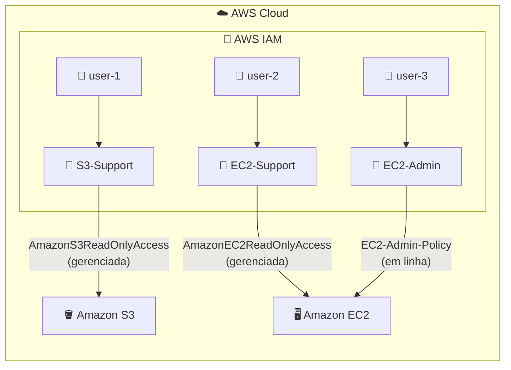

# 🔑 AWS IAM: Usuários, Grupos e Políticas de Acesso

**Laboratório prático: controlando permissões com usuários, grupos e políticas do IAM**

   

  -green?style=flat-square)

---

## 📑 Sumário

- [📖 Sobre o Projeto](#-sobre-o-projeto)
- [🎯 Objetivos](#-objetivos)
- [🧩 Cenário](#-cenário)
- [🏗️ Arquitetura](#️-arquitetura)
- [✅ Pré-requisitos](#-pré-requisitos)
- [📊 Resultado](#-resultado)
- [🔍 Validação](#-validação)
- [💡 Principais Aprendizados](#-principais-aprendizados)
- [🧹 Encerramento do Laboratório](#-encerramento-do-laboratório)
- [☁️ Serviços Abordados](#️-serviços-abordados)
- [👤 Autor](#-autor)

---

## 📖 Sobre o Projeto

Este projeto documenta um laboratório prático opcional realizado na plataforma **AWS Skill Builder** (*Introduction to AWS Identity and Access Management*, código SPL-66), como parte da minha preparação para a certificação **AWS Certified Solutions Architect – Associate**.

O laboratório apresenta os fundamentos do **AWS Identity and Access Management (IAM)**: explorar usuários, grupos e políticas já criados, atribuir usuários a grupos de acordo com a função de cada um e testar, na prática, como as permissões afetam o acesso a serviços como **Amazon EC2** e **Amazon S3**.

> 💡 No IAM, a regra de partida é **nenhum acesso**. Cada permissão precisa ser concedida de forma explícita, e agrupar usuários por função torna essa gestão simples e escalável.

---

## 🎯 Objetivos

- 🔎 Explorar os usuários e grupos do IAM pré-criados
- 📜 Inspecionar as políticas do IAM associadas aos grupos
- 👥 Adicionar usuários aos grupos de acordo com um cenário real de negócio
- 🔗 Localizar e usar a URL de login de usuários do IAM
- 🧪 Testar os efeitos das políticas no acesso aos serviços

---

## 🧩 Cenário

A empresa está ampliando o uso da AWS, com muitas instâncias do **Amazon EC2** e grande volume de dados no **Amazon S3**. O objetivo é conceder acesso aos novos membros da equipe de acordo com a função de cada um.

| 👤 Usuário | 👥 Grupo | 🔐 Permissão esperada |
|---|---|---|
| `user-1` | `S3-Support` | Acesso somente leitura ao Amazon S3 |
| `user-2` | `EC2-Support` | Acesso somente leitura ao Amazon EC2 |
| `user-3` | `EC2-Admin` | Visualizar, iniciar e interromper instâncias do Amazon EC2 |

**Políticas dos grupos:**

| 👥 Grupo | 📜 Política | 🏷️ Tipo |
|---|---|---|
| `S3-Support` | `AmazonS3ReadOnlyAccess` | Gerenciada |
| `EC2-Support` | `AmazonEC2ReadOnlyAccess` | Gerenciada |
| `EC2-Admin` | `EC2-Admin-Policy` | Em linha (*inline*) |

---

## 🏗️ Arquitetura

Cada usuário pertence a um grupo e **herda as permissões** das políticas associadas a ele. Assim, o acesso aos serviços é definido pela função, e não usuário por usuário.

---

## ✅ Pré-requisitos

- 🎓 Acesso à plataforma **AWS Skill Builder** com o laboratório iniciado
- ☁️ Console de Gerenciamento da AWS aberto pelo ambiente do laboratório
- 🕶️ Uma janela privada (anônima) do navegador para testar o login dos usuários sem encerrar a sessão principal
- 🌎 Região mantida como a do ambiente do laboratório, sem alterações

> ⚠️ No ambiente do laboratório, a conta tem permissões limitadas. Mensagens de "não autorizado" durante a configuração são esperadas e não impedem a conclusão.

---

## 📊 Resultado

Ao final do laboratório, cada usuário se comportou conforme as permissões herdadas do seu grupo:

| 👤 Usuário | 🧪 Teste | ✅ Resultado |
|---|---|---|
| `user-1` (S3-Support) | Abrir o Amazon S3 | **Permitido:** lista os buckets e visualiza o conteúdo do bucket do laboratório |
| `user-1` (S3-Support) | Listar instâncias no Amazon EC2 | **Sem acesso:** nenhuma instância é exibida, pois não há permissões para o EC2 |
| `user-2` (EC2-Support) | Listar instâncias no Amazon EC2 | **Permitido:** visualiza a instância (somente leitura) |
| `user-2` (EC2-Support) | Interromper a instância | **Negado:** erro de operação não autorizada |
| `user-2` (EC2-Support) | Abrir o Amazon S3 | **Negado:** erro de acesso negado (*Access Denied*) |
| `user-3` (EC2-Admin) | Interromper a instância | **Permitido:** a instância entra em *stopping* e é desligada |

---

## 🔍 Validação

| ✔️ | Item | Esperado |
|---|---|---|
| ☑️ | **Usuários iniciais** | `user-1`, `user-2` e `user-3` sem permissões nem grupos antes da atribuição |
| ☑️ | **Grupos existentes** | `EC2-Admin`, `EC2-Support` e `S3-Support` |
| ☑️ | **Políticas dos grupos** | Duas gerenciadas (somente leitura) e uma em linha (administração do EC2) |
| ☑️ | **Associação aos grupos** | Cada usuário no grupo correspondente à sua função |
| ☑️ | **Contagem por grupo** | Número **1** na coluna de usuários de cada grupo |
| ☑️ | **Login dos usuários** | Acesso pela URL de login de usuários do IAM da conta, em janela privada |

---

## 💡 Principais Aprendizados

- 🚫 **Sem permissão, sem acesso:** um usuário recém-criado não consegue fazer nada até receber permissões, diretamente ou por meio de um grupo.
- 👥 **Grupos simplificam a gestão:** em vez de ajustar cada usuário, basta colocá-lo no grupo da sua função e ele herda as permissões.
- 📜 **Política gerenciada × em linha:** a gerenciada é reutilizável e, quando atualizada, a mudança vale imediatamente para quem a utiliza; a em linha pertence a um único usuário ou grupo e serve para casos pontuais.
- 🧱 **Estrutura de uma política:** cada instrução combina o **efeito** (permitir ou negar), as **ações** (chamadas de API) e os **recursos** aos quais se aplicam.
- 🔐 **Privilégio mínimo:** funções de suporte recebem somente leitura, e a administração do EC2 se limita a visualizar, iniciar e interromper instâncias.
- 🧪 **Testar com cada identidade:** usar uma janela privada e a URL de login do IAM permite validar as permissões reais de cada usuário, sem misturar sessões.
- 🧠 **Relevância para a prova:** usuários, grupos, políticas gerenciadas e em linha e o princípio do menor privilégio são temas centrais do exame.

---

## 🧹 Encerramento do Laboratório

O ambiente do laboratório é temporário e gerenciado pelo Skill Builder. Para finalizar:

- 🚪 Sair do console da AWS
- 🛑 Usar **End Lab** na página do laboratório e confirmar o encerramento

---

## ☁️ Serviços Abordados

  

| Serviço | Papel no laboratório |
|---|---|
| 🔑 **AWS IAM** | Usuários, grupos e políticas (gerenciadas e em linha) que controlam o acesso |
| 🖥️ **Amazon EC2** | Serviço usado para testar permissões de leitura e de administração de instâncias |
| 🪣 **Amazon S3** | Serviço usado para testar o acesso somente leitura a buckets |

---

## 👤 Autor

**Lucas Barretto**

---

☁️ Laboratório opcional realizado na plataforma **AWS Skill Builder** 🚀

