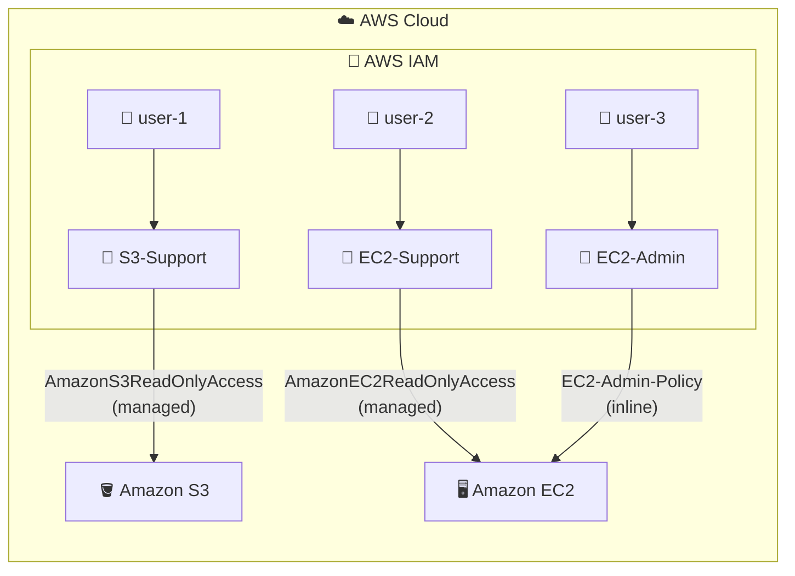

# 🔑 AWS IAM: Users, Groups, and Access Policies

**Hands-on lab: controlling permissions with IAM users, groups, and policies**

   

  

---

## 📑 Table of Contents

- [📖 About the Project](#-about-the-project)
- [🎯 Objectives](#-objectives)
- [🧩 Scenario](#-scenario)
- [🏗️ Architecture](#️-architecture)
- [✅ Prerequisites](#-prerequisites)
- [📊 Result](#-result)
- [🔍 Validation](#-validation)
- [💡 Key Takeaways](#-key-takeaways)
- [🧹 Lab Wrap-Up](#-lab-wrap-up)
- [☁️ AWS Services Covered](#️-aws-services-covered)
- [👤 Author](#-author)

---

## 📖 About the Project

This project documents an optional hands-on lab completed on the **AWS Skill Builder** platform (*Introduction to AWS Identity and Access Management*, code SPL-66), part of my preparation for the **AWS Certified Solutions Architect – Associate** certification.

The lab introduces the fundamentals of **AWS Identity and Access Management (IAM)**: exploring pre-created users, groups, and policies, assigning users to groups according to their job role, and testing in practice how permissions affect access to services such as **Amazon EC2** and **Amazon S3**.

> 💡 In IAM, the starting rule is **no access**. Every permission must be granted explicitly, and grouping users by role keeps that management simple and scalable.

---

## 🎯 Objectives

- 🔎 Explore the pre-created IAM users and groups
- 📜 Inspect the IAM policies attached to the groups
- 👥 Add users to groups following a real business scenario
- 🔗 Locate and use the IAM users sign-in URL
- 🧪 Test the effects of policies on service access

---

## 🧩 Scenario

The company is expanding its use of AWS, with many **Amazon EC2** instances and a large volume of data in **Amazon S3**. The goal is to grant new team members access according to their job role.

| 👤 User | 👥 Group | 🔐 Expected permission |
|---|---|---|
| `user-1` | `S3-Support` | Read-only access to Amazon S3 |
| `user-2` | `EC2-Support` | Read-only access to Amazon EC2 |
| `user-3` | `EC2-Admin` | View, start, and stop Amazon EC2 instances |

**Group policies:**

| 👥 Group | 📜 Policy | 🏷️ Type |
|---|---|---|
| `S3-Support` | `AmazonS3ReadOnlyAccess` | Managed |
| `EC2-Support` | `AmazonEC2ReadOnlyAccess` | Managed |
| `EC2-Admin` | `EC2-Admin-Policy` | Inline |

---

## 🏗️ Architecture

Each user belongs to a group and **inherits the permissions** of the policies attached to it. Access to services is therefore defined by role, not user by user.

---

## ✅ Prerequisites

- 🎓 Access to the **AWS Skill Builder** platform with the lab started
- ☁️ AWS Management Console opened from the lab environment
- 🕶️ A private (incognito) browser window to test user sign-ins without ending the main session
- 🌎 Region kept as the one set by the lab environment, without changes

> ⚠️ In the lab environment, the account has limited permissions. "Not authorized" messages during setup are expected and do not prevent completion.

---

## 📊 Result

At the end of the lab, each user behaved according to the permissions inherited from their group:

| 👤 User | 🧪 Test | ✅ Result |
|---|---|---|
| `user-1` (S3-Support) | Open Amazon S3 | **Allowed:** lists buckets and views the contents of the lab bucket |
| `user-1` (S3-Support) | List instances in Amazon EC2 | **No access:** no instances are shown, since there are no EC2 permissions |
| `user-2` (EC2-Support) | List instances in Amazon EC2 | **Allowed:** views the instance (read-only) |
| `user-2` (EC2-Support) | Stop the instance | **Denied:** unauthorized operation error |
| `user-2` (EC2-Support) | Open Amazon S3 | **Denied:** *Access Denied* error |
| `user-3` (EC2-Admin) | Stop the instance | **Allowed:** the instance enters *stopping* and shuts down |

---

## 🔍 Validation

| ✔️ | Item | Expected |
|---|---|---|
| ☑️ | **Initial users** | `user-1`, `user-2`, and `user-3` with no permissions or groups before assignment |
| ☑️ | **Existing groups** | `EC2-Admin`, `EC2-Support`, and `S3-Support` |
| ☑️ | **Group policies** | Two managed (read-only) and one inline (EC2 administration) |
| ☑️ | **Group membership** | Each user in the group matching their role |
| ☑️ | **Count per group** | Number **1** in the users column of each group |
| ☑️ | **User sign-in** | Access through the account's IAM users sign-in URL, in a private window |

---

## 💡 Key Takeaways

- 🚫 **No permission, no access:** a newly created user can do nothing until it receives permissions, directly or through a group.
- 👥 **Groups simplify management:** instead of adjusting each user, just place them in the group for their role and they inherit the permissions.
- 📜 **Managed vs. inline policy:** a managed policy is reusable and, when updated, the change applies immediately to everyone using it; an inline policy belongs to a single user or group and suits one-off cases.
- 🧱 **Policy structure:** each statement combines the **effect** (allow or deny), the **actions** (API calls), and the **resources** they apply to.
- 🔐 **Least privilege:** support roles get read-only access, and EC2 administration is limited to viewing, starting, and stopping instances.
- 🧪 **Test with each identity:** using a private window and the IAM sign-in URL validates each user's real permissions without mixing sessions.
- 🧠 **Exam relevance:** users, groups, managed and inline policies, and the least privilege principle are core exam topics.

---

## 🧹 Lab Wrap-Up

The lab environment is temporary and managed by Skill Builder. To finish:

- 🚪 Sign out of the AWS console
- 🛑 Use **End Lab** on the lab page and confirm

---

## ☁️ AWS Services Covered

  

| Service | Role in the lab |
|---|---|
| 🔑 **AWS IAM** | Users, groups, and policies (managed and inline) that control access |
| 🖥️ **Amazon EC2** | Service used to test read and instance administration permissions |
| 🪣 **Amazon S3** | Service used to test read-only access to buckets |

---

## 👤 Author

**Lucas Barretto**

---

☁️ Optional lab completed on the **AWS Skill Builder** platform 🚀

