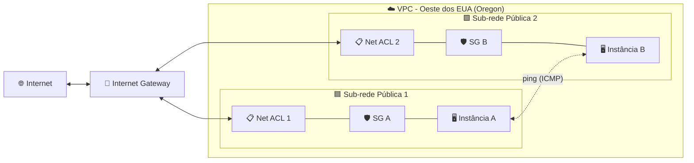

<div align="center">

# 🛡️ Configurar Network ACLs e Security Groups no Amazon VPC

**Laboratório prático: controlando o tráfego de rede com Network ACLs e Security Groups em uma VPC**

    

  -555555?style=flat-square)

</div>

---

## 📑 Sumário

- [📖 Sobre o Projeto](#-sobre-o-projeto)
- [🎯 Objetivos](#-objetivos)
- [🧩 Cenário](#-cenário)
- [🏗️ Arquitetura](#-arquitetura)
- [✅ Pré-requisitos](#-pré-requisitos)
- [📊 Resultado](#-resultado)
- [🔍 Validação](#-validação)
- [💡 Principais Aprendizados](#-principais-aprendizados)
- [🧹 Encerramento do Laboratório](#-encerramento-do-laboratório)
- [☁️ Serviços Abordados](#-serviços-abordados)
- [👤 Autor](#-autor)

---

## 📖 Sobre o Projeto

Este é um laboratório opcional da plataforma **AWS Skill Builder**, parte da minha preparação para a certificação **AWS Certified Solutions Architect – Associate**. Ele faz parte do repositório `aws-sa-associate-labs`, na pasta *Optional Labs*.

O exercício mostra como duas camadas de filtragem de tráfego em uma VPC trabalham juntas: as **Network ACLs** (aplicadas na borda da sub-rede) e os **Security Groups** (aplicados no nível da instância). Duas instâncias EC2 ficam em sub-redes públicas diferentes, e o objetivo é fazer com que ambas sejam alcançáveis pela internet e entre si, identificando e corrigindo um caminho bloqueado ao longo do processo.

> 💬 *As Network ACLs vigiam a porta da sub-rede; os Security Groups vigiam a porta de cada instância — o tráfego precisa ser permitido nas duas.*

---

## 🎯 Objetivos

- 🧱 Criar duas Network ACLs e associar cada uma a uma sub-rede pública diferente
- 📝 Definir regras de entrada e de saída para as Network ACLs
- 🔐 Adicionar regras de entrada (HTTP, HTTPS e ICMP) aos Security Groups das duas instâncias
- 📡 Testar a conectividade com `ping` das instâncias para a internet e entre elas
- 🛠️ Diagnosticar e corrigir um problema de conectividade causado por regras ausentes

---

## 🧩 Cenário

O ambiente já traz uma VPC com duas sub-redes públicas, cada uma com uma instância EC2 (Instância A e Instância B) e seu próprio Security Group (SG A e SG B). As duas instâncias precisam acessar a internet e se comunicar entre si. Você cria as Network ACLs do zero, ajusta os Security Groups e usa o `ping` para descobrir onde o tráfego está sendo descartado.

| Parâmetro | Valor |
|---|---|
| Região | Oeste dos EUA (Oregon) — conforme os prints do console |
| VPC | A VPC da empresa do laboratório (chamada *UmaEmpresa* nas instruções; nos prints do console aparece um nome iniciado por "AnyCompany") |
| Network ACL 1 | Nome `Net ACL 1`; regra de entrada 10 – todo o tráfego, `0.0.0.0/0`, permitir; regra de saída 10 – todo o tráfego, `0.0.0.0/0`, permitir; associada à sub-rede pública 1 |
| Network ACL 2 | Nome `Net ACL 2`; regra de saída 10 – todo o tráfego, `0.0.0.0/0`, permitir; sem regra de entrada no início (apenas a negação implícita); associada à sub-rede pública 2 |
| Network ACL 2 – correção | Regra de entrada 10 – todo o tráfego, `0.0.0.0/0`, permitir, adicionada na etapa de correção |
| SG A (Instância A) | Novas regras de entrada: HTTP (80), HTTPS (443) e todos os ICMP – IPv4, origem qualquer lugar IPv4 |
| SG B (Instância B) | As mesmas três regras de entrada, adicionadas na etapa de correção |
| Acesso às instâncias | Terminal no navegador (Session Manager) |

---

## 🏗️ Arquitetura



O tráfego de ou para uma instância passa pelo **Internet Gateway**, depois pela **Network ACL** da sub-rede e, por fim, pelo **Security Group** da instância — e o caminho de volta atravessa as mesmas camadas em sentido inverso. As Network ACLs são stateless, então os dois sentidos precisam de regras explícitas; os Security Groups são stateful, então a resposta de uma conexão permitida é liberada automaticamente. A falta de uma regra de permissão em qualquer uma das camadas basta para descartar os pacotes, que é exatamente o que acontece com a Instância B antes da correção.

---

## ✅ Pré-requisitos

- ☑️ Acesso ao laboratório pelo AWS Skill Builder, com o laboratório iniciado e o console aberto a partir da página do lab
- ☑️ Noções básicas de VPC: sub-redes, rota para um Internet Gateway, IPs públicos
- ☑️ Familiaridade com o console do EC2 e com a execução de comandos em um terminal
- ☑️ Manter a Região fornecida pelo laboratório (não alterá-la)

> ⚠️ **Aviso:** o laboratório roda em um ambiente de capacitação com permissões limitadas. Apenas os recursos e ações habilitados para o usuário do lab estão disponíveis, e todo o ambiente é temporário — ele é removido quando o laboratório termina.

---

## 📊 Resultado

### 🔹 Network ACLs criadas e associadas

Depois de criar as duas ACLs e associá-las às sub-redes públicas, a lista de Network ACLs no console da VPC mostra `Net ACL 1` e `Net ACL 2`, cada uma vinculada a uma sub-rede diferente da VPC do laboratório.

<div align="center">
  
  <br>
  <em>Figura 1: Lista de Network ACLs na Região de Oregon — Net ACL 1 e Net ACL 2 associadas a sub-redes diferentes. A Net ACL 2 mostra 1 regra de entrada contra 2 nas demais, o que é consistente com ela ainda não ter uma regra de permissão nesse momento.</em>
</div>

### 🔹 Regras do Security Group e confirmação da alteração

A página de Grupos de segurança mostra o SG A selecionado, com três regras de entrada abertas para `0.0.0.0/0`: HTTP na porta 80, HTTPS na porta 443 e todos os ICMP para IPv4. Um banner verde confirma que regras de entrada foram modificadas com êxito em um grupo de segurança.

<div align="center">
  
  <br>
  <em>Figura 2: SG A com três regras de entrada (HTTP, HTTPS e ICMP) a partir de 0.0.0.0/0. O banner de sucesso se refere a uma modificação feita no grupo de segurança identificado como SG B.</em>
</div>

### 🔹 Testes de conectividade

A sessão de terminal na Instância A registra a sequência de testes: o `ping` para o site da AWS funciona sem perda de pacotes; o `ping` para um IP público (o da Instância B, seguindo o fluxo do lab) primeiro mostra 100% de perda; após a correção, o mesmo endereço responde a todos os pacotes; e um `ping` final para outro endereço também recebe todas as respostas.

<div align="center">
  
  <br>
  <em>Figura 3: Terminal na Instância A — ping para a internet com 0% de perda, um IP de destino que primeiro falha com 100% de perda e depois responde com 0% de perda, e um ping final para outro IP com 0% de perda.</em>
</div>

<details>
<summary>Saída do terminal (versão em texto)</summary>

```text
$ ping -c 5 www.aws.amazon.com
PING dr49lng3n1n2s.cloudfront.net (3.163.24.96) 56(84) bytes of data.
64 bytes from server-3-163-24-96.hio52.r.cloudfront.net (3.163.24.96): icmp_seq=1 ttl=249 time=4.95 ms
64 bytes from server-3-163-24-96.hio52.r.cloudfront.net (3.163.24.96): icmp_seq=2 ttl=249 time=4.95 ms
64 bytes from server-3-163-24-96.hio52.r.cloudfront.net (3.163.24.96): icmp_seq=3 ttl=249 time=4.96 ms
64 bytes from server-3-163-24-96.hio52.r.cloudfront.net (3.163.24.96): icmp_seq=4 ttl=249 time=4.96 ms
64 bytes from server-3-163-24-96.hio52.r.cloudfront.net (3.163.24.96): icmp_seq=5 ttl=249 time=4.97 ms

--- dr49lng3n1n2s.cloudfront.net ping statistics ---
5 packets transmitted, 5 received, 0% packet loss, time 4006ms
rtt min/avg/max/mdev = 4.947/4.958/4.972/0.008 ms
$ ping -c 3 35.95.142.142
PING 35.95.142.142 (35.95.142.142) 56(84) bytes of data.

--- 35.95.142.142 ping statistics ---
3 packets transmitted, 0 received, 100% packet loss, time 2058ms

$ ping -c 3 35.95.142.142
PING 35.95.142.142 (35.95.142.142) 56(84) bytes of data.
64 bytes from 35.95.142.142: icmp_seq=1 ttl=126 time=0.679 ms
64 bytes from 35.95.142.142: icmp_seq=2 ttl=126 time=0.664 ms
64 bytes from 35.95.142.142: icmp_seq=3 ttl=126 time=0.651 ms

--- 35.95.142.142 ping statistics ---
3 packets transmitted, 3 received, 0% packet loss, time 2104ms
rtt min/avg/max/mdev = 0.651/0.664/0.679/0.011 ms
$ ping -c 5 www.aws.amazon.com
PING dr49lng3n1n2s.cloudfront.net (3.163.24.15) 56(84) bytes of data.
64 bytes from server-3-163-24-15.hio52.r.cloudfront.net (3.163.24.15): icmp_seq=1 ttl=249 time=4.70 ms
64 bytes from server-3-163-24-15.hio52.r.cloudfront.net (3.163.24.15): icmp_seq=2 ttl=249 time=4.68 ms
64 bytes from server-3-163-24-15.hio52.r.cloudfront.net (3.163.24.15): icmp_seq=3 ttl=249 time=4.70 ms
64 bytes from server-3-163-24-15.hio52.r.cloudfront.net (3.163.24.15): icmp_seq=4 ttl=249 time=4.71 ms
64 bytes from server-3-163-24-15.hio52.r.cloudfront.net (3.163.24.15): icmp_seq=5 ttl=249 time=4.70 ms

--- dr49lng3n1n2s.cloudfront.net ping statistics ---
5 packets transmitted, 5 received, 0% packet loss, time 4005ms
rtt min/avg/max/mdev = 4.679/4.698/4.712/0.010 ms
$ ping -c 3 18.236.137.2
PING 18.236.137.2 (18.236.137.2) 56(84) bytes of data.
64 bytes from 18.236.137.2: icmp_seq=1 ttl=126 time=0.165 ms
64 bytes from 18.236.137.2: icmp_seq=2 ttl=126 time=0.201 ms
64 bytes from 18.236.137.2: icmp_seq=3 ttl=126 time=0.182 ms

--- 18.236.137.2 ping statistics ---
3 packets transmitted, 3 received, 0% packet loss, time 2093ms
rtt min/avg/max/mdev = 0.165/0.182/0.201/0.014 ms
$
```

</details>

---

## 🔍 Validação

| ✔️ | Item | Resultado esperado |
|---|---|---|
| ✔️ | Net ACL 1 e Net ACL 2 existem na VPC do lab | Ambas aparecem na lista de Network ACLs |
| ✔️ | Cada Network ACL está associada a uma sub-rede pública diferente | Net ACL 1 → sub-rede pública 1; Net ACL 2 → sub-rede pública 2 |
| ✔️ | Regras de entrada do SG A | HTTP, HTTPS e ICMP permitidos de qualquer lugar (IPv4) |
| ✔️ | Instância A → internet (`ping www.aws.amazon.com`) | 5 enviados, 5 recebidos, 0% de perda |
| ✔️ | Instância A → Instância B antes da correção | 100% de perda de pacotes |
| ✔️ | Instância A → Instância B após corrigir o SG B e a Net ACL 2 | 3 enviados, 3 recebidos, 0% de perda |

---

## 💡 Principais Aprendizados

- 🧱 **Network ACLs são stateless:** as regras de entrada e saída são avaliadas de forma independente, então o tráfego de retorno precisa da sua própria regra de permissão.
- 🔢 **A ordem das regras importa:** as regras da Network ACL são processadas do menor número para o maior, e o que não corresponde a nenhuma é negado pela regra implícita no final.
- 🛡️ **Security Groups são stateful e só permitem:** se uma conexão é permitida em um sentido, a resposta é liberada automaticamente; não existem regras de negação.
- 🎯 **Escopos diferentes:** as Network ACLs atuam no nível da sub-rede, os Security Groups no nível da instância (interface de rede).
- 🔎 **O diagnóstico é em camadas:** quando o ping falha, verifique o Security Group, a Network ACL (nos dois sentidos) e o roteamento — uma única regra ausente já causa 100% de perda.
- 🧠 **Relevância para a prova:** a diferença entre stateful e stateless, a ordem de avaliação das regras, os Security Groups apenas com permissão e o escopo sub-rede vs. instância são temas clássicos do Solutions Architect Associate, frequentemente cobrados em cenários de troubleshooting.

---

## 🧹 Encerramento do Laboratório

O ambiente do laboratório é encerrado pela página do lab no Skill Builder. Marque cada item quando concluir:

- [ ] Sair do console da AWS (menu do usuário → Sign out)
- [ ] Escolher **End Lab** na página do laboratório e confirmar
- [ ] Confirmar que os recursos temporários do lab (instâncias, Network ACLs, Security Groups) não estão mais disponíveis

---

## ☁️ Serviços Abordados

  

| Serviço | Papel no laboratório |
|---|---|
| Amazon VPC | Hospeda as sub-redes, o Internet Gateway, as Network ACLs e os Security Groups |
| Network ACLs | Filtragem stateless na borda da sub-rede |
| Security Groups | Filtragem stateful, apenas com permissão, no nível da instância |
| Amazon EC2 | Instâncias A e B, usadas como pontos de teste |
| AWS Systems Manager – Session Manager | Terminal no navegador usado para executar os testes de `ping` |

---

## 👤 Autor

**Lucas Barretto**

[](https://www.linkedin.com/in/lucaspimentabarretto) [](https://github.com/lbarretto)

---

<div align="center">

Laboratório opcional realizado na plataforma AWS Skill Builder 🚀

</div>
