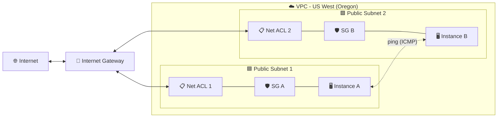
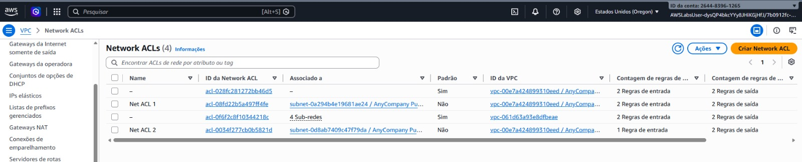
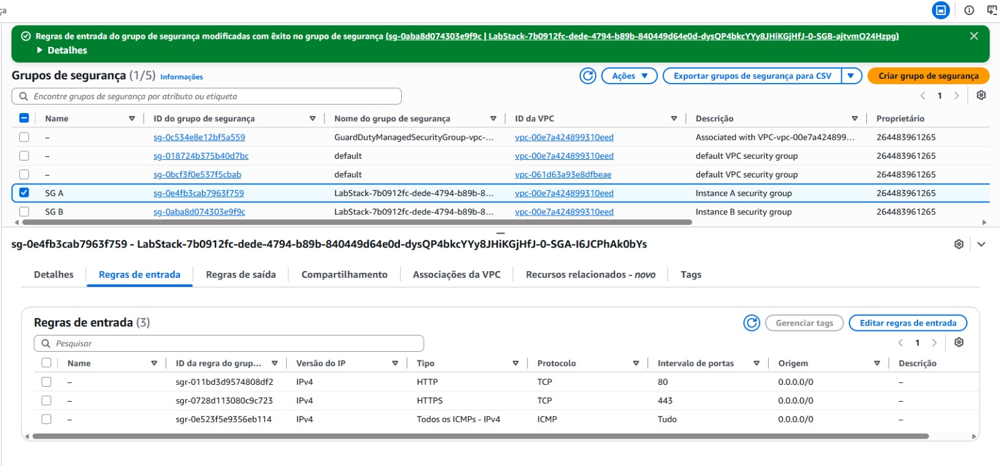
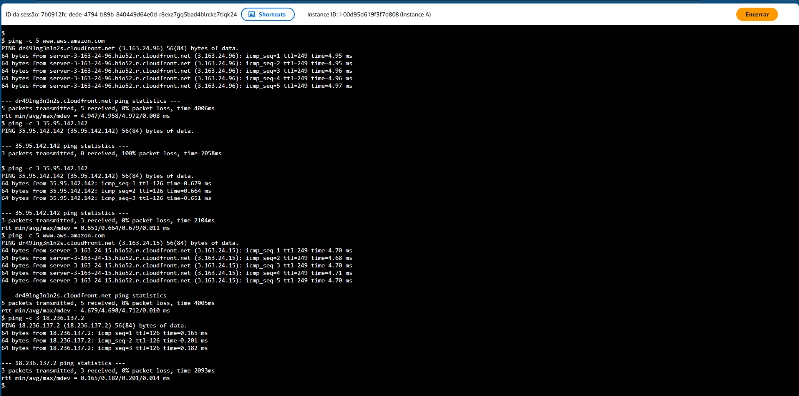

<div align="center">

# 🛡️ Configure Network ACLs and Security Groups in Amazon VPC

**Hands-on lab: controlling network traffic with Network ACLs and Security Groups in a VPC**

    

  

</div>

---

## 📑 Table of Contents

- [📖 About the Project](#-about-the-project)
- [🎯 Objectives](#-objectives)
- [🧩 Scenario](#-scenario)
- [🏗️ Architecture](#-architecture)
- [✅ Prerequisites](#-prerequisites)
- [📊 Results](#-results)
- [🔍 Validation](#-validation)
- [💡 Key Takeaways](#-key-takeaways)
- [🧹 Lab Wrap-Up](#-lab-wrap-up)
- [☁️ Services Covered](#-services-covered)
- [👤 Author](#-author)

---

## 📖 About the Project

This is an optional lab from the **AWS Skill Builder** platform, part of my preparation for the **AWS Certified Solutions Architect – Associate** exam. It lives in the `aws-sa-associate-labs` repository, under *Optional Labs*.

The exercise shows how two layers of VPC traffic filtering work together: **Network ACLs** (applied at the subnet boundary) and **Security Groups** (applied at the instance level). Two EC2 instances sit in two different public subnets, and the goal is to make them reachable from the internet and from each other, finding and fixing a blocked path along the way.

> 💬 *Network ACLs guard the door of the subnet; Security Groups guard the door of each instance — traffic needs to be allowed by both.*

---

## 🎯 Objectives

- 🧱 Create two Network ACLs and attach each to a different public subnet
- 📝 Define inbound and outbound rules for the Network ACLs
- 🔐 Add inbound rules (HTTP, HTTPS and ICMP) to the Security Groups of both instances
- 📡 Test connectivity with `ping` from the instances to the internet and between them
- 🛠️ Diagnose and fix a connectivity problem caused by missing rules

---

## 🧩 Scenario

The environment comes with a VPC that has two public subnets, each hosting one EC2 instance (Instance A and Instance B), each with its own Security Group (SG A and SG B). Both instances must be able to reach the internet and to talk to each other. You build the Network ACLs from scratch, tune the Security Groups, and use `ping` to find out where traffic is being dropped.

| Parameter | Value |
|---|---|
| Region | US West (Oregon) — as shown in the console screenshots |
| VPC | The lab's company VPC (named *UmaEmpresa* in the instructions; the console prints show a name starting with "AnyCompany") |
| Network ACL 1 | Name `Net ACL 1`; inbound rule 10 – all traffic, `0.0.0.0/0`, allow; outbound rule 10 – all traffic, `0.0.0.0/0`, allow; associated with public subnet 1 |
| Network ACL 2 | Name `Net ACL 2`; outbound rule 10 – all traffic, `0.0.0.0/0`, allow; no inbound rule at first (only the implicit deny); associated with public subnet 2 |
| Network ACL 2 – fix | Inbound rule 10 – all traffic, `0.0.0.0/0`, allow, added during the troubleshooting step |
| SG A (Instance A) | New inbound rules: HTTP (80), HTTPS (443) and all ICMP – IPv4, source anywhere IPv4 |
| SG B (Instance B) | Same three inbound rules, added during the troubleshooting step |
| Access to instances | Browser-based terminal (Session Manager) |

---

## 🏗️ Architecture



Traffic going to or from an instance passes through the **Internet Gateway**, then the **Network ACL** of the subnet, and finally the **Security Group** of the instance — and the return path crosses the same layers in reverse. Network ACLs are stateless, so both directions need explicit rules; Security Groups are stateful, so return traffic for allowed connections is automatically permitted. A missing allow rule in either layer is enough to drop the packets, which is exactly what happens to Instance B before the fix.

---

## ✅ Prerequisites

- ☑️ Access to the lab through AWS Skill Builder, with the lab started and the console opened from the lab page
- ☑️ Basic knowledge of VPC concepts: subnets, route to an Internet Gateway, public IPs
- ☑️ Familiarity with the EC2 console and with running commands in a terminal
- ☑️ Keep the Region that the lab provides (do not change it)

> ⚠️ **Warning:** the lab runs in a training environment with limited permissions. Only resources and actions enabled for the lab user are available, and the whole environment is temporary — it is removed when the lab ends.

---

## 📊 Results

### 🔹 Network ACLs created and associated

After creating the two ACLs and associating them with the public subnets, the Network ACLs list in the VPC console shows `Net ACL 1` and `Net ACL 2`, each tied to a different subnet of the lab VPC.

<div align="center">
  
  <br>
  <em>Figure 1: Network ACLs list in the Oregon Region — Net ACL 1 and Net ACL 2 associated with different subnets. Net ACL 2 shows 1 inbound rule versus 2 in the others, consistent with it still having no allow rule at this point.</em>
</div>

### 🔹 Security Group rules and update confirmation

The Security Groups page shows SG A selected, with three inbound rules open to `0.0.0.0/0`: HTTP on port 80, HTTPS on port 443, and all ICMP for IPv4. A green banner confirms that inbound rules were successfully modified for a security group.

<div align="center">
  
  <br>
  <em>Figure 2: SG A with three inbound rules (HTTP, HTTPS and ICMP) from 0.0.0.0/0. The success banner refers to a modification made on the security group labeled SG B.</em>
</div>

### 🔹 Connectivity tests

The terminal session on Instance A records the sequence of tests: `ping` to the AWS website succeeds with no packet loss; `ping` to a public IP address (Instance B's, following the lab flow) first shows 100% packet loss; after the fix, the same address answers all packets; and a final `ping` to another address also receives all replies.

<div align="center">
  
  <br>
  <em>Figure 3: Terminal on Instance A — internet ping with 0% loss, a target IP that first fails with 100% loss and then answers with 0% loss, and a final ping to another IP with 0% loss.</em>
</div>

<details>
<summary>Terminal output (text version)</summary>

```text
$ ping -c 5 www.aws.amazon.com
PING dr49lng3n1n2s.cloudfront.net (3.163.24.96) 56(84) bytes of data.
64 bytes from server-3-163-24-96.hio52.r.cloudfront.net (3.163.24.96): icmp_seq=1 ttl=249 time=4.95 ms
64 bytes from server-3-163-24-96.hio52.r.cloudfront.net (3.163.24.96): icmp_seq=2 ttl=249 time=4.95 ms
64 bytes from server-3-163-24-96.hio52.r.cloudfront.net (3.163.24.96): icmp_seq=3 ttl=249 time=4.96 ms
64 bytes from server-3-163-24-96.hio52.r.cloudfront.net (3.163.24.96): icmp_seq=4 ttl=249 time=4.96 ms
64 bytes from server-3-163-24-96.hio52.r.cloudfront.net (3.163.24.96): icmp_seq=5 ttl=249 time=4.97 ms

--- dr49lng3n1n2s.cloudfront.net ping statistics ---
5 packets transmitted, 5 received, 0% packet loss, time 4006ms
rtt min/avg/max/mdev = 4.947/4.958/4.972/0.008 ms
$ ping -c 3 35.95.142.142
PING 35.95.142.142 (35.95.142.142) 56(84) bytes of data.

--- 35.95.142.142 ping statistics ---
3 packets transmitted, 0 received, 100% packet loss, time 2058ms

$ ping -c 3 35.95.142.142
PING 35.95.142.142 (35.95.142.142) 56(84) bytes of data.
64 bytes from 35.95.142.142: icmp_seq=1 ttl=126 time=0.679 ms
64 bytes from 35.95.142.142: icmp_seq=2 ttl=126 time=0.664 ms
64 bytes from 35.95.142.142: icmp_seq=3 ttl=126 time=0.651 ms

--- 35.95.142.142 ping statistics ---
3 packets transmitted, 3 received, 0% packet loss, time 2104ms
rtt min/avg/max/mdev = 0.651/0.664/0.679/0.011 ms
$ ping -c 5 www.aws.amazon.com
PING dr49lng3n1n2s.cloudfront.net (3.163.24.15) 56(84) bytes of data.
64 bytes from server-3-163-24-15.hio52.r.cloudfront.net (3.163.24.15): icmp_seq=1 ttl=249 time=4.70 ms
64 bytes from server-3-163-24-15.hio52.r.cloudfront.net (3.163.24.15): icmp_seq=2 ttl=249 time=4.68 ms
64 bytes from server-3-163-24-15.hio52.r.cloudfront.net (3.163.24.15): icmp_seq=3 ttl=249 time=4.70 ms
64 bytes from server-3-163-24-15.hio52.r.cloudfront.net (3.163.24.15): icmp_seq=4 ttl=249 time=4.71 ms
64 bytes from server-3-163-24-15.hio52.r.cloudfront.net (3.163.24.15): icmp_seq=5 ttl=249 time=4.70 ms

--- dr49lng3n1n2s.cloudfront.net ping statistics ---
5 packets transmitted, 5 received, 0% packet loss, time 4005ms
rtt min/avg/max/mdev = 4.679/4.698/4.712/0.010 ms
$ ping -c 3 18.236.137.2
PING 18.236.137.2 (18.236.137.2) 56(84) bytes of data.
64 bytes from 18.236.137.2: icmp_seq=1 ttl=126 time=0.165 ms
64 bytes from 18.236.137.2: icmp_seq=2 ttl=126 time=0.201 ms
64 bytes from 18.236.137.2: icmp_seq=3 ttl=126 time=0.182 ms

--- 18.236.137.2 ping statistics ---
3 packets transmitted, 3 received, 0% packet loss, time 2093ms
rtt min/avg/max/mdev = 0.165/0.182/0.201/0.014 ms
$
```

</details>

---

## 🔍 Validation

| ✔️ | Item | Expected result |
|---|---|---|
| ✔️ | Net ACL 1 and Net ACL 2 exist in the lab VPC | Both appear in the Network ACLs list |
| ✔️ | Each Network ACL is associated with a different public subnet | Net ACL 1 → public subnet 1; Net ACL 2 → public subnet 2 |
| ✔️ | SG A inbound rules | HTTP, HTTPS and ICMP allowed from anywhere (IPv4) |
| ✔️ | Instance A → internet (`ping www.aws.amazon.com`) | 5 sent, 5 received, 0% loss |
| ✔️ | Instance A → Instance B before the fix | 100% packet loss |
| ✔️ | Instance A → Instance B after fixing SG B and Net ACL 2 | 3 sent, 3 received, 0% loss |

---

## 💡 Key Takeaways

- 🧱 **Network ACLs are stateless:** inbound and outbound rules are evaluated independently, so return traffic needs its own allow rule.
- 🔢 **Rule order matters:** Network ACL rules are processed from the lowest number up, and anything unmatched is denied by the implicit rule at the end.
- 🛡️ **Security Groups are stateful and allow-only:** if a connection is permitted in one direction, the response is automatically allowed; there are no deny rules.
- 🎯 **Different scopes:** Network ACLs work at the subnet level, Security Groups at the instance (network interface) level.
- 🔎 **Troubleshooting is layered:** when ping fails, check the Security Group, the Network ACL (both directions) and the routing — one missing rule is enough to cause 100% loss.
- 🧠 **Relevance for the exam:** the stateful vs. stateless distinction, rule evaluation order, allow-only Security Groups and the subnet vs. instance scope are classic Solutions Architect Associate topics, often tested through troubleshooting scenarios.

---

## 🧹 Lab Wrap-Up

The lab environment is closed through the Skill Builder lab page. Mark each item once done:

- [ ] Sign out of the AWS console (user menu → Sign out)
- [ ] Choose **End Lab** on the lab page and confirm
- [ ] Confirm that the temporary lab resources (instances, Network ACLs, Security Groups) are no longer available

---

## ☁️ Services Covered

  

| Service | Role in the lab |
|---|---|
| Amazon VPC | Hosts the subnets, the Internet Gateway, the Network ACLs and the Security Groups |
| Network ACLs | Stateless filtering at the subnet boundary |
| Security Groups | Stateful, allow-only filtering at the instance level |
| Amazon EC2 | Instances A and B, used as test endpoints |
| AWS Systems Manager – Session Manager | Browser-based terminal used to run the `ping` tests |

---

## 👤 Author

**Lucas Barretto**

[](https://www.linkedin.com/in/lucaspimentabarretto) [](https://github.com/lbarretto)

---

<div align="center">

Optional lab completed on the AWS Skill Builder platform 🚀

</div>
