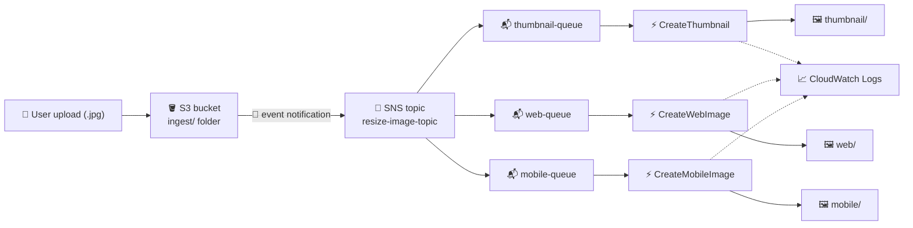

# ⚡ Build a Serverless Architecture with SNS, SQS, and Lambda

**Hands-on lab: an event-driven image-resizing pipeline using S3, SNS, SQS, and Lambda**

     

  

---

## 📑 Table of Contents

- [📖 About the Project](#-about-the-project)
- [🎯 Objectives](#-objectives)
- [🧩 Scenario](#-scenario)
- [🏗️ Architecture](#-architecture)
- [✅ Prerequisites](#-prerequisites)
- [📊 Results](#-results)
- [🔍 Validation](#-validation)
- [💡 Key Takeaways](#-key-takeaways)
- [🧹 Lab Wrap-Up](#-lab-wrap-up)
- [☁️ Services Covered](#-services-covered)
- [👤 Author](#-author)

---

## 📖 About the Project

This is an optional lab from the **AWS Skill Builder** platform, part of my preparation for the **AWS Certified Solutions Architect – Associate** exam. It belongs to the `aws-sa-associate-labs` repository, under *Optional Labs*.

The lab builds a fully serverless, event-driven pipeline: when a JPG image lands in an S3 bucket, an event notification publishes to an **SNS topic**, which fans the message out to three **SQS queues**. Each queue triggers its own **Lambda function**, and each function produces a different resized version of the image (thumbnail, web, and mobile) and saves it back to the bucket.

> 💬 *One upload, one notification, three independent consumers — SNS and SQS decouple the producer from the workers.*

---

## 🎯 Objectives

- 📣 Create a standard SNS topic to receive upload notifications
- 📬 Create three standard SQS queues and subscribe each one to the topic
- 🔐 Update the SNS topic access policy so S3 is allowed to publish to it
- 🪣 Configure an S3 event notification filtered by prefix and suffix
- ⚡ Create three Lambda functions triggered by SQS, using prebuilt deployment packages
- 📈 Upload an image and validate the result through CloudWatch Logs and the S3 bucket

---

## 🧩 Scenario

An ingest bucket receives images, and each new image must be turned into three sizes automatically, without any servers to manage. S3 notifies a single SNS topic; the topic delivers a copy of the message to each of three queues; and one Lambda function per queue handles one output size.

| Parameter | Value |
|---|---|
| Region | The one provided by the lab (not changed during the exercise) |
| SNS topic | Standard type, named `resize-image-topic-` plus four random digits |
| SQS queues | `thumbnail-queue`, `web-queue` and `mobile-queue` (standard, default settings), all subscribed to the topic |
| S3 bucket | Pre-created ingest bucket with a name in the pattern `xxxxx-labbucket-xxxxx` |
| S3 event notification | Name `resize-image-event`; prefix `ingest/`; suffix `.jpg`; all object-creation events; destination: the SNS topic |
| Topic access policy | Replaced so that the S3 service can publish to the topic, restricted to the lab's own account |
| Lambda functions | `CreateThumbnail`, `CreateWebImage` and `CreateMobileImage` — Python 3.11, one per queue, batch size 1 |
| Handlers | `CreateThumbnail.handler`, `CreateWebImage.handler`, `CreateMobileImage.handler` |
| Execution role | Existing role with a name similar to `xxxxx-LabExecutionRole-xxxxx`, with access to S3 and SQS |
| Output folders | `thumbnail`, `web` and `mobile` inside the same bucket |
| Test file | A `.jpg` image uploaded to the `ingest/` folder (`.jpeg` would not match the suffix filter) |

---

## 🏗️ Architecture

Uploading a `.jpg` to the `ingest/` folder triggers an S3 event notification that publishes to the SNS topic. Because all three queues are subscribed, each receives its own copy of the message (the fan-out pattern). Each Lambda function polls its queue, reads the original image from S3, resizes it, and writes the result to its own folder in the bucket. Every function also sends its logs to CloudWatch Logs, which is where the processing is verified.

---

## ✅ Prerequisites

- ☑️ Access to the lab through AWS Skill Builder, with the lab started and the console opened from the lab page
- ☑️ Basic knowledge of S3, SNS, SQS and Lambda concepts
- ☑️ A test image saved locally with the `.jpg` extension
- ☑️ The deployment packages (`.zip` files) for the three functions, supplied by the lab
- ☑️ Keep the Region that the lab provides (do not change it)

> ⚠️ **Warning:** the lab runs in a training environment with limited permissions. Only resources and actions enabled for the lab user are available (for example, the pre-created execution role and bucket), and the whole environment is temporary — it is removed when the lab ends.

---

## 📊 Results

This lab was documented without screenshots, so the results are summarized below as test → outcome.

| Test | Result |
|---|---|
| Create the standard SNS topic | Topic created; its name, ARN and owner account appear in the topic details |
| Create the three SQS queues | `thumbnail-queue`, `web-queue` and `mobile-queue` created with default settings |
| Subscribe each queue to the topic | The console confirms a successful subscription for each queue |
| Update the topic access policy | Topic saved with a policy that lets S3 publish to it |
| Create the S3 event notification | `resize-image-event` created, filtered by prefix `ingest/` and suffix `.jpg` |
| Create the three Lambda functions with SQS triggers | Functions created, packages uploaded and handlers set |
| Upload a `.jpg` to `ingest/` | Upload completed successfully |
| Check CloudWatch Logs for each function | Each function was invoked, and its log stream shows the execution details |
| Check the bucket for processed files | `thumbnail`, `web` and `mobile` folders appear, each with a resized version of the image |

---

## 🔍 Validation

| ✔️ | Item | Expected result |
|---|---|---|
| ✔️ | SNS topic | Standard topic exists and its ARN/owner were noted for later steps |
| ✔️ | SQS subscriptions | The three queues are subscribed to the topic |
| ✔️ | Topic access policy | Both placeholders (topic ARN and owner account) were replaced and the policy saved |
| ✔️ | S3 event notification | Configured for `ingest/` + `.jpg`, with the SNS topic as destination |
| ✔️ | Lambda triggers | Each function has its own SQS queue as trigger, with batch size 1 |
| ✔️ | Handler names | Each handler matches its file name (e.g. `CreateThumbnail.handler`) |
| ✔️ | Upload test | A `.jpg` placed in `ingest/` starts the whole chain |
| ✔️ | CloudWatch Logs | Logs show an invocation and a REPORT line for the functions |
| ✔️ | Output in S3 | Folders `thumbnail`, `web` and `mobile` contain the resized images |

---

## 💡 Key Takeaways

- 📢 **Fan-out with SNS + SQS:** a single published message is delivered to multiple queues, so several consumers can process the same event independently.
- 🔗 **Decoupling:** the queues sit between the topic and the functions, buffering messages so a slow or failing consumer does not affect the others.
- 🔐 **Resource policies matter:** S3 could only publish to the topic after the topic's access policy explicitly allowed it, scoped to the lab account.
- 🎯 **Event filters:** prefix and suffix filters limit which objects generate notifications, avoiding unnecessary invocations.
- ⚡ **Lambda event source mapping:** Lambda polls the SQS queue and invokes the function with batches of messages (here, one at a time).
- 🛠️ **Handler naming:** if the configured handler does not match the file and function name, Lambda cannot find the code.
- 📈 **Observability:** CloudWatch Logs and the Monitor tab are the first places to check invocations, durations and errors.
- 🧠 **Relevance for the exam:** SNS/SQS fan-out, S3 event notifications, Lambda with SQS triggers and loosely coupled, serverless designs are frequent Solutions Architect Associate topics.

---

## 🧹 Lab Wrap-Up

The lab environment is closed through the Skill Builder lab page. Mark each item once done:

- [ ] Sign out of the AWS console (user menu → Sign out)
- [ ] Choose **End Lab** on the lab page and confirm
- [ ] Confirm that the temporary lab resources (topic, queues, functions, bucket) are no longer available

---

## ☁️ Services Covered

    

| Service | Role in the lab |
|---|---|
| Amazon S3 | Stores the original image (`ingest/`) and the resized outputs; emits the event notification |
| Amazon SNS | Receives the S3 notification and fans it out to the queues |
| Amazon SQS | Three queues that buffer messages for each Lambda function |
| AWS Lambda | Three functions that resize the image into thumbnail, web and mobile versions |
| Amazon CloudWatch Logs | Holds the function logs used to validate the processing |
| AWS IAM (execution role) | Gives the functions access to S3 and SQS |

---

## 👤 Author

**Lucas Barretto**

 

---

Optional lab completed on the AWS Skill Builder platform 🚀

