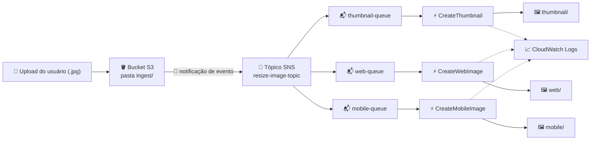

# ⚡ Construir uma Arquitetura Serverless com SNS, SQS e Lambda

**Laboratório prático: um pipeline orientado a eventos para redimensionar imagens usando S3, SNS, SQS e Lambda**

     

  -555555?style=flat-square)

---

## 📑 Sumário

- [📖 Sobre o Projeto](#-sobre-o-projeto)
- [🎯 Objetivos](#-objetivos)
- [🧩 Cenário](#-cenário)
- [🏗️ Arquitetura](#-arquitetura)
- [✅ Pré-requisitos](#-pré-requisitos)
- [📊 Resultado](#-resultado)
- [🔍 Validação](#-validação)
- [💡 Principais Aprendizados](#-principais-aprendizados)
- [🧹 Encerramento do Laboratório](#-encerramento-do-laboratório)
- [☁️ Serviços Abordados](#-serviços-abordados)
- [👤 Autor](#-autor)

---

## 📖 Sobre o Projeto

Este é um laboratório opcional da plataforma **AWS Skill Builder**, parte da minha preparação para a certificação **AWS Certified Solutions Architect – Associate**. Ele faz parte do repositório `aws-sa-associate-labs`, na pasta *Optional Labs*.

O laboratório monta um pipeline totalmente serverless e orientado a eventos: quando uma imagem JPG chega a um bucket do S3, uma notificação de evento publica em um **tópico do SNS**, que distribui a mensagem para três **filas do SQS**. Cada fila dispara sua própria **função Lambda**, e cada função gera uma versão redimensionada diferente da imagem (miniatura, web e mobile) e a salva de volta no bucket.

> 💬 *Um upload, uma notificação, três consumidores independentes — SNS e SQS desacoplam quem produz de quem processa.*

---

## 🎯 Objetivos

- 📣 Criar um tópico padrão do SNS para receber as notificações de upload
- 📬 Criar três filas padrão do SQS e inscrever cada uma no tópico
- 🔐 Atualizar a política de acesso do tópico para que o S3 possa publicar nele
- 🪣 Configurar uma notificação de evento do S3 filtrada por prefixo e sufixo
- ⚡ Criar três funções Lambda acionadas pelo SQS, usando pacotes de implantação prontos
- 📈 Fazer o upload de uma imagem e validar o resultado pelo CloudWatch Logs e pelo bucket do S3

---

## 🧩 Cenário

Um bucket de ingestão recebe imagens, e cada nova imagem precisa virar três tamanhos automaticamente, sem servidores para gerenciar. O S3 notifica um único tópico do SNS; o tópico entrega uma cópia da mensagem a cada uma das três filas; e uma função Lambda por fila cuida de um tamanho de saída.

| Parâmetro | Valor |
|---|---|
| Região | A fornecida pelo laboratório (não foi alterada durante o exercício) |
| Tópico do SNS | Tipo padrão, com nome `resize-image-topic-` seguido de quatro números aleatórios |
| Filas do SQS | `thumbnail-queue`, `web-queue` e `mobile-queue` (padrão, configurações default), todas inscritas no tópico |
| Bucket do S3 | Bucket de ingestão já criado, com nome no padrão `xxxxx-labbucket-xxxxx` |
| Notificação de evento do S3 | Nome `resize-image-event`; prefixo `ingest/`; sufixo `.jpg`; todos os eventos de criação de objeto; destino: o tópico do SNS |
| Política de acesso do tópico | Substituída para permitir que o serviço S3 publique no tópico, restrita à conta do próprio laboratório |
| Funções Lambda | `CreateThumbnail`, `CreateWebImage` e `CreateMobileImage` — Python 3.11, uma por fila, tamanho de lote 1 |
| Handlers | `CreateThumbnail.handler`, `CreateWebImage.handler`, `CreateMobileImage.handler` |
| Perfil de execução | Perfil existente com nome semelhante a `xxxxx-LabExecutionRole-xxxxx`, com acesso ao S3 e ao SQS |
| Pastas de saída | `thumbnail`, `web` e `mobile` no mesmo bucket |
| Arquivo de teste | Uma imagem `.jpg` enviada à pasta `ingest/` (`.jpeg` não atenderia ao filtro de sufixo) |

---

## 🏗️ Arquitetura

O upload de um `.jpg` na pasta `ingest/` dispara uma notificação de evento do S3 que publica no tópico do SNS. Como as três filas estão inscritas, cada uma recebe a sua própria cópia da mensagem (padrão fan-out). Cada função Lambda lê a sua fila, busca a imagem original no S3, redimensiona e grava o resultado na própria pasta do bucket. Todas as funções também enviam seus logs ao CloudWatch Logs, que é onde o processamento é verificado.

---

## ✅ Pré-requisitos

- ☑️ Acesso ao laboratório pelo AWS Skill Builder, com o laboratório iniciado e o console aberto a partir da página do lab
- ☑️ Noções básicas de S3, SNS, SQS e Lambda
- ☑️ Uma imagem de teste salva localmente com a extensão `.jpg`
- ☑️ Os pacotes de implantação (`.zip`) das três funções, fornecidos pelo laboratório
- ☑️ Manter a Região fornecida pelo laboratório (não alterá-la)

> ⚠️ **Aviso:** o laboratório roda em um ambiente de capacitação com permissões limitadas. Apenas os recursos e ações habilitados para o usuário do lab estão disponíveis (por exemplo, o perfil de execução e o bucket já criados), e todo o ambiente é temporário — ele é removido quando o laboratório termina.

---

## 📊 Resultado

Este laboratório foi documentado sem prints, então os resultados estão resumidos abaixo no formato teste → resultado.

| Teste | Resultado |
|---|---|
| Criar o tópico padrão do SNS | Tópico criado; nome, ARN e conta proprietária aparecem nos detalhes do tópico |
| Criar as três filas do SQS | `thumbnail-queue`, `web-queue` e `mobile-queue` criadas com as configurações padrão |
| Inscrever cada fila no tópico | O console confirma a inscrição bem-sucedida de cada fila |
| Atualizar a política de acesso do tópico | Tópico salvo com uma política que permite ao S3 publicar nele |
| Criar a notificação de evento do S3 | `resize-image-event` criada, filtrada por prefixo `ingest/` e sufixo `.jpg` |
| Criar as três funções Lambda com gatilhos SQS | Funções criadas, pacotes enviados e handlers definidos |
| Enviar um `.jpg` para `ingest/` | Upload concluído com sucesso |
| Verificar o CloudWatch Logs de cada função | Cada função foi invocada, e o log stream mostra os detalhes da execução |
| Verificar o bucket com os arquivos processados | Pastas `thumbnail`, `web` e `mobile` aparecem, cada uma com uma versão redimensionada da imagem |

---

## 🔍 Validação

| ✔️ | Item | Resultado esperado |
|---|---|---|
| ✔️ | Tópico do SNS | Tópico padrão existe e seu ARN/proprietário foram anotados para as etapas seguintes |
| ✔️ | Inscrições do SQS | As três filas estão inscritas no tópico |
| ✔️ | Política de acesso do tópico | Os dois espaços reservados (ARN do tópico e conta proprietária) foram substituídos e a política foi salva |
| ✔️ | Notificação de evento do S3 | Configurada para `ingest/` + `.jpg`, com o tópico do SNS como destino |
| ✔️ | Gatilhos do Lambda | Cada função tem sua própria fila SQS como gatilho, com tamanho de lote 1 |
| ✔️ | Nomes dos handlers | Cada handler corresponde ao nome do arquivo (ex.: `CreateThumbnail.handler`) |
| ✔️ | Teste de upload | Um `.jpg` colocado em `ingest/` inicia toda a cadeia |
| ✔️ | CloudWatch Logs | Os logs mostram uma invocação e uma linha REPORT para as funções |
| ✔️ | Saída no S3 | As pastas `thumbnail`, `web` e `mobile` contêm as imagens redimensionadas |

---

## 💡 Principais Aprendizados

- 📢 **Fan-out com SNS + SQS:** uma única mensagem publicada é entregue a várias filas, permitindo que vários consumidores processem o mesmo evento de forma independente.
- 🔗 **Desacoplamento:** as filas ficam entre o tópico e as funções, armazenando as mensagens, de modo que um consumidor lento ou com falha não afeta os demais.
- 🔐 **Políticas de recurso importam:** o S3 só conseguiu publicar no tópico depois que a política de acesso do tópico permitiu isso explicitamente, restrita à conta do lab.
- 🎯 **Filtros de evento:** filtros de prefixo e sufixo limitam quais objetos geram notificações, evitando invocações desnecessárias.
- ⚡ **Mapeamento de origem de eventos do Lambda:** o Lambda lê a fila SQS e invoca a função com lotes de mensagens (aqui, uma por vez).
- 🛠️ **Nome do handler:** se o handler configurado não corresponder ao nome do arquivo e da função, o Lambda não encontra o código.
- 📈 **Observabilidade:** o CloudWatch Logs e a aba Monitorar são os primeiros lugares para checar invocações, duração e erros.
- 🧠 **Relevância para a prova:** fan-out SNS/SQS, notificações de evento do S3, Lambda com gatilho SQS e arquiteturas serverless e fracamente acopladas são temas frequentes no Solutions Architect Associate.

---

## 🧹 Encerramento do Laboratório

O ambiente do laboratório é encerrado pela página do lab no Skill Builder. Marque cada item quando concluir:

- [ ] Sair do console da AWS (menu do usuário → Sign out)
- [ ] Escolher **End Lab** na página do laboratório e confirmar
- [ ] Confirmar que os recursos temporários do lab (tópico, filas, funções, bucket) não estão mais disponíveis

---

## ☁️ Serviços Abordados

    

| Serviço | Papel no laboratório |
|---|---|
| Amazon S3 | Armazena a imagem original (`ingest/`) e as saídas redimensionadas; emite a notificação de evento |
| Amazon SNS | Recebe a notificação do S3 e a distribui às filas |
| Amazon SQS | Três filas que armazenam as mensagens de cada função Lambda |
| AWS Lambda | Três funções que redimensionam a imagem em versões miniatura, web e mobile |
| Amazon CloudWatch Logs | Guarda os logs das funções usados para validar o processamento |
| AWS IAM (perfil de execução) | Dá às funções acesso ao S3 e ao SQS |

---

## 👤 Autor

**Lucas Barretto**

 

---

Laboratório opcional realizado na plataforma AWS Skill Builder 🚀

