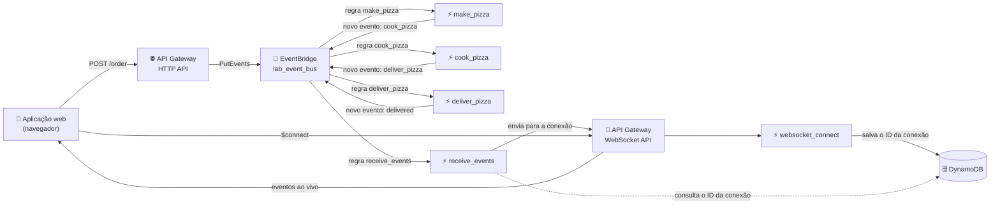

# 🍕 Arquitetura Orientada a Eventos com API Gateway, EventBridge e Lambda

**Laboratório prático: um fluxo serverless e orientado a eventos de pedido de pizza, com atualizações em tempo real via WebSocket**

     

  

---

## 📑 Índice

- [📖 Sobre o Projeto](#-sobre-o-projeto)
- [🎯 Objetivos](#-objetivos)
- [🧩 Cenário](#-cenário)
- [🏗️ Arquitetura](#-arquitetura)
- [✅ Pré-requisitos](#-pré-requisitos)
- [📊 Resultados](#-resultados)
- [🔍 Validação](#-validação)
- [💡 Principais Aprendizados](#-principais-aprendizados)
- [🧹 Encerramento do Lab](#-encerramento-do-lab)
- [☁️ Serviços Abordados](#-serviços-abordados)
- [👤 Autor](#-autor)

---

## 📖 Sobre o Projeto

Este é um laboratório opcional da plataforma **AWS Skill Builder**, parte da minha preparação para o exame **AWS Certified Solutions Architect – Associate**. Ele pertence ao repositório `aws-sa-associate-labs`, na seção *Optional Labs*.

O laboratório combina microsserviços, design orientado a eventos e computação serverless. Uma **HTTP API** no API Gateway encaminha cada pedido diretamente para um **barramento de eventos do EventBridge**; regras no barramento acionam funções **Lambda** que levam o pedido por três etapas, cada uma publicando um novo evento de volta no barramento. Em paralelo, uma **WebSocket API** mantém uma conexão ativa com o navegador, de modo que cada evento é enviado ao cliente assim que acontece.

> 💬 *Em um design orientado a eventos, produtores e consumidores nunca se chamam diretamente — eles apenas reagem a eventos em um barramento compartilhado.*

---

## 🎯 Objetivos

- ⚡ Criar funções Lambda e configurar suas variáveis de ambiente
- 🚌 Criar um barramento de eventos do EventBridge e regras que roteiam eventos para destinos Lambda
- 🌐 Criar uma HTTP API no API Gateway integrada diretamente ao EventBridge
- 🔌 Criar uma WebSocket API que armazena o ID de cada conexão no DynamoDB
- 🧪 Testar o fluxo completo a partir de uma aplicação web e acompanhar a chegada dos eventos em tempo real

---

## 🧩 Cenário

Um cliente "pede uma pizza" em uma pequena aplicação web. O pedido passa por três etapas — preparar, assar e entregar — e o navegador deve exibir cada etapa ao vivo. Cada etapa é tratada por sua própria função Lambda, e as etapas são encadeadas apenas por eventos no barramento. Uma função separada encaminha cada evento ao navegador pela conexão WebSocket.

| Parâmetro | Valor |
|---|---|
| Região | Oeste dos EUA (Oregon), `us-west-2` — conforme visto nas URLs de endpoint exibidas na aplicação de teste |
| Runtime do Lambda | Python 3.12, usando funções de execução pré-criadas (`lab_lambda_*`) |
| Funções Lambda | `make_pizza`, `cook_pizza`, `deliver_pizza`, `websocket_connect`, `receive_events` |
| Variáveis de ambiente | `EVENT_BUS` = `lab_event_bus` (as três funções de etapa); `TABLENAME` = `websocket_connections` (`websocket_connect` e `receive_events`); `APIGW_ENDPOINT` = URL de conexão do WebSocket (`receive_events`) |
| Barramento de eventos | `lab_event_bus` |
| Regras | `lab_make_pizza_rule`, `lab_cook_pizza_rule`, `lab_deliver_pizza_rule` (cada uma corresponde a um valor de `eventtype`) e `lab_receive_events_rule` (corresponde aos três valores) |
| Padrão de evento | Corresponde a `eventtype` aninhado em `detail.item`, portanto a regra deve seguir o mesmo aninhamento |
| HTTP API | `lab_http_api`, rota `POST` integrada ao `PutEvents` do EventBridge; detail = corpo da requisição, detail type `eventtype`, source `lab_http_api`; CORS habilitado |
| WebSocket API | `lab_websocket_api`, expressão de seleção de rota `request.body.action`, rota `$connect` → `websocket_connect`, stage `production` |
| Tabela do DynamoDB | `websocket_connections` (mapeia cada `order_id` ao ID de conexão WebSocket correspondente) |
| Pedido de teste | `order_id` `4AB`, `eventtype` inicial `make_pizza` |

---

## 🏗️ Arquitetura

Quando o usuário clica no botão de pedido, a aplicação primeiro abre a conexão WebSocket; `websocket_connect` armazena o ID da conexão no DynamoDB, associado ao pedido. Em seguida, a aplicação chama a HTTP API, que coloca o pedido no barramento de eventos como um evento `make_pizza`. A regra correspondente aciona `make_pizza`, que publica um evento `cook_pizza`; este aciona `cook_pizza`, que publica `deliver_pizza`; e `deliver_pizza` publica um evento final `delivered` que nenhuma regra captura, encerrando a cadeia. Como `lab_receive_events_rule` corresponde aos três valores de etapa, duas funções são executadas em paralelo para cada evento: o tratador da etapa e `receive_events`, que consulta o ID da conexão e envia o evento ao navegador.

---

## ✅ Pré-requisitos

- ☑️ Acesso ao laboratório pelo AWS Skill Builder, com o lab iniciado e o console aberto a partir da página do lab
- ☑️ Um computador com Windows, macOS ou Linux e um navegador moderno (Chrome ou Firefox)
- ☑️ Conhecimento básico de Lambda, API Gateway e conceitos de arquitetura orientada a eventos
- ☑️ Manter a Região fornecida pelo lab (não alterá-la)
- ⏱️ Cerca de 45 minutos, de acordo com o lab

> ⚠️ **Aviso:** o lab é executado em um ambiente de treinamento com permissões limitadas. Apenas os recursos e ações habilitados para o usuário do lab estão disponíveis (por exemplo, as funções de execução do Lambda pré-criadas e o servidor web de teste), e todo o ambiente é temporário — ele é removido quando o lab termina.

---

## 📊 Resultados

### 🔹 Teste de pedido na aplicação web

Depois de conectar todos os componentes, a aplicação web de teste recebeu a URL da HTTP API e a URL do WebSocket. Ao clicar no botão de pedido para o pedido `4AB`, a sequência de eventos foi exibida na área Events.

  
   
  <em>Figura 1: Aplicação web de teste com as URLs da API e do WebSocket preenchidas (us-west-2) e a área Events listando três eventos para o pedido 4AB: make_pizza, cook_pizza e deliver_pizza.</em>

---

## 🔍 Validação

| ✔️ | Item | Resultado esperado |
|---|---|---|
| ✔️ | Funções Lambda | As cinco funções existem, com o código implantado e as variáveis de ambiente definidas |
| ✔️ | Barramento de eventos | `lab_event_bus` existe e seu ARN foi salvo para a integração da HTTP API |
| ✔️ | Regras do EventBridge | Quatro regras existem no barramento, cada uma com o padrão correto e o destino Lambda correto |
| ✔️ | HTTP API | Rota `POST` integrada ao `PutEvents` do EventBridge, com CORS configurado |
| ✔️ | WebSocket API | A rota `$connect` chama `websocket_connect`; stage `production` implantado |
| ✔️ | Configuração de `receive_events` | `APIGW_ENDPOINT` contém a URL de conexão do WebSocket (sem a parte `@connections`) |
| ✔️ | Teste de ponta a ponta | O pedido `4AB` exibe os eventos `make_pizza`, `cook_pizza` e `deliver_pizza` na aplicação web |

---

## 💡 Principais Aprendizados

- 🚌 **O barramento de eventos como espinha dorsal:** os serviços se comunicam publicando e reagindo a eventos, o que mantém produtores e consumidores totalmente desacoplados.
- 🧬 **Padrões de evento devem espelhar a estrutura:** as regras só correspondem quando o padrão segue o mesmo aninhamento do detail do evento, e não apenas o valor.
- 🔁 **Coreografia encadeada:** cada função altera o tipo do evento e publica um novo evento, de modo que a próxima regra é disparada sem que nenhuma função chame outra.
- 👯 **Consumidores em paralelo:** um evento pode corresponder a várias regras ao mesmo tempo, de modo que destinos diferentes processam o mesmo evento simultaneamente.
- 🌐 **Integração direta entre serviços:** uma HTTP API do API Gateway pode enviar requisições ao EventBridge sem uma função Lambda intermediária.
- 💸 **HTTP API vs. REST API:** as HTTP APIs oferecem menos recursos, mas foram projetadas para custar menos; as REST APIs oferecem mais funcionalidades.
- 🔌 **WebSocket para push:** uma conexão persistente permite que o backend envie eventos ao navegador; o ID da conexão precisa ser armazenado para poder ser localizado depois (aqui, no DynamoDB).
- 🧠 **Relevância para o exame:** regras e barramentos do EventBridge, tipos de API do API Gateway, integração serverless e designs fracamente acoplados e orientados a eventos são tópicos frequentes no exame Solutions Architect Associate.

---

## 🧹 Encerramento do Lab

O ambiente do lab é encerrado pela página do lab no Skill Builder. Marque cada item após concluí-lo:

- [ ] Sair do console da AWS (menu do usuário → Sign out)
- [ ] Escolher **End Lab** na página do lab e confirmar
- [ ] Confirmar que os recursos temporários do lab (funções, barramento, APIs, servidor web) não estão mais disponíveis

---

## ☁️ Serviços Abordados

   

| Serviço | Papel no lab |
|---|---|
| Amazon API Gateway (HTTP API) | Recebe a requisição do pedido e a encaminha ao EventBridge |
| Amazon API Gateway (WebSocket API) | Mantém a conexão persistente com o navegador e entrega os eventos ao vivo |
| Amazon EventBridge | Barramento de eventos e regras que roteiam cada evento para a função Lambda correta |
| AWS Lambda | Funções de etapa (preparar, assar, entregar), tratador de conexão e encaminhador de eventos |
| Amazon DynamoDB | Armazena o mapeamento entre cada pedido e o ID de sua conexão WebSocket |

---

## 👤 Autor

**Lucas Barretto**

 

---

Laboratório opcional concluído na plataforma AWS Skill Builder 🚀

