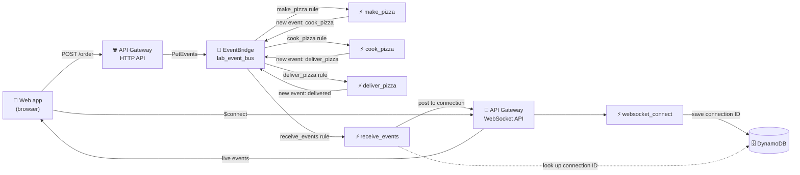
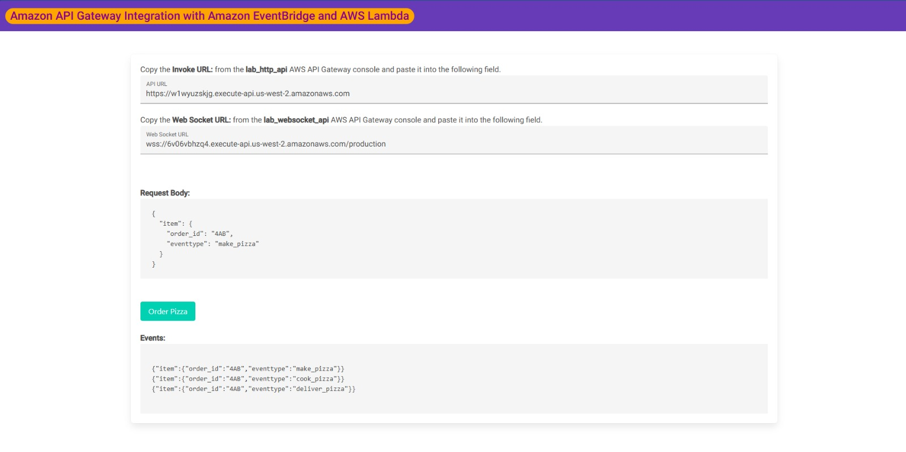

# 🍕 Event-Driven Architecture with API Gateway, EventBridge and Lambda

**Hands-on lab: a serverless, event-driven pizza-order workflow with real-time updates over WebSocket**

     

  

---

## 📑 Table of Contents

- [📖 About the Project](#-about-the-project)
- [🎯 Objectives](#-objectives)
- [🧩 Scenario](#-scenario)
- [🏗️ Architecture](#-architecture)
- [✅ Prerequisites](#-prerequisites)
- [📊 Results](#-results)
- [🔍 Validation](#-validation)
- [💡 Key Takeaways](#-key-takeaways)
- [🧹 Lab Wrap-Up](#-lab-wrap-up)
- [☁️ Services Covered](#-services-covered)
- [👤 Author](#-author)

---

## 📖 About the Project

This is an optional lab from the **AWS Skill Builder** platform, part of my preparation for the **AWS Certified Solutions Architect – Associate** exam. It belongs to the `aws-sa-associate-labs` repository, under *Optional Labs*.

The lab combines microservices, event-driven design and serverless computing. An **HTTP API** in API Gateway forwards each order straight to an **EventBridge** event bus; rules on the bus trigger **Lambda** functions that move the order through three stages, each one publishing a new event back to the bus. In parallel, a **WebSocket API** keeps a live connection with the browser, so every event is pushed to the client as soon as it happens.

> 💬 *In an event-driven design, producers and consumers never call each other directly — they only react to events on a shared bus.*

---

## 🎯 Objectives

- ⚡ Create Lambda functions and configure their environment variables
- 🚌 Create an EventBridge event bus and rules that route events to Lambda targets
- 🌐 Create an HTTP API in API Gateway integrated directly with EventBridge
- 🔌 Create a WebSocket API that stores each connection ID in DynamoDB
- 🧪 Test the full flow from a web app and watch the events arrive in real time

---

## 🧩 Scenario

A customer "orders a pizza" from a small web app. The order moves through three stages — make, cook and deliver — and the browser must show every stage live. Each stage is handled by its own Lambda function, and the stages are chained only through events on the bus. A separate function forwards every event to the browser over the WebSocket connection.

| Parameter | Value |
|---|---|
| Region | US West (Oregon), `us-west-2` — as seen in the endpoint URLs shown in the test app |
| Lambda runtime | Python 3.12, using pre-created execution roles (`lab_lambda_*`) |
| Lambda functions | `make_pizza`, `cook_pizza`, `deliver_pizza`, `websocket_connect`, `receive_events` |
| Environment variables | `EVENT_BUS` = `lab_event_bus` (the three stage functions); `TABLENAME` = `websocket_connections` (`websocket_connect` and `receive_events`); `APIGW_ENDPOINT` = WebSocket connection URL (`receive_events`) |
| Event bus | `lab_event_bus` |
| Rules | `lab_make_pizza_rule`, `lab_cook_pizza_rule`, `lab_deliver_pizza_rule` (each matches one `eventtype` value) and `lab_receive_events_rule` (matches all three values) |
| Event pattern | Matches `eventtype` nested under `detail.item`, so the rule must follow the same nesting |
| HTTP API | `lab_http_api`, `POST` route integrated with EventBridge `PutEvents`; detail = request body, detail type `eventtype`, source `lab_http_api`; CORS enabled |
| WebSocket API | `lab_websocket_api`, route selection expression `request.body.action`, `$connect` route → `websocket_connect`, stage `production` |
| DynamoDB table | `websocket_connections` (maps each `order_id` to its WebSocket connection ID) |
| Test order | `order_id` `4AB`, initial `eventtype` `make_pizza` |

---

## 🏗️ Architecture

When the user clicks the order button, the app first opens the WebSocket connection; `websocket_connect` stores the connection ID in DynamoDB, keyed by order. The app then calls the HTTP API, which puts the order on the event bus as a `make_pizza` event. The matching rule triggers `make_pizza`, which publishes a `cook_pizza` event; that triggers `cook_pizza`, which publishes `deliver_pizza`; and `deliver_pizza` publishes a final `delivered` event that no rule picks up, ending the chain. Because `lab_receive_events_rule` matches all three stage values, two functions run in parallel for each event: the stage handler and `receive_events`, which looks up the connection ID and pushes the event to the browser.

---

## ✅ Prerequisites

- ☑️ Access to the lab through AWS Skill Builder, with the lab started and the console opened from the lab page
- ☑️ A computer with Windows, macOS or Linux and a modern browser (Chrome or Firefox)
- ☑️ Basic knowledge of Lambda, API Gateway and event-driven concepts
- ☑️ Keep the Region that the lab provides (do not change it)
- ⏱️ About 45 minutes, according to the lab

> ⚠️ **Warning:** the lab runs in a training environment with limited permissions. Only resources and actions enabled for the lab user are available (for example, the pre-created Lambda execution roles and the test web server), and the whole environment is temporary — it is removed when the lab ends.

---

## 📊 Results

### 🔹 Order test in the web app

After wiring everything together, the test web app received the HTTP API URL and the WebSocket URL. Clicking the order button for order `4AB` produced the sequence of events in the Events area.

  
   
  <em>Figure 1: Test web app with the API and WebSocket URLs filled in (us-west-2) and the Events area listing three events for order 4AB: make_pizza, cook_pizza and deliver_pizza.</em>

---

## 🔍 Validation

| ✔️ | Item | Expected result |
|---|---|---|
| ✔️ | Lambda functions | The five functions exist, with their code deployed and environment variables set |
| ✔️ | Event bus | `lab_event_bus` exists and its ARN was saved for the HTTP API integration |
| ✔️ | EventBridge rules | Four rules exist on the bus, each with the right pattern and Lambda target |
| ✔️ | HTTP API | `POST` route integrated with EventBridge `PutEvents`, with CORS configured |
| ✔️ | WebSocket API | `$connect` route calls `websocket_connect`; `production` stage deployed |
| ✔️ | `receive_events` configuration | `APIGW_ENDPOINT` holds the WebSocket connection URL (without the `@connections` part) |
| ✔️ | End-to-end test | Order `4AB` shows `make_pizza`, `cook_pizza` and `deliver_pizza` events in the web app |

---

## 💡 Key Takeaways

- 🚌 **Event bus as the backbone:** services communicate by publishing and reacting to events, which keeps producers and consumers fully decoupled.
- 🧬 **Event patterns must mirror the structure:** the rules only match when the pattern follows the same nesting as the event's detail, not just the value.
- 🔁 **Chained choreography:** each function changes the event type and publishes a new event, so the next rule fires without any function calling another.
- 👯 **Parallel consumers:** one event can match several rules at once, so different targets process the same event simultaneously.
- 🌐 **Direct service integration:** an API Gateway HTTP API can send requests to EventBridge without an intermediate Lambda function.
- 💸 **HTTP API vs. REST API:** HTTP APIs offer fewer features but are designed to cost less; REST APIs support more capabilities.
- 🔌 **WebSocket for push:** a persistent connection lets the backend send events to the browser; the connection ID must be stored so it can be found later (here, in DynamoDB).
- 🧠 **Relevance for the exam:** EventBridge rules and buses, API Gateway API types, serverless integration and loosely coupled, event-driven designs are frequent Solutions Architect Associate topics.

---

## 🧹 Lab Wrap-Up

The lab environment is closed through the Skill Builder lab page. Mark each item once done:

- [ ] Sign out of the AWS console (user menu → Sign out)
- [ ] Choose **End Lab** on the lab page and confirm
- [ ] Confirm that the temporary lab resources (functions, bus, APIs, web server) are no longer available

---

## ☁️ Services Covered

   

| Service | Role in the lab |
|---|---|
| Amazon API Gateway (HTTP API) | Receives the order request and forwards it to EventBridge |
| Amazon API Gateway (WebSocket API) | Keeps the persistent connection with the browser and delivers live events |
| Amazon EventBridge | Event bus and rules that route each event to the right Lambda function |
| AWS Lambda | Stage functions (make, cook, deliver), connection handler and event forwarder |
| Amazon DynamoDB | Stores the mapping between each order and its WebSocket connection ID |

---

## 👤 Author

**Lucas Barretto**

 

---

Optional lab completed on the AWS Skill Builder platform 🚀

