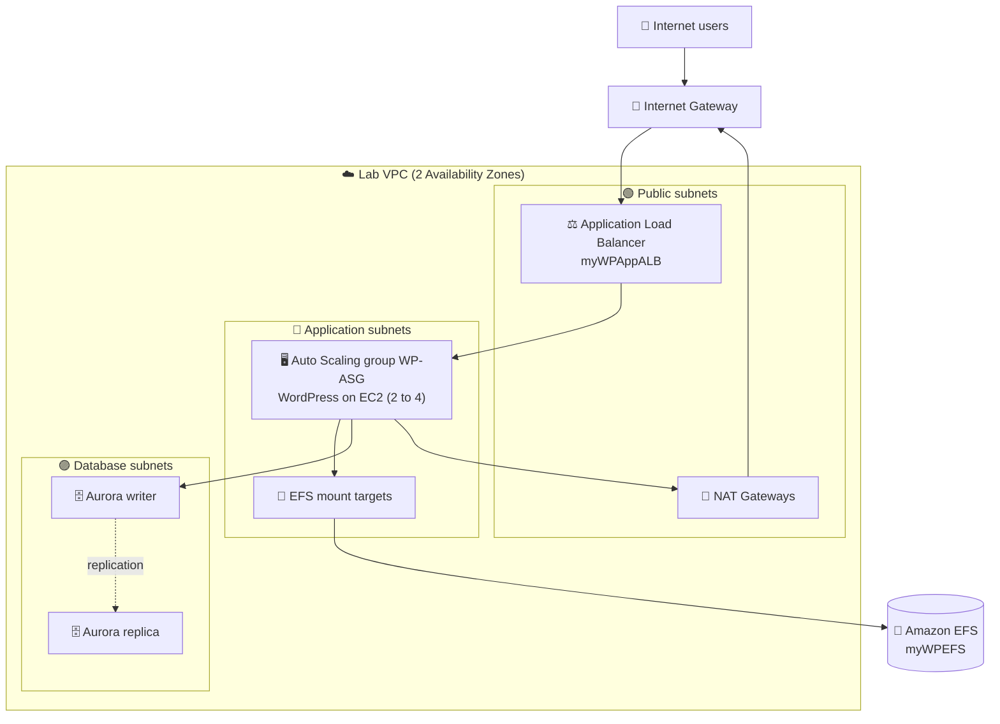

<h1 align="center">🏗️ Build a Multi-Tier AWS Architecture</h1>

<b>Hands-on lab: WordPress on a highly available, auto-scaled three-tier stack (VPC, Aurora, EFS, ALB, Auto Scaling)</b>

       

  

---

## 📑 Table of Contents

- [📖 About the Project](#-about-the-project)
- [🎯 Objectives](#-objectives)
- [🧩 Scenario](#-scenario)
- [🏗 Architecture](#-architecture)
- [✅ Prerequisites](#-prerequisites)
- [📊 Result](#-result)
- [🔍 Validation](#-validation)
- [💡 Key Takeaways](#-key-takeaways)
- [🧹 Resource Cleanup](#-resource-cleanup)
- [☁ AWS Services Covered](#-aws-services-covered)
- [👤 Author](#-author)

---

## 📖 About the Project

This is the capstone lab of the **Architecture on AWS** track. Instead of following a strictly guided walkthrough, the exercise hands over a list of requirements for each layer of a fictional company's marketing web portal and expects the architecture to be built from them. The lab also ships a detailed instruction set that can be consulted when a task gets difficult.

The scenario is a proof of concept that moves a customer-facing application from an on-premises data center to AWS. The goal is a solution that is fast, durable, scalable and cheaper than the existing infrastructure. The result is a WordPress application running on a network, database, shared storage, load balancing and compute layers spread across two Availability Zones.

> 💬 *Requirements first, console second: the lab trains the habit of turning business needs into architecture decisions.*

---

## 🎯 Objectives

- 🌐 Deploy a multi-AZ virtual network with a CloudFormation template
- 🗄️ Create a highly available, fully managed relational database with Amazon Aurora (MySQL-compatible)
- 📁 Provision a shared NFS storage layer for the application tier with Amazon EFS
- ⚖️ Distribute traffic with an Application Load Balancer and a target group with health checks
- 📜 Deploy the WordPress launch template and settings through a second CloudFormation stack
- 📈 Build an Auto Scaling group that grows and shrinks with load to complete the application tier

---

## 🧩 Scenario

The fictional company *Exemplo Corp.* builds marketing campaigns for small and medium businesses. Its customers use a web portal to access accounts, create marketing plans and analyze campaign data. The company wants a working prototype in two weeks, running on AWS and cheaper than the current on-premises setup.

The tables below summarize the parameters defined by the lab instructions.

**Names and general rules**

| Item | Value |
|---|---|
| Region | The one preset by the lab environment (not changed) |
| Network stack (CloudFormation) | `VPCStack` |
| Launch template stack (CloudFormation) | `WPLaunchConfigStack` |
| Network layout | 2 public, 2 private application and 2 private database subnets across 2 AZs, with an internet gateway and NAT gateways |
| Database subnets used by the DB subnet group | `10.0.4.0/24` (first AZ) and `10.0.5.0/24` (second AZ) |

**Database (Amazon Aurora)**

| Parameter | Value |
|---|---|
| DB subnet group | `AuroraSubnetGroup` (Lab VPC, database subnets only) |
| Cluster identifier | `MyDBCluster` |
| Engine / class | Aurora (MySQL-compatible), burstable `db.t3.medium` |
| Master user | `dbadmin` |
| Initial database name | `WPDatabase` |
| Availability | Aurora Replica in a different AZ |
| Access | Not public; only the RDS security group provided by the stack |
| Encryption | AWS owned KMS key (SSE-RDS) |
| Disabled options | Enhanced monitoring, automatic minor version upgrade, deletion protection |

**Storage (Amazon EFS)**

| Parameter | Value |
|---|---|
| File system name / `Name` tag | `myWPEFS` |
| Availability and durability | Regional |
| Performance / throughput | General Purpose / Bursting |
| Automatic backups and encryption at rest | Disabled |
| Mount targets | `AppSubnet1` and `AppSubnet2` with `EFSMountTargetSecurityGroup` |

**Load balancing and compute**

| Parameter | Value |
|---|---|
| Target group | `myWPTargetGroup` (HTTP, instances, Lab VPC) |
| Health check | Path `/wp-login.php`; healthy threshold 2; unhealthy threshold 10; timeout 50 s; interval 60 s |
| Load balancer | `myWPAppALB` in the public subnets, `AppInstanceSecurityGroup`, HTTP:80 listener forwarding to the target group |
| WordPress admin user / instance type | `wpadmin` / `t3.medium` |
| Auto Scaling group | `WP-ASG` using the launch template from `WPLaunchConfigStack`, application subnets of both AZs |
| Group size | Desired 2, minimum 2, maximum 4 |
| Health checks / grace period | ELB health checks enabled / 300 seconds |
| Scaling policy | Target tracking with default values; group metrics collection enabled in CloudWatch |
| Tag | `Name` = `WP-App` |

---

## 🏗 Architecture

Traffic from the internet enters through the internet gateway and reaches the Application Load Balancer, which sits in the public subnets. The ALB forwards requests to the WordPress instances managed by the Auto Scaling group in the private application subnets, using `/wp-login.php` for health checks. The instances mount the shared EFS file system through mount targets in each AZ and connect to the Aurora cluster, where the writer lives in one AZ and the replica in the other. For outbound internet access, the application instances go through the NAT gateways in the public subnets.

---

## ✅ Prerequisites

- 🎓 Access to the lab environment (Start Lab / Open Console) of the Escola da Nuvem program
- 🧠 Basic knowledge of VPC networking, security groups, RDS/Aurora, EFS, load balancing and Auto Scaling
- 📝 A text editor to keep the values copied between tasks (writer endpoint, file system ID, ALB DNS name)
- 📧 A valid e-mail address for the WordPress administrator parameter

> ⚠️ **Warning:** the training environment has limited permissions. Services not used by the lab are disabled and the allowed resources are restricted to what the lab requires, so actions outside the guide may return errors. An enhanced monitoring permission error shown when creating the Aurora cluster can be ignored, according to the instructions.

---

## 📊 Result

No screenshots have been attached to this README yet. The table below lists the checks proposed by the lab and the outcome expected from each one.

| Test | Result |
|---|---|
| `VPCStack` creation | Stack reaches `CREATE_COMPLETE` with the network resources and outputs |
| Aurora cluster creation | `MyDBCluster` becomes available with writer and replica instances in different AZs |
| EFS creation | `myWPEFS` is available with a mount target per AZ |
| Target group and ALB | `myWPAppALB` becomes active and forwards to `myWPTargetGroup` |
| `WPLaunchConfigStack` creation | Stack reaches `CREATE_COMPLETE` and the launch template is created |
| `WP-ASG` creation | Two instances are launched and reach the `InService` state |
| Target group health | Registered instances show as healthy |
| Access through the ALB | The WordPress login page opens at the ALB DNS name followed by `/wp-login.php` |

> 📷 **Screenshot pending:** the final evidence (WordPress login page reached through the ALB) still needs to be added. Place the image in `docs/images/` and reference it here with a figure caption.

---

## 🔍 Validation

| ✔️ | Item | Expected result |
|---|---|---|
| ✔️ | `VPCStack` | `CREATE_COMPLETE`, with the VPC, subnets, gateways and security groups created |
| ✔️ | DB subnet group | `AuroraSubnetGroup` created with the two database subnets in different AZs |
| ✔️ | Aurora cluster | `MyDBCluster` available, writer and replica in different AZs, not publicly accessible |
| ✔️ | EFS file system | `myWPEFS` available, with mount targets in `AppSubnet1` and `AppSubnet2` |
| ✔️ | Target group | `myWPTargetGroup` using HTTP and the `/wp-login.php` health check |
| ✔️ | Load balancer | `myWPAppALB` active in the public subnets with the HTTP:80 listener |
| ✔️ | `WPLaunchConfigStack` | `CREATE_COMPLETE` with the correct DB, EFS and ALB parameters |
| ✔️ | Auto Scaling group | `WP-ASG` with 2 instances `InService` (min 2, max 4) |
| ✔️ | Application | WordPress login page served through the ALB DNS name |

---

## 💡 Key Takeaways

- 🧱 **Design in layers:** separating network, data, storage, load balancing and compute makes each tier easier to secure and scale.
- 🌍 **Multi-AZ is the default for resilience:** subnets, Aurora, EFS mount targets and the Auto Scaling group all span two Availability Zones.
- 🔒 **Private by design:** application and database subnets stay private, and only the ALB is exposed to the internet.
- 📁 **Shared state outside the instance:** EFS lets any instance in the group serve the same WordPress files, which makes instances disposable.
- 📜 **Infrastructure as code:** CloudFormation templates created the network and the launch template reproducibly, and their outputs and parameters connect the tasks.
- ❤️ **Health checks matter:** the ALB health check path, thresholds and the ASG grace period directly affect when an instance receives traffic or is replaced.
- 🧠 **Relevance for the exam:** high availability with multiple AZs, public vs. private subnets and NAT, Aurora replicas, EFS vs. EBS, ALB with Auto Scaling and target tracking policies are recurring themes in the AWS Certified Solutions Architect – Associate exam.

---

## 🧹 Resource Cleanup

The resources created in this lab have not yet been confirmed as deleted. Checklist:

- [ ] Delete the Auto Scaling group `WP-ASG`
- [ ] Delete the load balancer `myWPAppALB` and the target group `myWPTargetGroup`
- [ ] Delete the `WPLaunchConfigStack` stack
- [ ] Delete the Aurora cluster `MyDBCluster` and the `AuroraSubnetGroup` subnet group
- [ ] Delete the EFS file system `myWPEFS`
- [ ] Delete the `VPCStack` stack
- [ ] Sign out of the console and select **End Lab** in the lab page

---

## ☁ AWS Services Covered

       

| Service | Role in the lab |
|---|---|
| Amazon VPC | Network with public, application and database subnets, internet gateway and NAT gateways |
| AWS CloudFormation | Deployed the network stack and the WordPress launch template stack |
| Amazon Aurora (RDS) | Managed MySQL-compatible database with a writer and a replica in different AZs |
| Amazon EFS | Shared file system mounted by the application instances |
| Elastic Load Balancing | Application Load Balancer and target group with health checks |
| Amazon EC2 / Auto Scaling | WordPress servers launched and scaled by `WP-ASG` |
| Amazon CloudWatch | Group metrics collection for the Auto Scaling group |

---

## 👤 Author

**Lucas Barretto**

 

---

Lab completed as part of the Escola da Nuvem program, Turma C10 OUT – DPCN 19 🚀

