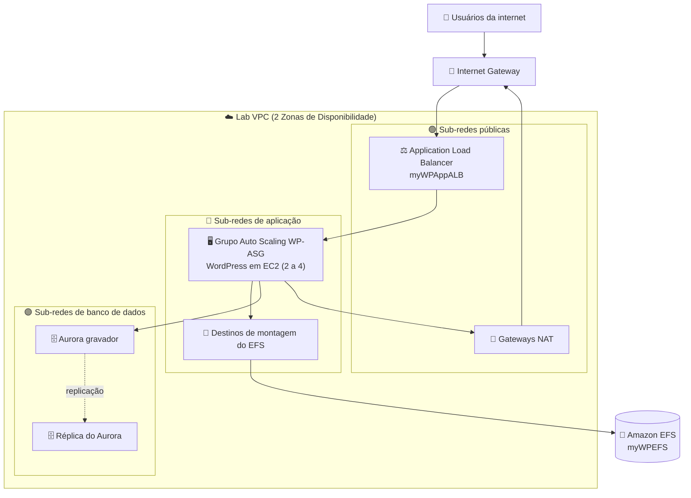

<h1 align="center">🏗️ Crie uma Arquitetura Multicamadas na AWS</h1>

<b>Laboratório prático: WordPress em uma pilha de três camadas altamente disponível e com Auto Scaling (VPC, Aurora, EFS, ALB, Auto Scaling)</b>

       

  

---

## 📑 Sumário

- [📖 Sobre o Projeto](#-sobre-o-projeto)
- [🎯 Objetivos](#-objetivos)
- [🧩 Cenário](#-cenário)
- [🏗 Arquitetura](#-arquitetura)
- [✅ Pré-requisitos](#-pré-requisitos)
- [📊 Resultado](#-resultado)
- [🔍 Validação](#-validação)
- [💡 Principais Aprendizados](#-principais-aprendizados)
- [🧹 Limpeza dos Recursos](#-limpeza-dos-recursos)
- [☁ Serviços Abordados](#-serviços-abordados)
- [👤 Autor](#-autor)

---

## 📖 Sobre o Projeto

Este é o laboratório final da trilha **Arquitetura na AWS**. Em vez de um passo a passo totalmente guiado, o exercício entrega uma lista de requisitos para cada camada do portal web de marketing de uma empresa fictícia e espera que a arquitetura seja montada a partir deles. O laboratório também traz um conjunto de instruções detalhadas para consulta quando alguma tarefa se tornar difícil.

O cenário é uma prova de conceito que leva uma aplicação voltada ao cliente de um data center on-premises para a AWS. O objetivo é uma solução rápida, durável, escalável e mais barata que a infraestrutura atual. O resultado é uma aplicação WordPress rodando sobre camadas de rede, banco de dados, armazenamento compartilhado, balanceamento de carga e computação distribuídas em duas Zonas de Disponibilidade.

> 💬 *Primeiro os requisitos, depois o console: o laboratório treina o hábito de transformar necessidades de negócio em decisões de arquitetura.*

---

## 🎯 Objetivos

- 🌐 Implantar uma rede virtual multi-AZ com um modelo do CloudFormation
- 🗄️ Criar um banco de dados relacional altamente disponível e totalmente gerenciado com o Amazon Aurora (compatível com MySQL)
- 📁 Provisionar uma camada de armazenamento NFS compartilhada para a aplicação com o Amazon EFS
- ⚖️ Distribuir o tráfego com um Application Load Balancer e um grupo de destino com health checks
- 📜 Implantar o modelo de execução e as configurações do WordPress por meio de uma segunda pilha do CloudFormation
- 📈 Criar um grupo do Auto Scaling que aumenta e diminui conforme a carga para completar a camada de aplicação

---

## 🧩 Cenário

A empresa fictícia *Exemplo Corp.* cria campanhas de marketing para pequenas e médias empresas. Os clientes usam um portal web para acessar contas, criar planos de marketing e analisar dados das campanhas. A empresa quer um protótipo funcional em duas semanas, rodando na AWS e mais barato que a estrutura on-premises atual.

As tabelas abaixo resumem os parâmetros definidos nas instruções do laboratório.

**Nomes e regras gerais**

| Item | Valor |
|---|---|
| Região | A predefinida pelo ambiente do laboratório (não alterada) |
| Pilha de rede (CloudFormation) | `VPCStack` |
| Pilha do modelo de execução (CloudFormation) | `WPLaunchConfigStack` |
| Desenho da rede | 2 sub-redes públicas, 2 sub-redes privadas de aplicação e 2 sub-redes privadas de banco de dados em 2 AZs, com gateway da internet e gateways NAT |
| Sub-redes de banco de dados usadas no grupo de sub-redes | `10.0.4.0/24` (primeira AZ) e `10.0.5.0/24` (segunda AZ) |

**Banco de dados (Amazon Aurora)**

| Parâmetro | Valor |
|---|---|
| Grupo de sub-redes de banco de dados | `AuroraSubnetGroup` (Lab VPC, somente sub-redes de banco de dados) |
| Identificador do cluster | `MyDBCluster` |
| Mecanismo / classe | Aurora (compatível com MySQL), burstable `db.t3.medium` |
| Usuário principal | `dbadmin` |
| Nome do banco de dados inicial | `WPDatabase` |
| Disponibilidade | Réplica do Aurora em outra AZ |
| Acesso | Não público; apenas o grupo de segurança do RDS fornecido pela pilha |
| Criptografia | Chave do KMS de propriedade da AWS (SSE-RDS) |
| Opções desativadas | Monitoramento aprimorado, atualização automática de versão secundária, proteção contra exclusão |

**Armazenamento (Amazon EFS)**

| Parâmetro | Valor |
|---|---|
| Nome do sistema de arquivos / tag `Name` | `myWPEFS` |
| Disponibilidade e durabilidade | Regional |
| Desempenho / throughput | Uso geral / Intermitência (Bursting) |
| Backups automáticos e criptografia em repouso | Desativados |
| Destinos de montagem | `AppSubnet1` e `AppSubnet2` com `EFSMountTargetSecurityGroup` |

**Balanceamento de carga e computação**

| Parâmetro | Valor |
|---|---|
| Grupo de destino | `myWPTargetGroup` (HTTP, instâncias, Lab VPC) |
| Health check | Caminho `/wp-login.php`; limite íntegro 2; limite de integridade inadequada 10; tempo limite 50 s; intervalo 60 s |
| Balanceador de carga | `myWPAppALB` nas sub-redes públicas, `AppInstanceSecurityGroup`, listener HTTP:80 encaminhando para o grupo de destino |
| Usuário admin do WordPress / tipo de instância | `wpadmin` / `t3.medium` |
| Grupo do Auto Scaling | `WP-ASG` com o modelo de execução da `WPLaunchConfigStack`, sub-redes de aplicação das duas AZs |
| Tamanho do grupo | Desejada 2, mínima 2, máxima 4 |
| Health checks / período de carência | Verificações do ELB ativadas / 300 segundos |
| Política de scaling | Monitoramento de destino (target tracking) com valores padrão; coleta de métricas do grupo habilitada no CloudWatch |
| Tag | `Name` = `WP-App` |

---

## 🏗 Arquitetura

O tráfego da internet entra pelo gateway da internet e chega ao Application Load Balancer, que fica nas sub-redes públicas. O ALB encaminha as requisições para as instâncias WordPress gerenciadas pelo grupo do Auto Scaling nas sub-redes privadas de aplicação, usando `/wp-login.php` nas health checks. As instâncias montam o sistema de arquivos EFS compartilhado por meio de destinos de montagem em cada AZ e se conectam ao cluster Aurora, em que o gravador fica em uma AZ e a réplica na outra. Para acesso de saída à internet, as instâncias de aplicação passam pelos gateways NAT das sub-redes públicas.

---

## ✅ Pré-requisitos

- 🎓 Acesso ao ambiente do laboratório (Start Lab / Open Console) do programa Escola da Nuvem
- 🧠 Noções básicas de redes VPC, grupos de segurança, RDS/Aurora, EFS, balanceamento de carga e Auto Scaling
- 📝 Um editor de texto para guardar os valores copiados entre as tarefas (endpoint do gravador, ID do sistema de arquivos, nome DNS do ALB)
- 📧 Um endereço de e-mail válido para o parâmetro de administrador do WordPress

> ⚠️ **Atenção:** o ambiente de capacitação tem permissões limitadas. Os serviços não usados no laboratório ficam desativados e os recursos permitidos se restringem ao que ele exige; por isso, ações fora do roteiro podem gerar erros. Um erro de permissão de monitoramento aprimorado exibido ao criar o cluster Aurora pode ser ignorado, segundo as instruções.

---

## 📊 Resultado

Ainda não há prints anexados a este README. A tabela abaixo lista as verificações propostas pelo laboratório e o resultado esperado em cada uma.

| Teste | Resultado |
|---|---|
| Criação da `VPCStack` | Pilha chega a `CREATE_COMPLETE` com os recursos de rede e as saídas |
| Criação do cluster Aurora | `MyDBCluster` fica disponível com instâncias gravadora e réplica em AZs diferentes |
| Criação do EFS | `myWPEFS` fica disponível com um destino de montagem por AZ |
| Grupo de destino e ALB | `myWPAppALB` fica ativo e encaminha para `myWPTargetGroup` |
| Criação da `WPLaunchConfigStack` | Pilha chega a `CREATE_COMPLETE` e o modelo de execução é criado |
| Criação do `WP-ASG` | Duas instâncias são iniciadas e chegam ao estado `InService` |
| Integridade do grupo de destino | As instâncias registradas aparecem como íntegras |
| Acesso pelo ALB | A página de login do WordPress abre no nome DNS do ALB seguido de `/wp-login.php` |

> 📷 **Print pendente:** falta incluir a evidência final (página de login do WordPress acessada pelo ALB). Coloque a imagem em `docs/images/` e referencie aqui com uma legenda de figura.

---

## 🔍 Validação

| ✔️ | Item | Resultado esperado |
|---|---|---|
| ✔️ | `VPCStack` | `CREATE_COMPLETE`, com VPC, sub-redes, gateways e grupos de segurança criados |
| ✔️ | Grupo de sub-redes do banco | `AuroraSubnetGroup` criado com as duas sub-redes de banco de dados em AZs diferentes |
| ✔️ | Cluster Aurora | `MyDBCluster` disponível, gravador e réplica em AZs diferentes, sem acesso público |
| ✔️ | Sistema de arquivos EFS | `myWPEFS` disponível, com destinos de montagem em `AppSubnet1` e `AppSubnet2` |
| ✔️ | Grupo de destino | `myWPTargetGroup` usando HTTP e a health check em `/wp-login.php` |
| ✔️ | Balanceador de carga | `myWPAppALB` ativo nas sub-redes públicas com o listener HTTP:80 |
| ✔️ | `WPLaunchConfigStack` | `CREATE_COMPLETE` com os parâmetros corretos de banco, EFS e ALB |
| ✔️ | Grupo do Auto Scaling | `WP-ASG` com 2 instâncias `InService` (mín. 2, máx. 4) |
| ✔️ | Aplicação | Página de login do WordPress servida pelo nome DNS do ALB |

---

## 💡 Principais Aprendizados

- 🧱 **Projetar em camadas:** separar rede, dados, armazenamento, balanceamento e computação facilita proteger e escalar cada camada.
- 🌍 **Multi-AZ como padrão de resiliência:** sub-redes, Aurora, destinos de montagem do EFS e o grupo do Auto Scaling se espalham por duas Zonas de Disponibilidade.
- 🔒 **Privado por design:** as sub-redes de aplicação e de banco de dados permanecem privadas, e só o ALB fica exposto à internet.
- 📁 **Estado compartilhado fora da instância:** o EFS permite que qualquer instância do grupo sirva os mesmos arquivos do WordPress, o que torna as instâncias descartáveis.
- 📜 **Infraestrutura como código:** os modelos do CloudFormation criaram a rede e o modelo de execução de forma reproduzível, e suas saídas e parâmetros conectam as tarefas.
- ❤️ **Health checks importam:** o caminho, os limites da health check do ALB e o período de carência do ASG afetam diretamente quando uma instância recebe tráfego ou é substituída.
- 🧠 **Relevância para a prova:** alta disponibilidade com várias AZs, sub-redes públicas vs. privadas e NAT, réplicas do Aurora, EFS vs. EBS, ALB com Auto Scaling e políticas de target tracking são temas recorrentes na prova AWS Certified Solutions Architect – Associate.

---

## 🧹 Limpeza dos Recursos

A exclusão dos recursos criados neste laboratório ainda não foi confirmada. Lista de tarefas:

- [ ] Excluir o grupo do Auto Scaling `WP-ASG`
- [ ] Excluir o balanceador de carga `myWPAppALB` e o grupo de destino `myWPTargetGroup`
- [ ] Excluir a pilha `WPLaunchConfigStack`
- [ ] Excluir o cluster Aurora `MyDBCluster` e o grupo de sub-redes `AuroraSubnetGroup`
- [ ] Excluir o sistema de arquivos EFS `myWPEFS`
- [ ] Excluir a pilha `VPCStack`
- [ ] Sair do console e selecionar **End Lab** na página do laboratório

---

## ☁ Serviços Abordados

       

| Serviço | Papel no laboratório |
|---|---|
| Amazon VPC | Rede com sub-redes públicas, de aplicação e de banco de dados, gateway da internet e gateways NAT |
| AWS CloudFormation | Implantou a pilha de rede e a pilha do modelo de execução do WordPress |
| Amazon Aurora (RDS) | Banco gerenciado compatível com MySQL com gravador e réplica em AZs diferentes |
| Amazon EFS | Sistema de arquivos compartilhado montado pelas instâncias de aplicação |
| Elastic Load Balancing | Application Load Balancer e grupo de destino com health checks |
| Amazon EC2 / Auto Scaling | Servidores WordPress iniciados e escalados pelo `WP-ASG` |
| Amazon CloudWatch | Coleta de métricas do grupo do Auto Scaling |

---

## 👤 Autor

**Lucas Barretto**

 

---

Laboratório realizado como parte do programa Escola da Nuvem, Turma C10 OUT – DPCN 19 🚀

