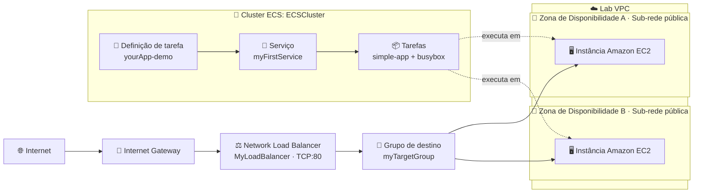

# 🐳 Trabalhando com o Amazon Elastic Container Service

**Laboratório prático: registrando uma definição de tarefa, executando um serviço no Amazon ECS, implantando uma atualização e aumentando a capacidade**

    

  

---

## 📑 Sumário

- [📖 Sobre o Projeto](#sobre)
- [🎯 Objetivos](#objetivos)
- [🧩 Cenário](#cenario)
- [🏗️ Arquitetura](#arquitetura)
- [✅ Pré-requisitos](#pre-requisitos)
- [📊 Resultado](#resultado)
- [🔍 Validação](#validacao)
- [💡 Principais Aprendizados](#aprendizados)
- [☁️ Serviços Abordados](#servicos)
- [👤 Autor](#autor)

---

## 📖 Sobre o Projeto

Neste projeto, **assumi a orquestração e implantação** de aplicações conteinerizadas no **Amazon ECS** com tipo de lançamento EC2: configurei uma **definição de tarefa (Task Definition)** multicontêiner com volume de dados compartilhado, publiquei e integrei o serviço (**ECS Service**) a um Network Load Balancer (NLB), realizei uma implantação contínua (*rolling update*) sem downtime e escalei horizontalmente a capacidade de tarefas.

> 💬 *A definição de tarefa representa o blueprint da aplicação, enquanto o serviço do ECS assegura a disponibilidade contínua com a contagem desejada de réplicas ativas.*

---

## 🎯 Objetivos

- 📄 Registrar uma definição de tarefa do Amazon ECS a partir de um documento JSON
- 🚀 Implantar uma aplicação como serviço do ECS atrás de um Network Load Balancer
- 🔄 Implantar uma atualização da aplicação criando uma nova revisão da definição de tarefa
- 📈 Aumentar o número de tarefas em execução para ganhar capacidade
- 🔎 *(Opcional)* Analisar o modelo do CloudFormation que provisionou o ambiente do laboratório

---

## 🧩 Cenário

Em um cenário de modernização com contêineres, assumi a responsabilidade de provisionar e operacionalizar a aplicação no cluster ECS: criei a definição de tarefa, configurei o serviço vinculado ao NLB existente, promovi atualizações de versão sem indisponibilidade e aumentei a capacidade operacional conforme a demanda.

O ambiente já traz uma VPC com duas sub-redes públicas em Zonas de Disponibilidade diferentes, um Network Load Balancer com um nó em cada sub-rede, um grupo do EC2 Auto Scaling que fornece a capacidade para o ECS e o próprio cluster do ECS.

| Parâmetro | Valor |
|-----------|-------|
| Família da definição de tarefa | `yourApp-demo` |
| Contêiner 1 | `simple-app` — imagem `httpd:2.4`, porta 80 do host → porta 80 do contêiner, memória 300, CPU 10, essencial |
| Contêiner 2 | `busybox` — imagem `busybox`, memória 200, CPU 10, não essencial; executa um laço em shell que regenera uma página HTML |
| Volume compartilhado | `my-vol`, montado pelo `simple-app` na raiz de documentos do Apache e também disponibilizado ao `busybox` |
| Cluster | `ECSCluster` |
| Nome do serviço | `myFirstService` |
| Tipo de lançamento | EC2 |
| Tipo de serviço | Réplica |
| Tarefas desejadas | 1 na criação, depois alterado para 2 |
| VPC | `Lab VPC` |
| Balanceador de carga | `MyLoadBalancer` (Network Load Balancer) |
| Receptor | `TCP:80` (receptor existente) |
| Grupo de destino | `myTargetGroup` (existente) |
| Região | Padrão do laboratório (as instruções pedem para não alterar) |
| Regras | Manter as demais configurações padrão; aguardar a implantação mostrar *Concluída* antes de avançar |

---

## 🏗️ Arquitetura

O tráfego da internet entra pelo Internet Gateway e chega ao Network Load Balancer, que o encaminha ao grupo de destino e, daí, às instâncias EC2 que pertencem ao cluster. Essas instâncias vêm de um grupo do Auto Scaling e ficam em duas sub-redes públicas, em duas Zonas de Disponibilidade. A definição de tarefa descreve os dois contêineres, e o serviço `myFirstService` pede ao programador do ECS que mantenha o número desejado de tarefas em execução nas instâncias do cluster. Quando uma nova revisão é implantada, o programador inicia tarefas a partir dela e encerra as antigas aos poucos, de modo que a página continua acessível.

---

## ✅ Pré-requisitos

- 🐳 Conhecimento prático sobre contêineres do Docker
- 🛠️ Familiaridade geral com administração de servidores e a terminologia de DevOps
- 🌐 Noções básicas de aplicações web e redes (portas TCP, proxies HTTP, balanceadores de carga)
- 🔑 Acesso ao laboratório no AWS Skill Builder (iniciar o lab e abrir o console pela página do laboratório)

> ⚠️ **Atenção:** o ambiente do laboratório concede apenas as permissões necessárias para os exercícios. Abrir outros serviços ou executar ações que não fazem parte do guia gera erros. Evite também digitar informações pessoais ou confidenciais no ambiente, pois elas podem ficar visíveis para outras pessoas.

---

## 📊 Resultado

Não há prints da minha execução anexados a esta documentação, então a tabela abaixo resume o que as instruções do laboratório dizem que deve ser observado em cada etapa.

| Teste | Resultado |
|-------|-----------|
| Registrar a definição de tarefa `yourApp-demo` a partir do JSON | Uma mensagem de confirmação indica que a definição foi criada e pode ser usada em um serviço ou na execução de uma tarefa |
| Criar o `myFirstService` (tipo EC2, Réplica, 1 tarefa desejada, receptor e grupo de destino existentes do NLB) | A coluna *Última implantação* da guia Serviços passa a mostrar *Concluída* após alguns minutos |
| Abrir o nome DNS do balanceador de carga em uma nova guia | Uma página escura com o título "Amazon ECS Sample App", um título "Congratulations!", uma mensagem curta e um carimbo de data e hora |
| Criar uma nova revisão da definição de tarefa e atualizar o serviço para a revisão mais recente | A guia Implantações mostra o progresso da atualização contínua e os eventos, terminando como *Concluída* |
| Atualizar a página com o nome DNS do balanceador | A mesma página de exemplo agora exibe o título "Thank You!" |
| Atualizar o serviço para 2 tarefas desejadas | Uma nova tarefa inicia na seção Eventos e a contagem de tarefas em execução na visão geral do serviço passa de 1 para 2 |
| *(Opcional)* Abrir a pilha do CloudFormation e a guia Modelo | O modelo mostra o código que preparou o cluster, as instâncias e o balanceador de carga para o lab |

---

## 🔍 Validação

| ✔️ | Item | Resultado esperado |
|----|------|--------------------|
| ✔️ | Definição de tarefa `yourApp-demo` | Registrada com os contêineres `simple-app` e `busybox` e o volume `my-vol` |
| ✔️ | Serviço `myFirstService` | Em execução no cluster `ECSCluster` com tipo de lançamento EC2 e tipo de serviço Réplica |
| ✔️ | Integração com o balanceador | Serviço ligado ao `MyLoadBalancer`, receptor `TCP:80` e grupo de destino `myTargetGroup` |
| ✔️ | Acesso à aplicação | A página de exemplo carrega pelo nome DNS do balanceador |
| ✔️ | Atualização da aplicação | Após a implantação contínua terminar, a página exibe o novo título |
| ✔️ | Capacidade | O serviço mostra 2 tarefas em execução depois que a contagem desejada é aumentada |

---

## 💡 Principais Aprendizados

- 📄 **Definição de tarefa = projeto da aplicação:** registra imagens, CPU e memória, mapeamentos de porta e volumes. Cada mudança gera uma nova *revisão* dentro da mesma *família*.
- 🧱 **Tarefas com vários contêineres:** contêineres de uma mesma tarefa podem compartilhar um volume. O parâmetro `essential` define se a tarefa depende de determinado contêiner.
- 🖥️ **Tipos de lançamento:** no EC2 você provisiona e gerencia as instâncias (por exemplo, com grupos do Auto Scaling); no Fargate a AWS gerencia a infraestrutura e você não lida com instâncias.
- 🔁 **Tipo de serviço Réplica:** o programador do serviço mantém o número exato de tarefas desejadas e substitui as que falham ou são interrompidas.
- ⚖️ **Balanceador na frente do serviço:** um Network Load Balancer, um receptor e um grupo de destino existentes foram associados ao serviço, e os usuários acessam a aplicação por um único nome DNS.
- 🔄 **Implantação contínua:** o programador inicia tarefas da nova revisão e encerra as antigas passo a passo, mantendo a contagem desejada e reduzindo a indisponibilidade.
- 📈 **Mudança de capacidade:** aumentar ou diminuir as tarefas desejadas altera quantas cópias rodam. É preciso ter capacidade suficiente de EC2 ou Fargate para as tarefas extras. Embora por vezes rotulado como aumento de capacidade, adicionar instâncias de tarefas adicionais configura, a rigor, escalabilidade horizontal (scaling out).
- 🏗️ **Infraestrutura como código:** o ambiente-base foi provisionado via CloudFormation, adotando o provisionamento declarativo e reprodutível como padrão corporativo.
- 🧠 **Relevância para a prova:** as questões costumam comparar os tipos de lançamento EC2 e Fargate, perguntar qual balanceador atende a determinado caso (o Network Load Balancer atua no nível de conexão, TCP) e testar como os serviços do ECS mantêm a disponibilidade e fazem atualizações sem indisponibilidade.

---

## ☁️ Serviços Abordados

   

| Serviço | Papel no laboratório |
|---------|----------------------|
| Amazon Elastic Container Service (ECS) | Abriga a definição de tarefa, o cluster e o serviço `myFirstService`, que executa e atualiza os contêineres |
| Amazon EC2 | Fornece as instâncias (gerenciadas por um grupo do Auto Scaling) em que as tarefas do ECS rodam |
| Elastic Load Balancing (Network Load Balancer) | Recebe o tráfego em `TCP:80` e o encaminha ao serviço por meio do grupo de destino |
| AWS CloudFormation | Criou o ambiente-base; analisar o modelo foi uma tarefa final opcional |

---

## 👤 Autor

**Lucas Barretto**

 

---

Laboratório opcional realizado na plataforma AWS Skill Builder 🚀

