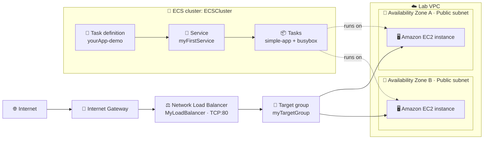

# 🐳 Working with Amazon Elastic Container Service

**Hands-on Lab: Registering a task definition, running a service on Amazon ECS, rolling out an update and scaling it**

    

  

---

## 📑 Table of Contents

- [📖 About the Project](#about)
- [🎯 Objectives](#objectives)
- [🧩 Scenario](#scenario)
- [🏗️ Architecture](#architecture)
- [✅ Prerequisites](#prerequisites)
- [📊 Results](#results)
- [🔍 Validation](#validation)
- [💡 Key Takeaways](#learnings)
- [☁️ AWS Services Covered](#services)
- [👤 Author](#author)

---

## 📖 About the Project

In this project, I **orchestrated and deployed** containerized applications on **Amazon ECS** using the EC2 launch type: authored a multi-container **task definition** with shared volume storage, integrated and launched an **ECS service** behind a Network Load Balancer (NLB), executed zero-downtime rolling updates, and horizontally scaled task capacity to meet demand.

> 💬 *A task definition serves as the application blueprint, while the ECS service ensures continuous availability and automatic lifecycle maintenance of desired task replicas.*

---

## 🎯 Objectives

- 📄 Register an Amazon ECS task definition from a JSON document
- 🚀 Deploy an application as an ECS service behind a Network Load Balancer
- 🔄 Roll out an application update by creating a new task definition revision
- 📈 Increase the number of running tasks to add capacity
- 🔎 *(Optional)* Look at the CloudFormation template that provisioned the lab environment

---

## 🧩 Scenario

In a containerized modernization workload, I assumed responsibility for operationalizing the ECS cluster: registered the application definition, attached the service to an existing NLB, rolled out zero-downtime updates, and expanded task capacity under traffic demand.

The environment already provides a VPC with two public subnets in different Availability Zones, a Network Load Balancer with a node in each subnet, an EC2 Auto Scaling group that supplies the capacity for ECS, and the ECS cluster itself.

| Parameter | Value |
|-----------|-------|
| Task definition family | `yourApp-demo` |
| Container 1 | `simple-app` — image `httpd:2.4`, host port 80 → container port 80, 300 memory, 10 CPU, essential |
| Container 2 | `busybox` — image `busybox`, 200 memory, 10 CPU, not essential; runs a shell loop that regenerates an HTML page |
| Shared volume | `my-vol`, mounted by `simple-app` at the Apache document root and also made available to `busybox` |
| Cluster | `ECSCluster` |
| Service name | `myFirstService` |
| Launch type | EC2 |
| Service type | Replica |
| Desired tasks | 1 at creation, later changed to 2 |
| VPC | `Lab VPC` |
| Load balancer | `MyLoadBalancer` (Network Load Balancer) |
| Listener | `TCP:80` (existing listener) |
| Target group | `myTargetGroup` (existing) |
| Region | Lab default (the instructions say not to change it) |
| Rules | Keep the remaining defaults; wait for the deployment to show *Completed* before moving on |

---

## 🏗️ Architecture

Traffic from the internet enters through the Internet Gateway and reaches the Network Load Balancer, which forwards it to the target group and from there to the EC2 instances that belong to the cluster. Those instances come from an Auto Scaling group and sit in two public subnets across two Availability Zones. The task definition describes the two containers, and the `myFirstService` service asks the ECS scheduler to keep the desired number of tasks running on the cluster's instances. When a new revision is deployed, the scheduler starts tasks from it and retires the old ones gradually, so the page stays reachable.

---

## ✅ Prerequisites

- 🐳 Working knowledge of Docker containers
- 🛠️ General familiarity with server administration and DevOps terminology
- 🌐 Basic understanding of web applications and networking (TCP ports, HTTP proxies, load balancers)
- 🔑 Access to the AWS Skill Builder lab (start the lab, then open the console from the lab page)

> ⚠️ **Warning:** the lab environment grants only the permissions needed for the exercises. Opening other services or doing actions that are not part of the guide leads to errors. Also avoid typing personal or confidential information into the environment, since it may be visible to others.

---

## 📊 Results

No screenshots of my own run are attached to this documentation, so the table below summarizes what the lab instructions say should be observed at each stage.

| Test | Result |
|------|--------|
| Register the `yourApp-demo` task definition from JSON | A confirmation message shows that the task definition was created and is ready for a service or a task run |
| Create `myFirstService` (EC2 launch type, Replica, 1 desired task, existing NLB listener and target group) | The *Last deployment* column of the Services tab changes to *Completed* after a few minutes |
| Open the load balancer's DNS name in a new browser tab | A dark page titled "Amazon ECS Sample App" with a "Congratulations!" heading, a short message and a timestamp |
| Create a new task definition revision and update the service to the latest revision | The Deployments tab shows the rolling update progress and events, ending as *Completed* |
| Refresh the load balancer's DNS name | The same sample page now shows a "Thank You!" heading |
| Update the service to 2 desired tasks | A new task starts in the Events section and the running tasks count in the service overview goes from 1 to 2 |
| *(Optional)* Open the CloudFormation stack and its Template tab | The template shows the code that prepared the cluster, instances and load balancer for the lab |

---

## 🔍 Validation

| ✔️ | Item | Expected result |
|----|------|-----------------|
| ✔️ | Task definition `yourApp-demo` | Registered with the `simple-app` and `busybox` containers and the `my-vol` volume |
| ✔️ | Service `myFirstService` | Running on the `ECSCluster` cluster with the EC2 launch type and the Replica service type |
| ✔️ | Load balancer integration | Service attached to `MyLoadBalancer`, listener `TCP:80` and target group `myTargetGroup` |
| ✔️ | Application access | The sample page loads through the load balancer's DNS name |
| ✔️ | Application update | After the rolling deployment completes, the page shows the new heading |
| ✔️ | Scaling | The service reports 2 running tasks after the desired count is raised |

---

## 💡 Key Takeaways

- 📄 **Task definition = application blueprint:** it records the images, CPU and memory, port mappings and volumes. Each change produces a new *revision* inside the same *family*.
- 🧱 **Multi-container tasks:** containers in one task can share a volume. The `essential` flag defines whether the task depends on a given container.
- 🖥️ **Launch types:** with EC2 you provision and manage the instances yourself (for example with Auto Scaling groups); with Fargate AWS manages the infrastructure and you do not handle instances.
- 🔁 **Replica service type:** the service scheduler keeps the exact number of desired tasks running and replaces tasks that fail or stop.
- ⚖️ **Load balancer in front of the service:** an existing Network Load Balancer, listener and target group were attached to the service, so users reach the app through a single DNS name.
- 🔄 **Rolling deployments:** the scheduler starts tasks from the new revision and stops old ones step by step, keeping the desired count and minimizing downtime.
- 📈 **Changing capacity:** raising or lowering the desired task count changes how many copies run. There must be enough EC2 or Fargate capacity for the extra tasks. While often phrased as scaling up capacity, provisioning additional task replicas represents true horizontal scaling (scaling out).
- 🏗️ **Infrastructure as code:** the base environment was provisioned via CloudFormation, adopting declarative, repeatable infrastructure as code as an enterprise standard.
- 🧠 **Relevance for the exam:** questions often compare EC2 and Fargate launch types, ask which load balancer fits a given case (a Network Load Balancer works at the connection level, TCP), and test how ECS services keep availability and perform updates without downtime.

---

## ☁️ AWS Services Covered

   

| Service | Role in the lab |
|---------|-----------------|
| Amazon Elastic Container Service (ECS) | Hosts the task definition, the cluster and the `myFirstService` service that runs and updates the containers |
| Amazon EC2 | Provides the instances (managed through an Auto Scaling group) where the ECS tasks run |
| Elastic Load Balancing (Network Load Balancer) | Receives traffic on `TCP:80` and forwards it to the service through the target group |
| AWS CloudFormation | Created the base environment; reviewing its template was an optional final task |

---

## 👤 Author

**Lucas Barretto**

 

---

Optional lab completed on the AWS Skill Builder platform 🚀

