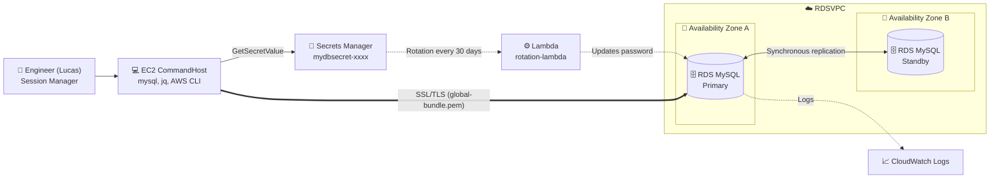

<div align="center">

# 🗄️ Building with Amazon RDS Databases

**Multi-AZ RDS MySQL, Secrets Manager with automatic rotation, SSL/TLS connection and failover testing**

     

  

</div>

---

## 📑 Table of Contents

- [📖 About the Project](#-about-the-project)
- [🎯 Objectives](#-objectives)
- [🧩 Scenario](#-scenario)
- [🏗️ Architecture](#-architecture)
- [✅ Prerequisites](#-prerequisites)
- [📊 Results](#-results)
- [🔍 Validation](#-validation)
- [💡 Key Takeaways](#-key-takeaways)
- [☁️ Services Covered](#️-services-covered)
- [👤 Author](#-author)

---

## 📖 About the Project

In this project, I **engineered and validated** a resilient, secure relational data tier on AWS: started from a production **Amazon RDS MySQL** instance configured for **Multi-AZ** high availability, implemented dynamic credential lifecycle management with automatic rotation via **AWS Secrets Manager**, enforced encrypted connections in transit using **SSL/TLS (TLS 1.3)**, and performed real-time failover stress tests proving zero data loss (**RPO = 0**).

> 💬 **Highlight:** security and availability go hand in hand — credentials kept out of code, encrypted traffic, and a synchronous standby ready to take over.

---

## 🎯 Objectives

1. 🛠️ Understand how to configure a production-grade RDS MySQL instance with **Multi-AZ**, backups and log exports.
2. 🔑 Create a **Secrets Manager** secret for the database credentials and retrieve it via console and AWS CLI.
3. 🔄 Enable **automatic rotation** of the secret through a Lambda function.
4. 🔒 Connect to the database over **SSL/TLS**, validating the server certificate.
5. ⚡ Run a **Multi-AZ failover test** and confirm data synchronization.

---

## 🧩 Scenario

To validate a mission-critical workload requiring automated failover and zero hardcoded credentials, I operated from an administrative EC2 bastion (**CommandHost**) connected via **AWS Systems Manager Session Manager** to query credentials, establish TLS sessions, and audit cluster behavior under active failover conditions.

| Parameter | Value |
|---|---|
| AWS Region | Set by the lab environment (do not change) |
| Engine | MySQL |
| Template | Production |
| Deployment | Multi-AZ DB instance (2 instances) |
| Instance class | db.t3.micro (burstable) |
| Storage | General Purpose SSD (gp3) |
| VPC / Subnets | RDSVPC / subnet group `mydbsubnetgroup` |
| Public access | No |
| Security Group | Group whose name contains `DBSecurityGroup` |
| Log exports | All available types to CloudWatch Logs |
| Initial database | `MyRDSLab` |
| Backup retention | 10 days |
| Maintenance window | Sunday, 23:00 UTC, 1 hour |
| Instance used for the rest of the lab | `mydb` (pre-provisioned) |
| Secret | `mydbsecret-xxxx` (`aws/secretsmanager` key) |
| Rotation | Every 30 days via the `rotation-lambda` Lambda function |

---

## 🏗️ Architecture



From the CommandHost session managed via Session Manager, I retrieved database credentials dynamically from Secrets Manager (with automated rotation handled by Lambda) to establish an encrypted TLS connection directly to the RDS endpoint. During a failover event, the synchronous standby instantly assumes the primary role with complete transactional integrity.

---

## ✅ Prerequisites

- Access to the lab environment on AWS Skill Builder (**Start lab** and **Open Console** buttons).
- A browser with pop-up/script blockers disabled or the lab domain allow-listed.
- A local text editor to keep the secret ARN and the command block reused several times.
- Basic knowledge of MySQL, the Linux command line and VPC concepts.

> ⚠️ **Warning:** IAM permissions in the environment are restricted to the lab scope. Do not change the Region and do not enter personal or confidential data in the environment.

---

## 📊 Results

Below is the summary of the tests performed during the lab execution from the helper instance (**CommandHost**) via Session Manager, followed by the actual commands, interactions, and outputs from each step:

| Test | Result |
|---|---|
| Creating the `RDSLabDB` instance (Task 1) | Configuration completed; creation takes about 20 min, so the lab uses the already provisioned `mydb` instance |
| Creating the secret for `mydb` | Secret stored successfully in Secrets Manager |
| Retrieving the secret (console and CLI) | Key-value pairs/JSON displayed; current version tagged `AWSCURRENT` |
| MySQL connection without SSL + `STATUS;` | `SSL` line shows **Not in use** (insecure connection identified) |
| Enabling automatic rotation | Configured successfully every 30 days via `rotation-lambda` function |
| Connection with `--ssl-ca` and `--ssl-verify-server-cert` + `STATUS;` | `SSL` line confirms active cipher: `TLS_AES_256_GCM_SHA384` |
| Creating `db_test_meter` database and `db_sync` table | Database and table created successfully via Python script |
| Reboot with failover during the test | Temporary failure recorded (~120 s) and successful primary host failover transition |
| Querying `db_sync` after failover | 203 records retrieved intact, demonstrating complete synchronization with zero data loss |

---

### 1. Retrieving and Validating the Secret in AWS Secrets Manager

Querying the versions and metadata of the provisioned secret:

```bash
aws secretsmanager list-secret-version-ids --secret-id mydbsecret-0111
```

```json
{
    "Versions": [
        {
            "VersionId": "772d5d35-7e1b-4d0b-ac7e-252f0a8c48a8",
            "VersionStages": [
                "AWSCURRENT"
            ],
            "LastAccessedDate": "2026-11-01T00:00:00+00:00",
            "CreatedDate": "2026-11-01T22:41:56.196000+00:00",
            "KmsKeyIds": [
                "DefaultEncryptionKey"
            ]
        }
    ],
    "ARN": "arn:aws:secretsmanager:us-east-1:593528889246:secret:mydbsecret-0111-Pcso5t",
    "Name": "mydbsecret-0111"
}
```

Retrieving the secret ARN and inspecting the credentials via CLI:

```bash
aws secretsmanager list-secret-version-ids --secret-id mydbsecret-0111 --output text --query ARN
```

```text
arn:aws:secretsmanager:us-east-1:593528889246:secret:mydbsecret-0111-Pcso5t
```

```bash
aws secretsmanager get-secret-value --secret-id arn:aws:secretsmanager:us-east-1:593528889246:secret:mydbsecret-0111-Pcso5t --version-stage AWSCURRENT
```

```json
{
    "ARN": "arn:aws:secretsmanager:us-east-1:593528889246:secret:mydbsecret-0111-Pcso5t",
    "Name": "mydbsecret-0111",
    "VersionId": "772d5d35-7e1b-4d0b-ac7e-252f0a8c48a8",
    "SecretString": "{\"username\":\"admin\",\"password\":\"jQzRz4F9J3i7\",\"engine\":\"mysql\",\"host\":\"mydb.c78wgqic0l6i.us-east-1.rds.amazonaws.com\",\"port\":3306,\"dbname\":\"mydb\",\"dbInstanceIdentifier\":\"mydb\"}",
    "VersionStages": [
        "AWSCURRENT"
    ],
    "CreatedDate": "2026-11-01T22:41:56.196000+00:00"
}
```

---

### 2. Initial MySQL Connection Without Encryption (SSL Inactive)

Parsing the credentials from the secret using `jq` and initiating a standard MySQL connection:

```bash
secret=$(aws secretsmanager get-secret-value --secret-id arn:aws:secretsmanager:us-east-1:593528889246:secret:mydbsecret-0111-Pcso5t | jq .SecretString | jq fromjson)
user=$(echo $secret | jq -r .username)
password=$(echo $secret | jq -r .password)
endpoint=$(echo $secret | jq -r .host)
port=$(echo $secret | jq -r .port)

mysql -h $endpoint -u $user -P $port -p$password mydb
```

Checking connection status inside the MariaDB/MySQL prompt:

```sql
STATUS;
```

```text
--------------
mysql  Ver 15.1 Distrib 10.5.29-MariaDB, for Linux (x86_64) using  EditLine wrapper

Connection id:          58
Current database:       mydb
Current user:           admin@10.0.1.112
SSL:                    Not in use
Current pager:          stdout
Using outfile:          ''
Using delimiter:        ;
Server:                 MySQL
Server version:         8.4.11 Source distribution
Protocol version:       10
Connection:             mydb.c78wgqic0l6i.us-east-1.rds.amazonaws.com via TCP/IP
Server characterset:    utf8mb4
Db     characterset:    utf8mb4
Client characterset:    utf8mb3
Conn.  characterset:    utf8mb3
TCP port:               3306
Uptime:                 1 hour 3 min 7 sec

Threads: 4  Questions: 14712  Slow queries: 0  Opens: 409  Flush tables: 3  Open tables: 273  Queries per second avg: 3.884
--------------
```

> ⚠️ The line **`SSL: Not in use`** proves that queries and database credentials traveled unencrypted prior to configuring encryption in transit.

---

### 3. Secure MySQL Connection with SSL/TLS and Certificate Verification

Configuring file permissions on AWS root certificate bundle (`global-bundle.pem`) and connecting with strict certificate validation (`--ssl-ca` and `--ssl-verify-server-cert`):

```bash
cd ~
chmod 600 global-bundle.pem

secret=$(aws secretsmanager get-secret-value --secret-id arn:aws:secretsmanager:us-east-1:593528889246:secret:mydbsecret-0111-Pcso5t | jq .SecretString | jq fromjson)
user=$(echo $secret | jq -r .username)
password=$(echo $secret | jq -r .password)
endpoint=$(echo $secret | jq -r .host)
port=$(echo $secret | jq -r .port)

mysql -h $endpoint --ssl-ca=/home/ssm-user/global-bundle.pem --ssl-verify-server-cert -u $user -P $port -p$password mydb
```

Verifying the encrypted session status:

```sql
STATUS;
```

```text
--------------
mysql  Ver 15.1 Distrib 10.5.29-MariaDB, for Linux (x86_64) using  EditLine wrapper

Connection id:          65
Current database:       mydb
Current user:           admin@10.0.1.112
SSL:                    Cipher in use is TLS_AES_256_GCM_SHA384
Current pager:          stdout
Using outfile:          ''
Using delimiter:        ;
Server:                 MySQL
Server version:         8.4.11 Source distribution
Protocol version:       10
Connection:             mydb.c78wgqic0l6i.us-east-1.rds.amazonaws.com via TCP/IP
Server characterset:    utf8mb4
Db     characterset:    utf8mb4
Client characterset:    utf8mb3
Conn.  characterset:    utf8mb3
TCP port:               3306
Uptime:                 1 hour 9 min 35 sec

Threads: 4  Questions: 15200  Slow queries: 0  Opens: 410  Flush tables: 3  Open tables: 274  Queries per second avg: 3.640
--------------
```

> 🔒 The line **`SSL: Cipher in use is TLS_AES_256_GCM_SHA384`** confirms active TLS protection and server identity verification.

---

### 4. Initialization of the Synchronization Database and Table

Running the `create_failover_sync_db.py` script to initialize the `db_test_meter` database and `db_sync` tracking table:

```bash
cd ~
python3 create_failover_sync_db.py
```

```text
This will destroy and recreate sync database and tracking table
enter y to continue, n to exit [n]: y
Connecting over SSL (y/n) [y]: y
path to ssl cert [./global-bundle.pem]: ./global-bundle.pem
mydb.c78wgqic0l6i.us-east-1.rds.amazonaws.com
Database db_test_meter created
Table db_test_meter.db_sync created
```

---

### 5. Real-Time Multi-AZ Failover Testing

Executing continuous inserts with `failover_test.py` while initiating a **Reboot with Failover** action in the Amazon RDS Management Console:

```bash
python3 failover_test.py --test_run_id test_run_0
```

Execution excerpt showing the disconnect event during failover and automatic reconnection:

```text
Connecting over SSL (y/n) [y]: y
path to ssl cert [./global-bundle.pem]: ./global-bundle.pem
mydb.c78wgqic0l6i.us-east-1.rds.amazonaws.com
Connection succeeded at Sun Nov  1 22:58:04 2026
Test starting, initial Db node hostname: ip-172-17-1-193
Insert succeeded at Sun Nov  1 22:58:04 2026 test_run_id: test_run_0, index_id:1
Insert succeeded at Sun Nov  1 22:58:04 2026 test_run_id: test_run_0, index_id:2
...
Insert succeeded at Sun Nov  1 22:59:47 2026 test_run_id: test_run_0, index_id:203
(2013, 'Lost connection to MySQL server during query (The read operation timed out)')
There was an error: Db Connection failed

Connection succeeded at Sun Nov  1 23:01:49 2026

========================================
Total Db connection attempts: 206
Successful Db connections: 205
Failed Db connections: 1
failure_start_time: Sun Nov  1 22:59:48 2026
failure_end_time: Sun Nov  1 23:01:49 2026
failure condition duration: 120 seconds
Last inserted sync record id on initial primary db node: 203
Pre-failure Db node hostname: ip-172-17-1-193
Post-failure Db node hostname: ip-172-17-4-62
Newest 5 sync records in current primary db node:
[ {'created': 1793573987, 'index_id': 203, 'test_run_id': 'test_run_0'},
  {'created': 1793573986, 'index_id': 202, 'test_run_id': 'test_run_0'},
  {'created': 1793573986, 'index_id': 201, 'test_run_id': 'test_run_0'},
  {'created': 1793573985, 'index_id': 200, 'test_run_id': 'test_run_0'},
  {'created': 1793573985, 'index_id': 199, 'test_run_id': 'test_run_0'}]
```

* **Downtime duration:** 120 seconds.
* **Pre-failure primary node:** `ip-172-17-1-193`.
* **Post-failure promoted primary node:** `ip-172-17-4-62`.
* **Last inserted sync record ID:** `203`.

---

### 6. Post-Failover Data Integrity Audit on the New Primary Node

Reconnecting over SSL and inspecting the `db_sync` table in the newly promoted primary node:

```bash
secret=$(aws secretsmanager get-secret-value --secret-id arn:aws:secretsmanager:us-east-1:593528889246:secret:mydbsecret-0111-Pcso5t | jq .SecretString | jq fromjson)
user=$(echo $secret | jq -r .username)
password=$(echo $secret | jq -r .password)
endpoint=$(echo $secret | jq -r .host)
port=$(echo $secret | jq -r .port)

mysql -h $endpoint --ssl-ca=/home/ssm-user/global-bundle.pem --ssl-verify-server-cert -u $user -P $port -p$password mydb
```

MySQL queries:

```sql
SHOW DATABASES;
USE db_test_meter;
SELECT * FROM db_sync;
```

```text
+--------------------+
| Database           |
+--------------------+
| db_test_meter      |
| information_schema |
| mydb               |
| mysql              |
| performance_schema |
| sys                |
+--------------------+
6 rows in set (0.001 sec)

Database changed
+-------------+----------+------------+
| test_run_id | index_id | created    |
+-------------+----------+------------+
| test_run_0  |        1 | 1793573884 |
| test_run_0  |        2 | 1793573884 |
| test_run_0  |        3 | 1793573885 |
...
| test_run_0  |      201 | 1793573986 |
| test_run_0  |      202 | 1793573986 |
| test_run_0  |      203 | 1793573987 |
+-------------+----------+------------+
203 rows in set (0.001 sec)
```

> 🎯 **Conclusion:** All 203 records committed to the initial primary database were preserved on the newly promoted primary node, proving **Zero Data Loss (RPO = 0)** achieved by synchronous RDS Multi-AZ replication.

---

## 🔍 Validation

| Status | Item | Obtained / Expected Result |
|:---:|---|---|
| ☑️ | Secret created and linked to `mydb` | Confirmed: `mydbsecret-0111-Pcso5t` secret listed and active in Secrets Manager |
| ☑️ | Secret version | Confirmed: single version tagged with `AWSCURRENT` stage (`772d5d35-7e1b-4d0b-ac7e-252f0a8c48a8`) |
| ☑️ | Connection without SSL | Confirmed: status indicates `SSL: Not in use` |
| ☑️ | Automatic rotation | Confirmed: 30-day rotation schedule configured with `rotation-lambda` function |
| ☑️ | Connection with verified SSL | Confirmed: status displays `SSL: Cipher in use is TLS_AES_256_GCM_SHA384` |
| ☑️ | Failover summary | Confirmed: host transition from `ip-172-17-1-193` to `ip-172-17-4-62` over 120 s downtime |
| ☑️ | Post-failover `db_sync` table | Confirmed: all 203 rows of `test_run_0` recovered intact on the new node |

---

## 💡 Key Takeaways

- 🛡️ **Multi-AZ = high availability, not read scaling:** the standby is synchronous and not accessible to clients; it exists for automatic failover and shorter maintenance downtime.
- 💾 **Backups from the standby:** in Multi-AZ, automated snapshots are preferably taken from the standby, relieving the primary.
- 🔑 **Secrets out of code:** Secrets Manager delivers credentials via API, with IAM access control and KMS encryption; the EC2 role needs permissions such as `GetSecretValue`.
- 🔄 **Automatic rotation:** happens in steps (create, set, test, finish) using stages such as `AWSPENDING` and `AWSCURRENT`.
- 🔒 **Encryption in transit:** SSL/TLS protects traffic; verifying the server certificate against the certificate bundle ensures the endpoint is truly RDS.
- 🌐 **Private access:** keeping `Publicly accessible = No` and restricting access with Security Groups shrinks the attack surface.
- ⚠️ **Lab vs. best practice:** storing passwords in environment variables (done here for simplicity) is not recommended in production.
- 🎓 **SAA-C03 exam relevance:** Multi-AZ vs. Read Replicas, automatic failover, Secrets Manager vs. Parameter Store (native rotation), encryption in transit and at rest, and databases in private subnets are recurring exam topics.


---

## ☁️ Services Covered

       

| Service | Role in the lab |
|---|---|
| Amazon RDS (MySQL) | Multi-AZ relational database with backups and logs |
| AWS Secrets Manager | Store, retrieve and rotate database credentials |
| AWS Lambda | Run the secret rotation logic |
| Amazon EC2 (CommandHost) | Client for CLI, MySQL and test scripts |
| AWS Systems Manager (Session Manager) | Terminal access to the CommandHost |
| Amazon VPC / Security Groups | Private network and database access control |
| AWS IAM | EC2 role with permission to read the secret |
| AWS KMS | `aws/secretsmanager` key that encrypts the secret |
| Amazon CloudWatch Logs | Destination for RDS log exports |

---

## 👤 Author

**Lucas Barretto**

[](https://www.linkedin.com/in/lucaspimentabarretto) [](https://github.com/lbarretto)

---

<div align="center">

*Optional lab completed on the AWS Skill Builder platform.*

</div>