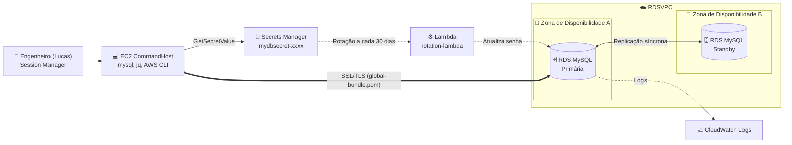

<div align="center">

# 🗄️ Construindo com Bancos de Dados Amazon RDS

**RDS MySQL Multi-AZ, Secrets Manager com rotação automática, conexão SSL/TLS e teste de failover**

     

  

</div>

---

## 📑 Sumário

- [📖 Sobre o Projeto](#-sobre-o-projeto)
- [🎯 Objetivos](#-objetivos)
- [🧩 Cenário](#-cenário)
- [🏗️ Arquitetura](#-arquitetura)
- [✅ Pré-requisitos](#-pré-requisitos)
- [📊 Resultado](#-resultado)
- [🔍 Validação](#-validação)
- [💡 Principais Aprendizados](#-principais-aprendizados)
- [☁️ Serviços Abordados](#️-serviços-abordados)
- [👤 Autor](#-autor)

---

## 📖 Sobre o Projeto

Neste projeto, **estruturei e validei** uma camada de dados relacional resiliente e segura na AWS: parti de um banco **Amazon RDS MySQL** configurado em alta disponibilidade **Multi-AZ**, configurei o gerenciamento dinâmico de credenciais com rotação automática via **AWS Secrets Manager**, forcei a criptografia em trânsito com **SSL/TLS (TLS 1.3)** e conduzi testes de failover em tempo real com preservação integral dos dados (**RPO = 0**).

> 💬 **Destaque:** segurança e disponibilidade andam juntas — credenciais fora do código, tráfego criptografado e uma réplica síncrona pronta para assumir.

---

## 🎯 Objetivos

1. 🛠️ Entender a configuração de uma instância RDS MySQL de produção com **Multi-AZ**, backups e exportação de logs.
2. 🔑 Criar um segredo no **Secrets Manager** para as credenciais do banco e recuperá-lo pelo console e pela AWS CLI.
3. 🔄 Habilitar a **rotação automática** do segredo por meio de uma função Lambda.
4. 🔒 Conectar ao banco com **SSL/TLS** validando o certificado do servidor.
5. ⚡ Executar um **teste de failover Multi-AZ** e confirmar a sincronização dos dados.

---

## 🧩 Cenário

Para simular uma aplicação corporativa crítica que demanda banco relacional com tolerância a falhas e tráfego seguro, atuei a partir de uma instância de gerência (**CommandHost**) conectada via **AWS Systems Manager Session Manager** para gerenciar as credenciais, validar as conexões criptografadas e auditar o comportamento do cluster RDS sob estresse.

| Parâmetro | Valor |
|---|---|
| Região AWS | Definida pelo ambiente do laboratório (não alterar) |
| Mecanismo | MySQL |
| Modelo | Produção |
| Implantação | Multi-AZ DB instance (2 instâncias) |
| Classe da instância | db.t3.micro (burstable) |
| Armazenamento | Uso geral SSD (gp3) |
| VPC / Sub-redes | RDSVPC / grupo de sub-redes `mydbsubnetgroup` |
| Acesso público | Não |
| Security Group | Grupo contendo `DBSecurityGroup` no nome |
| Exportação de logs | Todos os tipos disponíveis para o CloudWatch Logs |
| Banco inicial | `MyRDSLab` |
| Retenção de backup | 10 dias |
| Janela de manutenção | Domingo, 23:00 UTC, duração de 1 hora |
| Instância usada no restante do lab | `mydb` (pré-provisionada) |
| Segredo | `mydbsecret-xxxx` (chave `aws/secretsmanager`) |
| Rotação | A cada 30 dias, via função Lambda `rotation-lambda` |

---

## 🏗️ Arquitetura



A partir da instância CommandHost acessada via Session Manager, recuperei programaticamente as credenciais seguras do Secrets Manager (com rotação automatizada via Lambda) para estabelecer uma conexão criptografada via TLS com o endpoint do RDS. Em caso de failover, a instância standby sincronizada assume imediatamente o papel de primária sem perda de registros.

---

## ✅ Pré-requisitos

- Acesso ao ambiente do laboratório no AWS Skill Builder (botões **Start lab** e **Open Console**).
- Navegador com bloqueadores de pop-up/script desativados ou com o domínio do lab liberado.
- Um editor de texto local para guardar o ARN do segredo e o bloco de comandos usado várias vezes.
- Noções básicas de MySQL, linha de comando Linux e conceitos de VPC.

> ⚠️ **Atenção:** as permissões IAM do ambiente são restritas ao escopo do laboratório. Não altere a região e não inclua dados pessoais ou confidenciais no ambiente.

---

## 📊 Resultado

Abaixo está o resumo dos testes realizados durante a execução do laboratório através da instância de apoio (**CommandHost**) via Session Manager, seguido pelos comandos, interações e saídas reais de cada etapa:

| Teste | Resultado |
|---|---|
| Criação da instância `RDSLabDB` (Tarefa 1) | Configuração concluída; a criação leva cerca de 20 min, então o lab usa a instância `mydb` já provisionada |
| Criação do segredo para `mydb` | Segredo armazenado com sucesso no Secrets Manager |
| Recuperação do segredo (console e CLI) | Pares chave-valor/JSON exibidos; versão atual marcada como `AWSCURRENT` |
| Conexão MySQL sem SSL + `STATUS;` | Linha `SSL` indica **Not in use** (conexão insegura identificada) |
| Ativação da rotação automática | Configurada com sucesso a cada 30 dias com a função `rotation-lambda` |
| Conexão com `--ssl-ca` e `--ssl-verify-server-cert` + `STATUS;` | Linha `SSL` confirma cifra ativa: `TLS_AES_256_GCM_SHA384` |
| Criação do banco `db_test_meter` e tabela `db_sync` | Banco e tabela criados com sucesso via script Python |
| Reboot com failover durante o teste | Falha temporária registrada (~120 s) e transição bem-sucedida do host primário |
| Consulta à tabela `db_sync` após o failover | 203 registros recuperados intactos, comprovando sincronização total sem perda de dados |

---

### 1. Recuperação e Validação do Segredo no AWS Secrets Manager

Consulta das versões e metadados do segredo provisionado:

```bash
aws secretsmanager list-secret-version-ids --secret-id mydbsecret-0111
```

```json
{
    "Versions": [
        {
            "VersionId": "772d5d35-7e1b-4d0b-ac7e-252f0a8c48a8",
            "VersionStages": [
                "AWSCURRENT"
            ],
            "LastAccessedDate": "2026-11-01T00:00:00+00:00",
            "CreatedDate": "2026-11-01T22:41:56.196000+00:00",
            "KmsKeyIds": [
                "DefaultEncryptionKey"
            ]
        }
    ],
    "ARN": "arn:aws:secretsmanager:us-east-1:593528889246:secret:mydbsecret-0111-Pcso5t",
    "Name": "mydbsecret-0111"
}
```

Obtenção do ARN e leitura direta das credenciais via CLI:

```bash
aws secretsmanager list-secret-version-ids --secret-id mydbsecret-0111 --output text --query ARN
```

```text
arn:aws:secretsmanager:us-east-1:593528889246:secret:mydbsecret-0111-Pcso5t
```

```bash
aws secretsmanager get-secret-value --secret-id arn:aws:secretsmanager:us-east-1:593528889246:secret:mydbsecret-0111-Pcso5t --version-stage AWSCURRENT
```

```json
{
    "ARN": "arn:aws:secretsmanager:us-east-1:593528889246:secret:mydbsecret-0111-Pcso5t",
    "Name": "mydbsecret-0111",
    "VersionId": "772d5d35-7e1b-4d0b-ac7e-252f0a8c48a8",
    "SecretString": "{\"username\":\"admin\",\"password\":\"jQzRz4F9J3i7\",\"engine\":\"mysql\",\"host\":\"mydb.c78wgqic0l6i.us-east-1.rds.amazonaws.com\",\"port\":3306,\"dbname\":\"mydb\",\"dbInstanceIdentifier\":\"mydb\"}",
    "VersionStages": [
        "AWSCURRENT"
    ],
    "CreatedDate": "2026-11-01T22:41:56.196000+00:00"
}
```

---

### 2. Conexão Inicial ao MySQL sem Criptografia (SSL Inativo)

Extração dos dados do segredo usando `jq` e conexão padrão ao banco:

```bash
secret=$(aws secretsmanager get-secret-value --secret-id arn:aws:secretsmanager:us-east-1:593528889246:secret:mydbsecret-0111-Pcso5t | jq .SecretString | jq fromjson)
user=$(echo $secret | jq -r .username)
password=$(echo $secret | jq -r .password)
endpoint=$(echo $secret | jq -r .host)
port=$(echo $secret | jq -r .port)

mysql -h $endpoint -u $user -P $port -p$password mydb
```

No prompt do MariaDB/MySQL, verificação do status da conexão:

```sql
STATUS;
```

```text
--------------
mysql  Ver 15.1 Distrib 10.5.29-MariaDB, for Linux (x86_64) using  EditLine wrapper

Connection id:          58
Current database:       mydb
Current user:           admin@10.0.1.112
SSL:                    Not in use
Current pager:          stdout
Using outfile:          ''
Using delimiter:        ;
Server:                 MySQL
Server version:         8.4.11 Source distribution
Protocol version:       10
Connection:             mydb.c78wgqic0l6i.us-east-1.rds.amazonaws.com via TCP/IP
Server characterset:    utf8mb4
Db     characterset:    utf8mb4
Client characterset:    utf8mb3
Conn.  characterset:    utf8mb3
TCP port:               3306
Uptime:                 1 hour 3 min 7 sec

Threads: 4  Questions: 14712  Slow queries: 0  Opens: 409  Flush tables: 3  Open tables: 273  Queries per second avg: 3.884
--------------
```

> ⚠️ A linha **`SSL: Not in use`** comprova que as credenciais e consultas trafegavam em texto puro antes da configuração de criptografia em trânsito.

---

### 3. Conexão Segura ao MySQL com Criptografia SSL/TLS e Validação de Certificado

Definição de permissões no arquivo de certificados raiz da AWS (`global-bundle.pem`) e conexão impondo validação estrita do certificado do RDS (`--ssl-ca` e `--ssl-verify-server-cert`):

```bash
cd ~
chmod 600 global-bundle.pem

secret=$(aws secretsmanager get-secret-value --secret-id arn:aws:secretsmanager:us-east-1:593528889246:secret:mydbsecret-0111-Pcso5t | jq .SecretString | jq fromjson)
user=$(echo $secret | jq -r .username)
password=$(echo $secret | jq -r .password)
endpoint=$(echo $secret | jq -r .host)
port=$(echo $secret | jq -r .port)

mysql -h $endpoint --ssl-ca=/home/ssm-user/global-bundle.pem --ssl-verify-server-cert -u $user -P $port -p$password mydb
```

Verificação do status seguro no banco:

```sql
STATUS;
```

```text
--------------
mysql  Ver 15.1 Distrib 10.5.29-MariaDB, for Linux (x86_64) using  EditLine wrapper

Connection id:          65
Current database:       mydb
Current user:           admin@10.0.1.112
SSL:                    Cipher in use is TLS_AES_256_GCM_SHA384
Current pager:          stdout
Using outfile:          ''
Using delimiter:        ;
Server:                 MySQL
Server version:         8.4.11 Source distribution
Protocol version:       10
Connection:             mydb.c78wgqic0l6i.us-east-1.rds.amazonaws.com via TCP/IP
Server characterset:    utf8mb4
Db     characterset:    utf8mb4
Client characterset:    utf8mb3
Conn.  characterset:    utf8mb3
TCP port:               3306
Uptime:                 1 hour 9 min 35 sec

Threads: 4  Questions: 15200  Slow queries: 0  Opens: 410  Flush tables: 3  Open tables: 274  Queries per second avg: 3.640
--------------
```

> 🔒 A linha **`SSL: Cipher in use is TLS_AES_256_GCM_SHA384`** confirma a proteção da conexão com TLS e validação criptográfica do endpoint do servidor.

---

### 4. Inicialização do Banco e Tabela de Sincronização

Execução do script `create_failover_sync_db.py` para provisionamento do banco `db_test_meter` e da tabela `db_sync`:

```bash
cd ~
python3 create_failover_sync_db.py
```

```text
This will destroy and recreate sync database and tracking table
enter y to continue, n to exit [n]: y
Connecting over SSL (y/n) [y]: y
path to ssl cert [./global-bundle.pem]: ./global-bundle.pem
mydb.c78wgqic0l6i.us-east-1.rds.amazonaws.com
Database db_test_meter created
Table db_test_meter.db_sync created
```

---

### 5. Execução do Teste de Failover Multi-AZ em Tempo Real

Execução contínua de inserções com o script `failover_test.py` enquanto uma ação de **Reboot com Failover** é acionada no console do Amazon RDS:

```bash
python3 failover_test.py --test_run_id test_run_0
```

Trecho de execução destacando o momento da desconexão, failover e restabelecimento automático:

```text
Connecting over SSL (y/n) [y]: y
path to ssl cert [./global-bundle.pem]: ./global-bundle.pem
mydb.c78wgqic0l6i.us-east-1.rds.amazonaws.com
Connection succeeded at Sun Nov  1 22:58:04 2026
Test starting, initial Db node hostname: ip-172-17-1-193
Insert succeeded at Sun Nov  1 22:58:04 2026 test_run_id: test_run_0, index_id:1
Insert succeeded at Sun Nov  1 22:58:04 2026 test_run_id: test_run_0, index_id:2
...
Insert succeeded at Sun Nov  1 22:59:47 2026 test_run_id: test_run_0, index_id:203
(2013, 'Lost connection to MySQL server during query (The read operation timed out)')
There was an error: Db Connection failed

Connection succeeded at Sun Nov  1 23:01:49 2026

========================================
Total Db connection attempts: 206
Successful Db connections: 205
Failed Db connections: 1
failure_start_time: Sun Nov  1 22:59:48 2026
failure_end_time: Sun Nov  1 23:01:49 2026
failure condition duration: 120 seconds
Last inserted sync record id on initial primary db node: 203
Pre-failure Db node hostname: ip-172-17-1-193
Post-failure Db node hostname: ip-172-17-4-62
Newest 5 sync records in current primary db node:
[ {'created': 1793573987, 'index_id': 203, 'test_run_id': 'test_run_0'},
  {'created': 1793573986, 'index_id': 202, 'test_run_id': 'test_run_0'},
  {'created': 1793573986, 'index_id': 201, 'test_run_id': 'test_run_0'},
  {'created': 1793573985, 'index_id': 200, 'test_run_id': 'test_run_0'},
  {'created': 1793573985, 'index_id': 199, 'test_run_id': 'test_run_0'}]
```

* **Duração da indisponibilidade:** 120 segundos.
* **Nó primário pré-falha:** `ip-172-17-1-193`.
* **Nó primário pós-falha (promovido):** `ip-172-17-4-62`.
* **Último ID inserido antes da perda:** `203`.

---

### 6. Auditoria de Integridade dos Dados Pós-Failover

Reconexão com SSL e conferência da integridade da tabela `db_sync` no novo nó primário promovido:

```bash
secret=$(aws secretsmanager get-secret-value --secret-id arn:aws:secretsmanager:us-east-1:593528889246:secret:mydbsecret-0111-Pcso5t | jq .SecretString | jq fromjson)
user=$(echo $secret | jq -r .username)
password=$(echo $secret | jq -r .password)
endpoint=$(echo $secret | jq -r .host)
port=$(echo $secret | jq -r .port)

mysql -h $endpoint --ssl-ca=/home/ssm-user/global-bundle.pem --ssl-verify-server-cert -u $user -P $port -p$password mydb
```

Consultas no MySQL:

```sql
SHOW DATABASES;
USE db_test_meter;
SELECT * FROM db_sync;
```

```text
+--------------------+
| Database           |
+--------------------+
| db_test_meter      |
| information_schema |
| mydb               |
| mysql              |
| performance_schema |
| sys                |
+--------------------+
6 rows in set (0.001 sec)

Database changed
+-------------+----------+------------+
| test_run_id | index_id | created    |
+-------------+----------+------------+
| test_run_0  |        1 | 1793573884 |
| test_run_0  |        2 | 1793573884 |
| test_run_0  |        3 | 1793573885 |
...
| test_run_0  |      201 | 1793573986 |
| test_run_0  |      202 | 1793573986 |
| test_run_0  |      203 | 1793573987 |
+-------------+----------+------------+
203 rows in set (0.001 sec)
```

> 🎯 **Conclusão:** Todos os 203 registros gravados na instância primária original foram preservados na nova primária, confirmando **Zero Data Loss (RPO = 0)** através da replicação síncrona do RDS Multi-AZ.

---

## 🔍 Validação

| Status | Item | Resultado Obtido / Esperado |
|:---:|---|---|
| ☑️ | Segredo criado e associado ao `mydb` | Confirmado: segredo `mydbsecret-0111-Pcso5t` listado e ativo no Secrets Manager |
| ☑️ | Versão do segredo | Confirmado: versão única com estágio `AWSCURRENT` (`772d5d35-7e1b-4d0b-ac7e-252f0a8c48a8`) |
| ☑️ | Conexão sem SSL | Confirmado: status indica `SSL: Not in use` |
| ☑️ | Rotação automática | Confirmado: agendamento a cada 30 dias via função `rotation-lambda` |
| ☑️ | Conexão com SSL verificado | Confirmado: status exibe `SSL: Cipher in use is TLS_AES_256_GCM_SHA384` |
| ☑️ | Resumo do failover | Confirmado: transição de `ip-172-17-1-193` para `ip-172-17-4-62` com 120 s de duração |
| ☑️ | Tabela `db_sync` pós-failover | Confirmado: todas as 203 linhas de `test_run_0` recuperadas intactas no novo nó |

---

## 💡 Principais Aprendizados

- 🛡️ **Multi-AZ = alta disponibilidade, não escalabilidade de leitura:** a standby é síncrona e inacessível aos clientes; serve para failover automático e reduz o downtime de manutenção.
- 💾 **Backups pelo standby:** em Multi-AZ, os snapshots automáticos são feitos preferencialmente pela standby, aliviando a primária.
- 🔑 **Segredos fora do código:** o Secrets Manager entrega credenciais via API, com controle por IAM e criptografia por KMS; o perfil da EC2 precisa de permissões como `GetSecretValue`.
- 🔄 **Rotação automática:** ocorre em etapas (criar, definir, testar, finalizar) usando estágios como `AWSPENDING` e `AWSCURRENT`.
- 🔒 **Criptografia em trânsito:** SSL/TLS protege o tráfego; validar o certificado do servidor com o pacote de certificados garante que o destino é de fato o RDS.
- 🌐 **Acesso privado:** manter `Publicly accessible = No` e restringir o acesso por Security Group reduz a superfície de ataque.
- ⚠️ **Boa prática x laboratório:** guardar senhas em variáveis de ambiente (como feito aqui por simplicidade) não é recomendado em produção.
- 🎓 **Relevância para a prova SAA-C03:** Multi-AZ vs. Read Replicas, failover automático, Secrets Manager vs. Parameter Store (rotação nativa), criptografia em trânsito e em repouso, e banco em sub-redes privadas são temas recorrentes.


---

## ☁️ Serviços Abordados

       

| Serviço | Papel no laboratório |
|---|---|
| Amazon RDS (MySQL) | Banco relacional Multi-AZ com backups e logs |
| AWS Secrets Manager | Armazenar, recuperar e rotacionar as credenciais do banco |
| AWS Lambda | Executar a lógica de rotação do segredo |
| Amazon EC2 (CommandHost) | Cliente para CLI, MySQL e scripts de teste |
| AWS Systems Manager (Session Manager) | Acesso ao terminal do CommandHost |
| Amazon VPC / Security Groups | Rede privada e controle de acesso ao banco |
| AWS IAM | Perfil da EC2 com permissões de leitura do segredo |
| AWS KMS | Chave `aws/secretsmanager` que cifra o segredo |
| Amazon CloudWatch Logs | Destino da exportação de logs do RDS |

---

## 👤 Autor

**Lucas Barretto**

[](https://www.linkedin.com/in/lucaspimentabarretto) [](https://github.com/lbarretto)

---

<div align="center">

*Laboratório opcional realizado na plataforma AWS Skill Builder.*

</div>