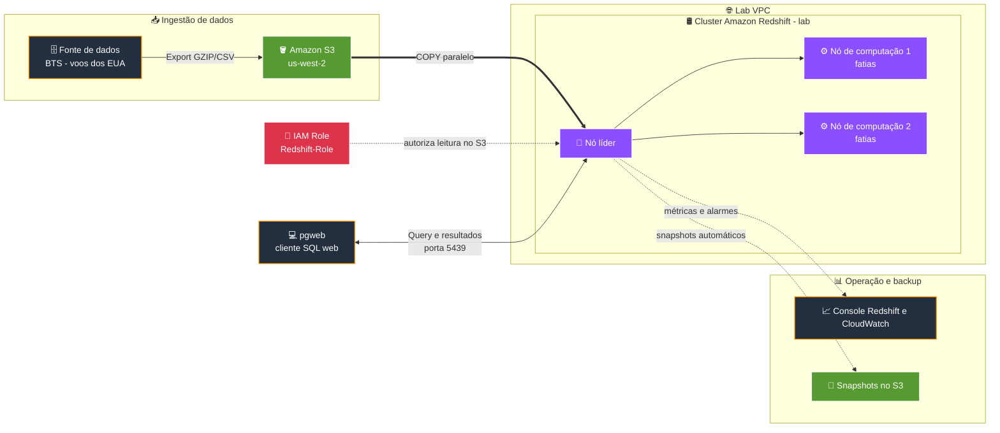
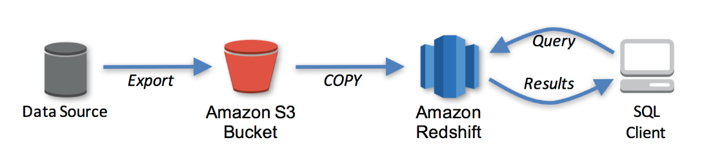

<div align="center">

<h1>🛢️ Trabalhando com Amazon Redshift</h1>

**Laboratório prático: Data warehouse na AWS com análise de dados de voos domésticos dos EUA**

     

  

</div>

---

## 📑 Sumário

- [📖 Sobre o Projeto](#-sobre-o-projeto)
- [🎯 Objetivos](#-objetivos)
- [🧩 Cenário](#-cenário)
- [🏗️ Arquitetura](#️-arquitetura)
- [✅ Pré-requisitos](#-pré-requisitos)
- [📊 Resultado](#-resultado)
- [🔍 Validação](#-validação)
- [💡 Principais Aprendizados](#-principais-aprendizados)
- [☁️ Serviços Abordados](#️-serviços-abordados)
- [👤 Autor](#-autor)

---

## 📖 Sobre o Projeto

Neste laboratório eu provisionei um cluster **Amazon Redshift** do zero e o usei para analisar cerca de 97 milhões de registros de voos domésticos dos Estados Unidos. Conectei um cliente SQL web ao cluster, carreguei os dados compactados direto do **Amazon S3** com o comando `COPY`, cruzei tabelas de dimensão (aeronaves e aeroportos), li planos de execução com `EXPLAIN` e acompanhei o consumo de disco e o histórico de queries pelo console.

Fui montando o ambiente em camadas. Primeiro vieram a infraestrutura e o acesso, depois a ingestão, as consultas analíticas, a otimização e, por fim, o monitoramento e a exclusão do cluster.

> 💬 *Aprendi na prática que, no Redshift, o desempenho nasce de decisões de modelagem (chave de distribuição, chave de ordenação e compressão colunar), e não de índices como nos bancos tradicionais.*

---

## 🎯 Objetivos

1. 🚀 Provisionar um cluster Amazon Redshift com nós `ra3.large` e um perfil IAM associado.
2. 🔌 Conectar um cliente SQL ao cluster pelo endpoint e pela porta `5439`.
3. 📥 Carregar dados do Amazon S3 com `COPY` em paralelo, a partir de arquivos compactados em GZIP.
4. 🔎 Consultar e agregar dados com SQL padrão sobre quase 100 milhões de linhas.
5. 🔗 Unir tabelas fato e dimensão com `JOIN`.
6. 📈 Analisar planos de execução com `EXPLAIN` e recomendações de compressão com `ANALYZE COMPRESSION`.
7. 🧱 Criar tabelas derivadas com `CREATE TABLE AS` (CTAS), definindo `DISTKEY` e `SORTKEY`.
8. 💾 Medir o uso de disco do cluster e o espaço ocupado por cada tabela.
9. 🖥️ Explorar o monitoramento de consultas, os alarmes e os snapshots no console.

---

## 🧩 Cenário

Eu precisava transformar dados brutos e detalhados de voos comerciais (de 1990 a 2012, do Bureau of Transportation Statistics dos EUA) em informação analítica. O volume era de cerca de 6 GB descompactados, ou aproximadamente 700 MB em GZIP, distribuídos em 23 arquivos CSV no S3. O desafio era carregar tudo de forma eficiente, descobrir quais operadoras, aeronaves e aeroportos concentram mais movimento e entender como o Redshift processa essas queries por baixo dos panos.

| Parâmetro | Valor |
|---|---|
| Região AWS | `us-west-2` (Oregon) |
| Identificador do cluster | `lab` |
| Tipo de nó | `ra3.large` (obrigatório no lab) |
| Número de nós | 2 (conforme configurado no roteiro) |
| Nome do banco de dados | `lab` |
| Usuário administrador | `master` |
| Senha do administrador | `********` *(omitida)* |
| Porta | `5439` |
| Perfil IAM associado | `Redshift-Role` |
| VPC / Security Group | `Lab VPC` / `Redshift Security Group` |
| Registro no Glue Data Catalog | Sem permissões federadas do Redshift |
| Relocação de cluster | Desabilitada |
| Cliente SQL | `pgweb` (cliente PostgreSQL web) |
| Origem dos dados | Bucket S3 de treinamento na região `us-west-2` |
| Tabelas criadas | `flights`, `aircraft`, `airports`, `vegas_flights` |

---

## 🏗️ Arquitetura



Estruturei o fluxo de ponta a ponta. Os dados partem do S3 em arquivos GZIP e entram no cluster por `COPY`, autorizado pelo perfil IAM `Redshift-Role` associado ao cluster. O nó líder recebe as queries do `pgweb` e distribui o trabalho às fatias dos nós de computação, que processam em paralelo e devolvem os resultados ao cliente. A tabela `flights` usa `carrier` como `DISTKEY`, para que as linhas de uma mesma operadora fiquem juntas e agilizem `GROUP BY` e `JOIN` nessa coluna. Em paralelo, o console e o CloudWatch me deram a visão de monitoramento, e os snapshots garantiram o backup do cluster.

Também registrei o fluxo geral do processo de carga, que o roteiro apresenta em um diagrama oficial: exporto os dados da fonte, deposito os arquivos no bucket do S3, carrego no Redshift com `COPY` e consulto pelo cliente SQL, que recebe os resultados de volta.

<div align="center"></div>

*Figura 1: Fluxo de carga e consulta de dados no Amazon Redshift (fonte de dados, Amazon S3, `COPY`, Amazon Redshift e cliente SQL).*

---

## ✅ Pré-requisitos

- Conhecimento básico de bancos de dados relacionais e SQL.
- Acesso ao AWS Management Console no ambiente do laboratório, com a região `us-west-2`.
- Perfil IAM `Redshift-Role` já disponível na conta, com acesso de leitura ao bucket S3 do laboratório.
- Navegador web para abrir o `pgweb` e o console do Redshift.

> ⚠️ **Nota:** Ambiente de capacitação com permissões IAM restritas.

> 🔒 **Proteção de dados:** nos comandos abaixo, o ID de conta de 12 dígitos no ARN foi substituído por `<ACCOUNT_ID>`, e a senha do administrador foi omitida. Antes de executar, use o ARN real do seu perfil `Redshift-Role`.

---

## 📊 Resultado

Como o roteiro não trazia capturas de tela, documentei cada etapa com os comandos SQL que executei no `pgweb` e com o resultado observado, sempre na ordem em que rodei.

### 🚀 Etapa 1: Provisionamento do cluster

No console do Amazon Redshift, criei o cluster `lab` com 2 nós `ra3.large`, banco `lab` e usuário `master`. Associei o perfil `Redshift-Role`, escolhi a `Lab VPC` com o `Redshift Security Group` (removendo o grupo padrão) e desabilitei a relocação do cluster. Aguardei até cinco minutos para o status ficar **Disponível**.

| Teste / Ação Realizada | Resultado Observado | Status |
|---|---|---|
| Criação do cluster `lab` (`ra3.large`) | Cluster provisionado e com status Disponível | ✅ |
| Associação do perfil `Redshift-Role` | Perfil associado ao cluster | ✅ |

> 📷 *[Imagem pendente: Envie o print referente ao cluster `lab` com status Disponível para atualização]*

### 🔌 Etapa 2: Conexão pelo pgweb

Copiei o endpoint do cluster, removi o sufixo `:5439/lab` e informei o host, o usuário `master`, o banco `lab` e a porta `5439` na tela de login do `pgweb`.

| Teste / Ação Realizada | Resultado Observado | Status |
|---|---|---|
| Conexão ao cluster pelo `pgweb` | Sessão estabelecida com o banco `lab` | ✅ |

> 📷 *[Imagem pendente: Envie o print referente à conexão do pgweb para atualização]*

### 🧱 Etapa 3: Criação da tabela `flights` e carga com `COPY`

Criei a tabela fato com `carrier` como chave de distribuição (`DISTKEY`):

```sql
CREATE TABLE flights (
  year           smallint,
  month          smallint,
  day            smallint,
  carrier        varchar(80) DISTKEY,
  origin         char(3),
  dest           char(3),
  aircraft_code  char(3),
  miles          int,
  departures     int,
  minutes        int,
  seats          int,
  passengers     int,
  freight_pounds int
);
```

Depois carreguei os dados do S3. O `COPY` leu os 23 arquivos GZIP em paralelo, distribuídos entre as fatias dos nós:

```sql
COPY flights
FROM 's3://us-west-2-aws-training/courses/spl-17/v4.2.20.prod-fd1dbe42/data/flights-usa'
IAM_ROLE 'arn:aws:iam::<ACCOUNT_ID>:role/Redshift-Role'
GZIP
DELIMITER ','
REMOVEQUOTES
REGION 'us-west-2';
```

| Parâmetro do `COPY` | Função |
|---|---|
| `FROM` | Localização dos arquivos no S3 |
| `IAM_ROLE` | Permissão para o Redshift ler o bucket |
| `GZIP` | Descompactação automática durante a carga |
| `DELIMITER ','` | Separador de campos do CSV |
| `REMOVEQUOTES` | Remove aspas ao redor dos valores |
| `REGION` | Região do bucket de origem |

| Teste / Ação Realizada | Resultado Observado | Status |
|---|---|---|
| `CREATE TABLE flights` | Tabela exibida no painel Tabelas | ✅ |
| `COPY flights` | Carga concluída em cerca de 3 minutos, com retorno "No records found" | ✅ |

### 🔎 Etapa 4: Consultas analíticas na tabela `flights`

Conferi o volume carregado e olhei uma amostra aleatória para entender a granularidade dos dados:

```sql
SELECT COUNT(*) FROM flights;
```

```sql
SELECT *
FROM flights
ORDER BY random()
LIMIT 10;
```

Em seguida, ranqueei as operadoras por número de partidas:

```sql
SELECT
  carrier,
  SUM (departures)
FROM flights
GROUP BY carrier
ORDER BY 2 DESC
LIMIT 10;
```

Repeti a mesma consulta trocando apenas a expressão agregada, para comparar o ranking por outras métricas:

| Métrica analisada | Expressão no `SUM(...)` |
|---|---|
| Passageiros transportados | `passengers` |
| Milhas voadas | `miles` |
| Passageiros-milhas | `passengers * miles` |
| Frete transportado | `freight_pounds` |

| Teste / Ação Realizada | Resultado Observado | Status |
|---|---|---|
| `SELECT COUNT(*)` | Cerca de 96,8 milhões de registros (roteiro indica 96.825.753) | ✅ |
| Amostra com `random()` | 10 linhas aleatórias retornadas com as 13 colunas | ✅ |
| Top 10 operadoras por partidas, passageiros, milhas, passageiros-milhas e frete | Cinco rankings gerados, cada um em poucos segundos | ✅ |

### 🔗 Etapa 5: Tabela `aircraft` e `JOIN`

Criei a tabela de dimensão de aeronaves, com `aircraft_code` como `SORTKEY`:

```sql
CREATE TABLE aircraft (
  aircraft_code CHAR(3) SORTKEY,
  aircraft      VARCHAR(100)
);
```

```sql
COPY aircraft
FROM 's3://us-west-2-aws-training/courses/spl-17/v4.2.20.prod-fd1dbe42/data/lookup_aircraft.csv'
IAM_ROLE 'arn:aws:iam::<ACCOUNT_ID>:role/Redshift-Role'
IGNOREHEADER 1
DELIMITER ','
REMOVEQUOTES
TRUNCATECOLUMNS
REGION 'us-west-2';
```

```sql
SELECT *
FROM aircraft
ORDER BY random()
LIMIT 10;
```

Com a dimensão carregada, uni `flights` e `aircraft` para descobrir os tipos de aeronave com mais viagens:

```sql
SELECT
  aircraft,
  SUM(departures) AS trips
FROM flights
JOIN aircraft using (aircraft_code)
GROUP BY aircraft
ORDER BY trips DESC
LIMIT 10;
```

| Teste / Ação Realizada | Resultado Observado | Status |
|---|---|---|
| `CREATE TABLE aircraft` e `COPY aircraft` | 383 tipos de aeronave carregados | ✅ |
| `JOIN` entre `flights` e `aircraft` | Top 10 aeronaves por número de viagens retornado | ✅ |

### 📈 Etapa 6: Plano de execução e compressão

Desativei o cache de resultados da sessão para avaliar o custo real da query e usei `EXPLAIN` sobre o mesmo `JOIN`:

```sql
SET enable_result_cache_for_session TO OFF;
EXPLAIN
SELECT
  aircraft,
  SUM(departures) AS trips
FROM flights
JOIN aircraft using (aircraft_code)
GROUP BY aircraft
ORDER BY trips DESC
LIMIT 10;
```

Li o plano de baixo para cima. Ele faz um `Seq Scan` em `flights`, outro em `aircraft`, um `Hash Join` com `DS_BCAST_INNER` (a tabela pequena é replicada aos nós), um `HashAggregate`, a ordenação e o `Limit` final. Notei que o Redshift não usa índices e varre mais de 96 milhões de linhas em poucos segundos graças ao armazenamento colunar e ao paralelismo.

Depois pedi as recomendações de compressão por coluna:

```sql
ANALYZE COMPRESSION flights;
```

| Teste / Ação Realizada | Resultado Observado | Status |
|---|---|---|
| `EXPLAIN` da query com `JOIN` | Plano com `Seq Scan`, `Hash Join DS_BCAST_INNER` e `HashAggregate` | ✅ |
| `ANALYZE COMPRESSION flights` | Encodings recomendados listados por coluna | ✅ |

### 🧱 Etapa 7: Tabela derivada `vegas_flights` (CTAS)

Criei a tabela de aeroportos para traduzir códigos de 3 letras em nomes legíveis:

```sql
CREATE TABLE airports (
  airport_code CHAR(3) SORTKEY,
  airport      varchar(100)
);
```

```sql
COPY airports
FROM 's3://us-west-2-aws-training/courses/spl-17/v4.2.20.prod-fd1dbe42/data/lookup_airports.csv'
IAM_ROLE 'arn:aws:iam::<ACCOUNT_ID>:role/Redshift-Role'
IGNOREHEADER 1
DELIMITER ','
REMOVEQUOTES
TRUNCATECOLUMNS
REGION 'us-west-2';
```

Para analisar só os voos com destino a Las Vegas, criei uma tabela derivada com `DISTKEY` e `SORTKEY` em `origin`:

```sql
CREATE TABLE vegas_flights
  DISTKEY (origin)
  SORTKEY (origin)
AS
SELECT
  flights.*,
  airport
FROM flights
JOIN airports ON origin = airport_code
WHERE dest = 'LAS';
```

Por fim, descobri de onde vem a maior parte dos passageiros que voam para Las Vegas:

```sql
SELECT
  airport,
  to_char(SUM(passengers), '999,999,999') as passengers
FROM vegas_flights
GROUP BY airport
ORDER BY SUM(passengers) desc
LIMIT 10;
```

| Teste / Ação Realizada | Resultado Observado | Status |
|---|---|---|
| `COPY airports` | 6.265 aeroportos carregados | ✅ |
| `CREATE TABLE vegas_flights ... AS SELECT` | Tabela criada apenas com voos de destino `LAS` | ✅ |
| Top 10 aeroportos de origem por passageiros | Ranking retornado com números formatados por `to_char` | ✅ |

### 💾 Etapa 8: Uso de disco e distribuição de dados

Verifiquei a capacidade e o consumo de cada disco por nó:

```sql
SELECT
  owner AS node,
  diskno,
  used,
  capacity,
  used/capacity::numeric * 100 as percent_used
FROM stv_partitions
WHERE host = node
ORDER BY 1, 2;
```

E medi quanto espaço cada tabela ocupa (valores em blocos de 1 MB):

```sql
SELECT
  name,
  count(*)
FROM stv_blocklist
JOIN (SELECT DISTINCT name, id as tbl from stv_tbl_perm) USING (tbl)
GROUP BY name;
```

| Teste / Ação Realizada | Resultado Observado | Status |
|---|---|---|
| Consulta em `stv_partitions` | Dados de voos ocupando menos de 0,5% da capacidade | ✅ |
| Consulta em `stv_blocklist` | `flights` com cerca de 1.600 MB, muito abaixo dos 8 TB por nó | ✅ |

### 🖥️ Etapa 9: Monitoramento no console

No console, abri o **Monitoramento de consultas**, atualizei a lista e localizei o job do `COPY` da tabela `flights`. Vi o SQL executado, o tempo total, as linhas e os dados varridos, além do gráfico na aba **Plano da consulta**. Em **Detalhes do cluster** conferi a seção de alarmes do CloudWatch (nenhum criado neste lab) e, na aba **Manutenção**, confirmei o snapshot automático.

| Teste / Ação Realizada | Resultado Observado | Status |
|---|---|---|
| Monitoramento de consultas | Histórico do `COPY` e das queries disponível | ✅ |
| Aba Manutenção > Snapshots | Snapshot automático criado | ✅ |

> 📷 *[Imagem pendente: Envie os prints do Monitoramento de consultas e dos Snapshots para atualização]*

---

## 🔍 Validação

| Status | Item Testado | Resultado Observado |
|---|---|---|
| ✅ | Cluster `lab` disponível | Status Disponível antes da conexão |
| ✅ | Conectividade do `pgweb` | Login com sucesso na porta `5439` |
| ✅ | Carga de `flights` | Cerca de 96,8 milhões de linhas |
| ✅ | Carga de `aircraft` | 383 registros |
| ✅ | Carga de `airports` | 6.265 registros |
| ✅ | `JOIN` e agregações | Rankings retornados em poucos segundos |
| ✅ | CTAS `vegas_flights` | Tabela filtrada por destino `LAS` |
| ✅ | Uso de disco | Menos de 0,5% da capacidade usada |
| ✅ | Monitoramento e snapshots | Histórico de queries e snapshot automático visíveis no console |

---

## 💡 Principais Aprendizados

- 🧱 **Aprendi na prática** que o armazenamento colunar reduz drasticamente a E/S de disco em queries analíticas, porque o Redshift lê apenas as colunas que a consulta usa.
- 📥 **Compreendi a importância do `COPY`** a partir do S3: arquivos GZIP divididos permitem carga paralela entre as fatias de todos os nós, o caminho mais eficiente de ingestão.
- 🔑 **Analisei o impacto da `DISTKEY`**: distribuir `flights` por `carrier` mantém os dados de cada operadora na mesma fatia, o que ajuda em `GROUP BY` e `JOIN`.
- 🗜️ **Constatei que a compressão** economiza armazenamento e melhora o desempenho, e que `ANALYZE COMPRESSION` recomenda o melhor encoding para cada coluna.
- 🔍 **Aprendi a ler um `EXPLAIN`** e a identificar estratégias como `DS_BCAST_INNER`, que replica a tabela pequena para evitar redistribuir a tabela grande.
- 🧩 **Percebi o ganho do CTAS** (`CREATE TABLE AS`): tabelas derivadas e menores reduzem o volume varrido em análises focadas, como a de Las Vegas.
- 📸 **Entendi o papel dos snapshots**: backups incrementais gravados no S3, com armazenamento gratuito equivalente à capacidade do cluster, e os manuais geram custo até serem excluídos.
- 📤 **Registrei o `UNLOAD`** como o caminho inverso do `COPY`, para exportar resultados ao S3 em formato delimitado ou de largura fixa, com opção de GZIP e criptografia.
- 🧠 **Relevância para a prova:** o SAA-C03 cobra a escolha do serviço de dados certo para cada carga. Redshift é a resposta para data warehouse e analytics (OLAP) em escala de petabytes, ingestão via `COPY` do S3, acesso por JDBC/ODBC, backups por snapshots e escalabilidade por redimensionamento de nós, em contraste com RDS/Aurora (OLTP) e DynamoDB (NoSQL).


---

## ☁️ Serviços Abordados

     

| Serviço | Papel no Laboratório |
|---|---|
| Amazon Redshift | Data warehouse colunar onde carreguei, consultei e analisei os dados de voos |
| Amazon S3 | Origem dos arquivos GZIP/CSV e destino dos snapshots do cluster |
| AWS IAM | Perfil `Redshift-Role`, que autorizou o `COPY` a ler o bucket |
| Amazon VPC | `Lab VPC` e `Redshift Security Group`, que isolaram e protegeram o acesso ao cluster |
| Amazon CloudWatch | Alarmes e métricas de disco e de integridade do cluster |
| AWS Management Console | Provisionamento, monitoramento de consultas, snapshots e exclusão do cluster |

---

## 👤 Autor

**Lucas Barretto**

[](https://www.linkedin.com/in/lucaspimentabarretto) [](https://github.com/lbarretto)

---

<p align="center">Laboratório opcional realizado na plataforma AWS Skill Builder 🚀</p>