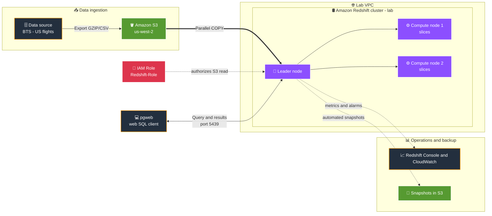
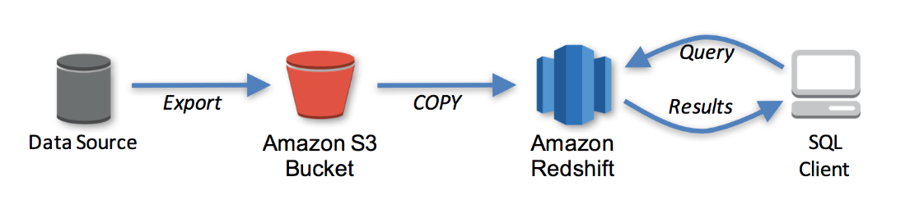

<div align="center">

<h1>🛢️ Working with Amazon Redshift</h1>

**Hands-on lab: Data warehousing on AWS with US domestic flight data analysis**

     

  

</div>

---

## 📑 Table of Contents

- [📖 About the Project](#-about-the-project)
- [🎯 Objectives](#-objectives)
- [🧩 Scenario](#-scenario)
- [🏗️ Architecture](#️-architecture)
- [✅ Prerequisites](#-prerequisites)
- [📊 Results](#-results)
- [🔍 Validation](#-validation)
- [💡 Key Takeaways](#-key-takeaways)
- [☁️ AWS Services Covered](#️-aws-services-covered)
- [👤 Author](#-author)

---

## 📖 About the Project

In this lab I provisioned an **Amazon Redshift** cluster from scratch and used it to analyze about 97 million records of US domestic flights. I connected a web-based SQL client to the cluster, loaded compressed data straight from **Amazon S3** with the `COPY` command, joined dimension tables (aircraft and airports), read execution plans with `EXPLAIN`, and tracked disk usage and query history in the console.

I built the environment in layers: infrastructure and access first, then ingestion, analytical queries, optimization, and finally monitoring and cluster deletion.

> 💬 *I learned in practice that Redshift performance comes from modeling decisions (distribution key, sort key and columnar compression), not from indexes like in traditional databases.*

---

## 🎯 Objectives

1. 🚀 Provision an Amazon Redshift cluster with `ra3.large` nodes and an associated IAM role.
2. 🔌 Connect a SQL client to the cluster using its endpoint and port `5439`.
3. 📥 Load data from Amazon S3 with a parallel `COPY` from GZIP-compressed files.
4. 🔎 Query and aggregate nearly 100 million rows with standard SQL.
5. 🔗 Join fact and dimension tables with `JOIN`.
6. 📈 Analyze execution plans with `EXPLAIN` and compression recommendations with `ANALYZE COMPRESSION`.
7. 🧱 Build derived tables with `CREATE TABLE AS` (CTAS), defining `DISTKEY` and `SORTKEY`.
8. 💾 Measure cluster disk usage and the space taken by each table.
9. 🖥️ Explore query monitoring, alarms and snapshots in the console.

---

## 🧩 Scenario

I needed to turn raw, highly detailed commercial flight data (1990 to 2012, from the US Bureau of Transportation Statistics) into analytical insight. The volume was about 6 GB uncompressed, or roughly 700 MB in GZIP, split across 23 CSV files in S3. The challenge was to load everything efficiently, find out which carriers, aircraft and airports concentrate the most traffic, and understand how Redshift processes these queries under the hood.

| Parameter | Value |
|---|---|
| AWS Region | `us-west-2` (Oregon) |
| Cluster identifier | `lab` |
| Node type | `ra3.large` (mandatory in the lab) |
| Number of nodes | 2 (as configured in the guide) |
| Database name | `lab` |
| Admin user | `master` |
| Admin password | `********` *(omitted)* |
| Port | `5439` |
| Associated IAM role | `Redshift-Role` |
| VPC / Security Group | `Lab VPC` / `Redshift Security Group` |
| Glue Data Catalog registration | Without Redshift federated permissions |
| Cluster relocation | Disabled |
| SQL client | `pgweb` (web-based PostgreSQL client) |
| Data source | Training S3 bucket in `us-west-2` |
| Tables created | `flights`, `aircraft`, `airports`, `vegas_flights` |

---

## 🏗️ Architecture



I designed the flow end to end. Data leaves S3 as GZIP files and enters the cluster through `COPY`, authorized by the `Redshift-Role` IAM role attached to the cluster. The leader node receives queries from `pgweb` and distributes the work to the slices of the compute nodes, which process in parallel and return results to the client. The `flights` table uses `carrier` as its `DISTKEY`, so rows of the same carrier stay together and speed up `GROUP BY` and `JOIN` on that column. In parallel, the console and CloudWatch gave me monitoring visibility, and snapshots covered cluster backup.

I also recorded the overall loading process, which the guide presents in an official diagram: I export the data from the source, place the files in the S3 bucket, load them into Redshift with `COPY`, and query through the SQL client, which receives the results back.

<div align="center"></div>

*Figure 1: Data loading and query flow in Amazon Redshift (data source, Amazon S3, `COPY`, Amazon Redshift and SQL client).*

---

## ✅ Prerequisites

- Basic knowledge of relational databases and SQL.
- Access to the AWS Management Console in the lab environment, in the `us-west-2` Region.
- The `Redshift-Role` IAM role available in the account, with read access to the lab S3 bucket.
- A web browser to open `pgweb` and the Redshift console.

> ⚠️ **Note:** Training environment with restricted IAM permissions.

> 🔒 **Data protection:** in the commands below, the 12-digit account ID inside the ARN was replaced with `<ACCOUNT_ID>`, and the admin password was omitted. Before running them, use the real ARN of your `Redshift-Role`.

---

## 📊 Results

Since the guide had no screenshots, I documented each stage with the SQL commands I ran in `pgweb` and the result I observed, always in the order I executed them.

### 🚀 Stage 1: Cluster provisioning

In the Amazon Redshift console I created the `lab` cluster with 2 `ra3.large` nodes, database `lab` and user `master`. I attached the `Redshift-Role` role, chose the `Lab VPC` with the `Redshift Security Group` (removing the default group) and disabled cluster relocation. I waited up to five minutes for the status to become **Available**.

| Test / Action Performed | Observed Result | Status |
|---|---|---|
| Creating the `lab` cluster (`ra3.large`) | Cluster provisioned and Available | ✅ |
| Attaching the `Redshift-Role` role | Role associated with the cluster | ✅ |

> 📷 *[Pending image: Please send the screenshot of the `lab` cluster in Available status to update this section]*

### 🔌 Stage 2: Connecting with pgweb

I copied the cluster endpoint, removed the `:5439/lab` suffix, and entered the host, the `master` user, the `lab` database and port `5439` on the `pgweb` login screen.

| Test / Action Performed | Observed Result | Status |
|---|---|---|
| Connecting to the cluster through `pgweb` | Session established with the `lab` database | ✅ |

> 📷 *[Pending image: Please send the screenshot of the pgweb connection to update this section]*

### 🧱 Stage 3: Creating the `flights` table and loading with `COPY`

I created the fact table with `carrier` as the distribution key (`DISTKEY`):

```sql
CREATE TABLE flights (
  year           smallint,
  month          smallint,
  day            smallint,
  carrier        varchar(80) DISTKEY,
  origin         char(3),
  dest           char(3),
  aircraft_code  char(3),
  miles          int,
  departures     int,
  minutes        int,
  seats          int,
  passengers     int,
  freight_pounds int
);
```

Then I loaded the data from S3. `COPY` read the 23 GZIP files in parallel, spread across the slices of the nodes:

```sql
COPY flights
FROM 's3://us-west-2-aws-training/courses/spl-17/v4.2.20.prod-fd1dbe42/data/flights-usa'
IAM_ROLE 'arn:aws:iam::<ACCOUNT_ID>:role/Redshift-Role'
GZIP
DELIMITER ','
REMOVEQUOTES
REGION 'us-west-2';
```

| `COPY` Parameter | Purpose |
|---|---|
| `FROM` | Location of the files in S3 |
| `IAM_ROLE` | Permission for Redshift to read the bucket |
| `GZIP` | Automatic decompression during load |
| `DELIMITER ','` | CSV field separator |
| `REMOVEQUOTES` | Strips quotes around values |
| `REGION` | Region of the source bucket |

| Test / Action Performed | Observed Result | Status |
|---|---|---|
| `CREATE TABLE flights` | Table shown in the Tables panel | ✅ |
| `COPY flights` | Load finished in about 3 minutes, returning "No records found" | ✅ |

### 🔎 Stage 4: Analytical queries on `flights`

I checked the loaded volume and looked at a random sample to understand the data granularity:

```sql
SELECT COUNT(*) FROM flights;
```

```sql
SELECT *
FROM flights
ORDER BY random()
LIMIT 10;
```

Then I ranked carriers by number of departures:

```sql
SELECT
  carrier,
  SUM (departures)
FROM flights
GROUP BY carrier
ORDER BY 2 DESC
LIMIT 10;
```

I reran the same query changing only the aggregated expression, to compare rankings across other metrics:

| Metric analyzed | Expression inside `SUM(...)` |
|---|---|
| Passengers carried | `passengers` |
| Miles flown | `miles` |
| Passenger-miles | `passengers * miles` |
| Freight transported | `freight_pounds` |

| Test / Action Performed | Observed Result | Status |
|---|---|---|
| `SELECT COUNT(*)` | About 96.8 million records (the guide indicates 96,825,753) | ✅ |
| Sample with `random()` | 10 random rows returned with all 13 columns | ✅ |
| Top 10 carriers by departures, passengers, miles, passenger-miles and freight | Five rankings produced, each in a few seconds | ✅ |

### 🔗 Stage 5: `aircraft` table and `JOIN`

I created the aircraft dimension table with `aircraft_code` as `SORTKEY`:

```sql
CREATE TABLE aircraft (
  aircraft_code CHAR(3) SORTKEY,
  aircraft      VARCHAR(100)
);
```

```sql
COPY aircraft
FROM 's3://us-west-2-aws-training/courses/spl-17/v4.2.20.prod-fd1dbe42/data/lookup_aircraft.csv'
IAM_ROLE 'arn:aws:iam::<ACCOUNT_ID>:role/Redshift-Role'
IGNOREHEADER 1
DELIMITER ','
REMOVEQUOTES
TRUNCATECOLUMNS
REGION 'us-west-2';
```

```sql
SELECT *
FROM aircraft
ORDER BY random()
LIMIT 10;
```

With the dimension loaded, I joined `flights` and `aircraft` to find the aircraft types with the most trips:

```sql
SELECT
  aircraft,
  SUM(departures) AS trips
FROM flights
JOIN aircraft using (aircraft_code)
GROUP BY aircraft
ORDER BY trips DESC
LIMIT 10;
```

| Test / Action Performed | Observed Result | Status |
|---|---|---|
| `CREATE TABLE aircraft` and `COPY aircraft` | 383 aircraft types loaded | ✅ |
| `JOIN` between `flights` and `aircraft` | Top 10 aircraft by number of trips returned | ✅ |

### 📈 Stage 6: Execution plan and compression

I turned off the session result cache to evaluate the real cost of the query, and ran `EXPLAIN` on the same `JOIN`:

```sql
SET enable_result_cache_for_session TO OFF;
EXPLAIN
SELECT
  aircraft,
  SUM(departures) AS trips
FROM flights
JOIN aircraft using (aircraft_code)
GROUP BY aircraft
ORDER BY trips DESC
LIMIT 10;
```

I read the plan from bottom to top. It does a `Seq Scan` on `flights`, another on `aircraft`, a `Hash Join` with `DS_BCAST_INNER` (the small table is broadcast to the nodes), a `HashAggregate`, the sort and the final `Limit`. I noticed that Redshift uses no indexes and still scans over 96 million rows in a few seconds thanks to columnar storage and parallelism.

Then I asked for per-column compression recommendations:

```sql
ANALYZE COMPRESSION flights;
```

| Test / Action Performed | Observed Result | Status |
|---|---|---|
| `EXPLAIN` of the `JOIN` query | Plan with `Seq Scan`, `Hash Join DS_BCAST_INNER` and `HashAggregate` | ✅ |
| `ANALYZE COMPRESSION flights` | Recommended encodings listed per column | ✅ |

### 🧱 Stage 7: Derived table `vegas_flights` (CTAS)

I created the airports table to translate 3-letter codes into readable names:

```sql
CREATE TABLE airports (
  airport_code CHAR(3) SORTKEY,
  airport      varchar(100)
);
```

```sql
COPY airports
FROM 's3://us-west-2-aws-training/courses/spl-17/v4.2.20.prod-fd1dbe42/data/lookup_airports.csv'
IAM_ROLE 'arn:aws:iam::<ACCOUNT_ID>:role/Redshift-Role'
IGNOREHEADER 1
DELIMITER ','
REMOVEQUOTES
TRUNCATECOLUMNS
REGION 'us-west-2';
```

To analyze only flights bound for Las Vegas, I built a derived table with `DISTKEY` and `SORTKEY` on `origin`:

```sql
CREATE TABLE vegas_flights
  DISTKEY (origin)
  SORTKEY (origin)
AS
SELECT
  flights.*,
  airport
FROM flights
JOIN airports ON origin = airport_code
WHERE dest = 'LAS';
```

Finally, I found out where most passengers flying to Las Vegas come from:

```sql
SELECT
  airport,
  to_char(SUM(passengers), '999,999,999') as passengers
FROM vegas_flights
GROUP BY airport
ORDER BY SUM(passengers) desc
LIMIT 10;
```

| Test / Action Performed | Observed Result | Status |
|---|---|---|
| `COPY airports` | 6,265 airports loaded | ✅ |
| `CREATE TABLE vegas_flights ... AS SELECT` | Table created only with flights to `LAS` | ✅ |
| Top 10 origin airports by passengers | Ranking returned with numbers formatted by `to_char` | ✅ |

### 💾 Stage 8: Disk usage and data distribution

I checked the capacity and usage of each disk per node:

```sql
SELECT
  owner AS node,
  diskno,
  used,
  capacity,
  used/capacity::numeric * 100 as percent_used
FROM stv_partitions
WHERE host = node
ORDER BY 1, 2;
```

And I measured how much space each table takes (values in 1 MB blocks):

```sql
SELECT
  name,
  count(*)
FROM stv_blocklist
JOIN (SELECT DISTINCT name, id as tbl from stv_tbl_perm) USING (tbl)
GROUP BY name;
```

| Test / Action Performed | Observed Result | Status |
|---|---|---|
| Query on `stv_partitions` | Flight data using less than 0.5% of capacity | ✅ |
| Query on `stv_blocklist` | `flights` at about 1,600 MB, far below the 8 TB per node | ✅ |

### 🖥️ Stage 9: Console monitoring

In the console I opened **Query monitoring**, refreshed the list and located the `COPY` job for the `flights` table. I reviewed the executed SQL, total runtime, rows and data scanned, plus the chart on the **Query plan** tab. Under **Cluster details** I checked the CloudWatch alarms section (none created in this lab) and, on the **Maintenance** tab, confirmed the automated snapshot.

| Test / Action Performed | Observed Result | Status |
|---|---|---|
| Query monitoring | History of the `COPY` and queries available | ✅ |
| Maintenance tab > Snapshots | Automated snapshot created | ✅ |

> 📷 *[Pending image: Please send the screenshots of Query monitoring and Snapshots to update this section]*

---

## 🔍 Validation

| Status | Item Tested | Observed Result |
|---|---|---|
| ✅ | `lab` cluster available | Available status before connecting |
| ✅ | `pgweb` connectivity | Successful login on port `5439` |
| ✅ | `flights` load | About 96.8 million rows |
| ✅ | `aircraft` load | 383 records |
| ✅ | `airports` load | 6,265 records |
| ✅ | `JOIN` and aggregations | Rankings returned in a few seconds |
| ✅ | `vegas_flights` CTAS | Table filtered by `LAS` destination |
| ✅ | Disk usage | Less than 0.5% of capacity used |
| ✅ | Monitoring and snapshots | Query history and automated snapshot visible in the console |

---

## 💡 Key Takeaways

- 🧱 **I learned in practice** that columnar storage drastically cuts disk I/O in analytical queries, since Redshift reads only the columns the query uses.
- 📥 **I understood the importance of `COPY`** from S3: split GZIP files allow parallel loading across the slices of all nodes, the most efficient ingestion path.
- 🔑 **I analyzed the impact of the `DISTKEY`**: distributing `flights` by `carrier` keeps each carrier's data on the same slice, which helps `GROUP BY` and `JOIN`.
- 🗜️ **I confirmed that compression** saves storage and improves performance, and that `ANALYZE COMPRESSION` recommends the best encoding for each column.
- 🔍 **I learned to read an `EXPLAIN`** and spot strategies like `DS_BCAST_INNER`, which broadcasts the small table to avoid redistributing the large one.
- 🧩 **I saw the benefit of CTAS** (`CREATE TABLE AS`): smaller derived tables reduce scanned volume in focused analyses, like the Las Vegas one.
- 📸 **I understood the role of snapshots**: incremental backups stored in S3, with free storage equal to the cluster capacity, while manual ones incur cost until deleted.
- 📤 **I noted `UNLOAD`** as the reverse of `COPY`, to export results to S3 in delimited or fixed-width format, with optional GZIP and encryption.
- 🧠 **Relevance for the exam:** SAA-C03 tests picking the right data service for each workload. Redshift is the answer for data warehousing and analytics (OLAP) at petabyte scale, with `COPY` ingestion from S3, JDBC/ODBC access, snapshot backups and scaling by resizing nodes, in contrast with RDS/Aurora (OLTP) and DynamoDB (NoSQL).


---

## ☁️ AWS Services Covered

     

| Service | Role in the Lab |
|---|---|
| Amazon Redshift | Columnar data warehouse where I loaded, queried and analyzed the flight data |
| Amazon S3 | Source of the GZIP/CSV files and destination of the cluster snapshots |
| AWS IAM | `Redshift-Role`, which authorized `COPY` to read the bucket |
| Amazon VPC | `Lab VPC` and `Redshift Security Group`, which isolated and protected access to the cluster |
| Amazon CloudWatch | Alarms and metrics for disk space and cluster health |
| AWS Management Console | Provisioning, query monitoring, snapshots and cluster deletion |

---

## 👤 Author

**Lucas Barretto**

[](https://www.linkedin.com/in/lucaspimentabarretto) [](https://github.com/lbarretto)

---

<p align="center">Optional lab completed on the AWS Skill Builder platform 🚀</p>