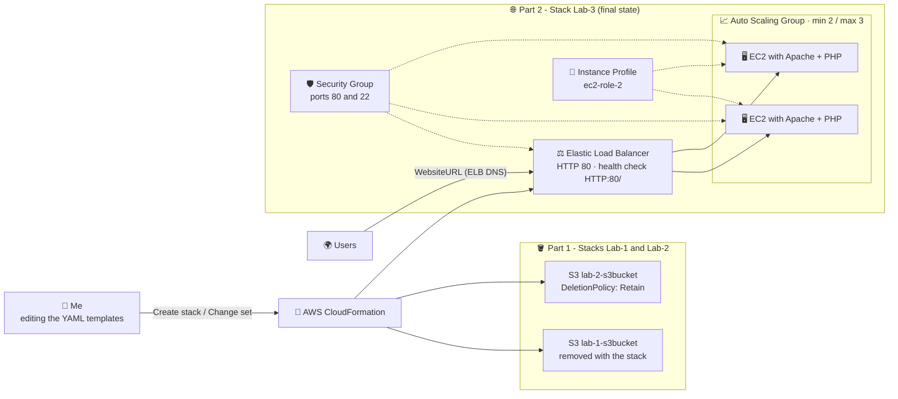

<div align="center">

<h1>🧱 Launching and Managing a Web Application with AWS CloudFormation</h1>

**Hands-on lab: infrastructure as code, from an S3 bucket to a web application with Auto Scaling and load balancing**


</div>

---

## 📑 Table of Contents

- [📖 About the Project](#-about-the-project)
- [🎯 Objectives](#-objectives)
- [🧩 Scenario](#-scenario)
- [🏗️ Architecture](#%EF%B8%8F-architecture)
- [✅ Prerequisites](#-prerequisites)
- [📊 Results](#-results)
- [🔍 Validation](#-validation)
- [💡 Key Takeaways](#-key-takeaways)
- [☁️ AWS Services Covered](#%EF%B8%8F-aws-services-covered)
- [👤 Author](#-author)

---

## 📖 About the Project

In this lab, I used AWS CloudFormation to provision and evolve an entire web application from YAML templates. I started with the simplest case, an Amazon S3 bucket, to understand how a stack creates and removes resources. I then studied how a retention policy changes what happens to a resource when its stack is deleted.

In the second half, I launched a PHP application on an EC2 instance running Apache and kept re-applying templates to the same stack: I switched the instance type through a parameter, added a tag and a security rule, swapped the IAM profile and finally turned the single instance into an Auto Scaling application behind a load balancer, without rebuilding the stack from scratch.

> 💬 *I learned firsthand that with infrastructure as code, changing the architecture becomes editing a file and reviewing a set of changes, with CloudFormation handling order and dependencies.*

---

## 🎯 Objectives

1. 🪣 Create an Amazon S3 bucket with public access blocked using CloudFormation.
2. 🗑️ Delete a stack and confirm its resources were removed with it.
3. 🔒 Apply the `DeletionPolicy: Retain` attribute and prove the bucket survives stack deletion.
4. 🌐 Launch a simple PHP web application on an Amazon Linux instance with Apache.
5. 🔁 Change properties of an existing stack through a parameter and an updated template, using *change sets*.
6. 🏷️ Add a tag and an inbound rule to resources that already existed in the stack.
7. ⚖️ Evolve the application to Auto Scaling with Elastic Load Balancing and an IAM profile with EC2 read permissions.

---

## 🧩 Scenario

I needed to show how CloudFormation lets you create and, above all, modify an application over time. The challenge was to evolve the same stack in stages: from an isolated resource to a multi-AZ application with load balancing and automatic scaling, while understanding the impact of each change on the resources.

| Parameter | Value |
|---|---|
| Platform | AWS Skill Builder (SPL-10) |
| AWS Region | The one set by the lab environment (not changed) |
| Stacks created | `Lab-1`, `Lab-2` and `Lab-3` |
| Templates used | `lab1.yaml` to `lab5.yaml` |
| Part 1 resource | S3 bucket with `PublicAccessBlockConfiguration` fully enabled |
| Retention | `DeletionPolicy: Retain` on the `Lab-2` stack |
| `ENV` parameter | `dev` (`t3.micro`) and `prod` (`t3.small`), set in the `EC2TypeConfig` mapping |
| Other parameters | `VPCId`, `VPCPublicSubnetId` and `VPCPublicSubnetAZ` (provided by the environment) |
| Application | PHP on Apache, installed through `cfn-init` and updated through `cfn-hup` |
| Tag added | `Name` = `Web server - port 80 and 22` |
| Security group | Inbound TCP 80 and TCP 22, both from `0.0.0.0/0` |
| IAM profile (Task 7) | Role `ec2-role-2` (read-only EC2 APIs) |
| Load balancer | Elastic Load Balancer, HTTP listener on 80, health check `HTTP:80/` |
| Auto Scaling | Minimum 2, maximum 3 instances |

---

## 🏗️ Architecture



I structured the diagram in two parts that mirror the lab. In the first, CloudFormation creates the buckets of the `Lab-1` and `Lab-2` stacks, and the difference between them is the retention policy: the first disappears with its stack, the second stays. In the second part, I show the final state of the `Lab-3` stack. CloudFormation provisions the load balancer, the Auto Scaling group with instances running Apache and PHP, the security group and the instance profile. Users come in through the load balancer's DNS name, which spreads requests across the healthy instances. The dotted lines indicate associated resources (security group and IAM profile), not traffic flow.

---

## ✅ Prerequisites

- Access to lab SPL-10 on the AWS Skill Builder platform (started with *Start Lab* and opened with *Open Console*).
- A text editor to read and examine the YAML templates.
- Basic knowledge of editing scripts.
- The `VPCId`, `VPCPublicSubnetId` and `VPCPublicSubnetAZ` values shown in the lab's own panel.
- Use restricted to the services the environment allows (CloudFormation, S3, EC2, IAM, Auto Scaling and Elastic Load Balancing).

---

## 📊 Results

I documented this lab based on the checkpoints in the guide itself, since I did not attach screenshots. The table shows what I ran in each task and the result expected and confirmed at each checkpoint.

### Code I worked with in the templates

Below are the snippets I found most important, rewritten in condensed form. The full templates are the lab's `lab1.yaml` through `lab5.yaml`.

**1. Bucket retention (Task 3):** the `DeletionPolicy: Retain` attribute makes the bucket survive stack deletion.

```yaml
Resources:
  S3BucketForWebsiteContent:
    Type: AWS::S3::Bucket
    DeletionPolicy: Retain          # keeps the bucket even if the stack is deleted or rolled back
    Properties:
      PublicAccessBlockConfiguration: # full public access block
        BlockPublicAcls: true
        BlockPublicPolicy: true
        IgnorePublicAcls: true
        RestrictPublicBuckets: true
Outputs:
  BucketName:
    Value: !Ref S3BucketForWebsiteContent
```

**2. Parameter and mapping (Task 5):** switching `dev` to `prod` during the update changes the instance type without editing the template.

```yaml
Parameters:
  ENV:
    Type: String
    Default: dev
    AllowedValues: [dev, prod]
Mappings:
  EC2TypeConfig:
    dev:  { InstanceType: t3.micro }
    prod: { InstanceType: t3.small }
```

**3. Tag and inbound rules (Task 6):**

```yaml
# On the EC2 instance
Tags:
  - Key: Name
    Value: Web server - port 80 and 22

# On the security group
SecurityGroupIngress:
  - { IpProtocol: tcp, FromPort: 80, ToPort: 80, CidrIp: 0.0.0.0/0 }
  - { IpProtocol: tcp, FromPort: 22, ToPort: 22, CidrIp: 0.0.0.0/0 }
```

**4. Auto Scaling with a load balancer (Task 7):** the instance became a Launch Template, the Elastic IP went away and the ELB and Auto Scaling group came in.

```yaml
ElasticLoadBalancer:
  Type: AWS::ElasticLoadBalancing::LoadBalancer
  Properties:
    Subnets: [!Ref VPCPublicSubnetId]
    SecurityGroupIds: [!Ref WebServerSecurityGroup]
    Listeners:
      - { LoadBalancerPort: 80, InstancePort: 80, Protocol: HTTP }
    HealthCheck:
      Target: HTTP:80/
      HealthyThreshold: 3
      UnhealthyThreshold: 5
      Interval: 30
      Timeout: 5

WebServerGroup:
  Type: AWS::AutoScaling::AutoScalingGroup
  Properties:
    MinSize: 2
    MaxSize: 3
    VPCZoneIdentifier: [!Ref VPCPublicSubnetId]
    AvailabilityZones: [!Ref VPCPublicSubnetAZ]
    LoadBalancerNames: [!Ref ElasticLoadBalancer]
    LaunchTemplate:
      LaunchTemplateId: !Ref WebServerConfig            # used to be the WebServerHost instance
      Version: !GetAtt WebServerConfig.LatestVersionNumber

Outputs:
  WebsiteURL:
    Value: !Sub 'http://${ElasticLoadBalancer.DNSName}'  # now the load balancer DNS name
```

### Task execution

| Test / Action Performed | Observed Result | Status |
|---|---|---|
| **Task 1:** I created the `Lab-1` stack from `lab1.yaml`, with rollback disabled | The stack went from `CREATE_IN_PROGRESS` to `CREATE_COMPLETE` and the Outputs tab showed the bucket name | ✅ |
| **Task 1.2:** I checked the bucket in the S3 console | Bucket with the `lab-1-s3bucket` prefix visible, plus a `cf-templates-xxx` bucket created automatically to store the templates | ✅ |
| **Task 2:** I deleted the `Lab-1` stack and went back to S3 | The stack went through `DELETE_IN_PROGRESS` and left the list; the `lab-1-s3bucket` bucket no longer existed | ✅ |
| **Task 3:** I created the `Lab-2` stack from `lab2.yaml` (`DeletionPolicy: Retain`) | `CREATE_COMPLETE`; bucket with the `lab-2-s3bucket` prefix listed in Outputs and reachable through the Resources tab link | ✅ |
| **Task 3.4/3.5:** I deleted the `Lab-2` stack and reviewed the bucket list | The `lab-2-s3bucket` bucket kept existing in S3, even without the stack | ✅ |
| **Task 4:** I created the `Lab-3` stack from `lab3.yaml` (`ENV=dev`, `VPCId`, `VPCPublicSubnetId`, IAM capability acknowledged) | In about 5 minutes, `CREATE_COMPLETE`; the `WebsiteURL` opened the "AWS CloudFormation sample PHP application" page | ✅ |
| **Task 4:** I opened the `WebServerHost` instance from the Resources tab | Instance type `t3.micro` | ✅ |
| **Task 5:** I created a *change set* switching `ENV` to `prod` and executed it | `UPDATE_COMPLETE`; the instance went from `t3.micro` to `t3.small` | ✅ |
| **Task 6:** I updated the stack with `lab4.yaml` through a *change set* | The page started showing "Updated version via UpdateStack" | ✅ |
| **Task 6:** I opened the instance from the Resources tab | `Name` tag with the value `Web server - port 80 and 22` | ✅ |
| **Task 7:** I updated the stack with `lab5.yaml`, providing `VPCPublicSubnetAZ`, and waited 3 minutes after `UPDATE_COMPLETE` | The `WebsiteURL` became the load balancer DNS name and showed "Highly available, load balanced stack updated version via UpdateStack" | ✅ |
| **Task 7:** I reviewed the stack's Resources tab | IAM instance profile, security group, ELB load balancer and Launch Template with an Auto Scaling group | ✅ |

> 📷 *[Pending image: Send screenshots of the stack statuses, the website (WebsiteURL) and the Lab-3 stack resource list if you want visual evidence]*

---

## 🔍 Validation

| Status | Item Tested | Observed Result |
|---|---|---|
| ✅ | Bucket creation through CloudFormation | `Lab-1` stack in `CREATE_COMPLETE` with the bucket visible in S3 |
| ✅ | Cascading resource deletion | Bucket `lab-1-s3bucket` removed together with the stack |
| ✅ | `DeletionPolicy: Retain` policy | Bucket `lab-2-s3bucket` preserved after deleting the `Lab-2` stack |
| ✅ | PHP application provisioned | "AWS CloudFormation sample PHP application" page reachable at the `WebsiteURL` |
| ✅ | Change through a parameter | `ENV` from `dev` to `prod` switched the instance from `t3.micro` to `t3.small` |
| ✅ | Change of existing properties | `Name` tag applied and page content updated through `UpdateStack` |
| ✅ | Evolution to Auto Scaling + ELB | Site answering on the load balancer DNS with the high availability message |
| ✅ | Final resources of the `Lab-3` stack | Instance profile, security group, ELB and Launch Template with Auto Scaling |
| ⚠️ | Visual evidence | No screenshots in this documentation; results based on the guide's checkpoints |

---

## 💡 Key Takeaways

- 🧱 **I learned the anatomy of a template in practice:** only the `Resources` section is required, and `Parameters`, `Mappings` and `Outputs` make a template reusable and readable.
- 🔒 **I understood the importance of `DeletionPolicy`:** without `Retain`, deleting the stack deletes the bucket; with it, the data survives, which is essential for user content or processing results.
- 🔁 **I grasped the value of *change sets*:** reviewing what will be added, modified or replaced before executing lowers the risk of a destructive update.
- 🧩 **I analyzed the difference between mutable and immutable changes:** some properties update in place, others require creating a new resource and removing the old one, and during that swap the application can be unavailable for a while.
- 🔄 **I noticed the role of `cfn-init` and `cfn-hup`:** the first installs packages and files from the metadata and the second detects metadata changes to reapply them, which let me update the page without recreating the instance.
- ⚖️ **I saw how to turn a single instance into high availability:** I removed the Elastic IP, converted the instance into a Launch Template and added an ELB and Auto Scaling (minimum 2, maximum 3), changing the access address to the load balancer DNS name.
- 🛡️ **I flagged a security point:** in the lab's rules, ports 80 and 22 are open to `0.0.0.0/0`; in production I would restrict port 80 to the load balancer's security group and port 22 to trusted sources.
- 🧠 **Relevance for the exam:** SAA-C03 tests resilient and operationally excellent architectures; understanding infrastructure as code with CloudFormation, retention policies, stack updates and the Auto Scaling + Elastic Load Balancing combination for multi-AZ high availability comes up often in solution design questions.

---

## ☁️ AWS Services Covered


| Service | Role in the Lab |
|---|---|
| AWS CloudFormation | Provisions and updates every resource from YAML templates, using stacks and *change sets* |
| Amazon S3 | Bucket created by the `Lab-1` and `Lab-2` stacks to demonstrate deletion and retention; also stores the uploaded templates |
| Amazon EC2 | Hosts the PHP application on Apache and, at the end, is launched through a Launch Template |
| EC2 Auto Scaling | Keeps between 2 and 3 application instances in the public subnet |
| Elastic Load Balancing | Spreads HTTP traffic across the instances and runs a health check on `HTTP:80/` |
| AWS IAM | Instance profile with the `ec2-role-2` role, which grants read-only access to the EC2 APIs |

---

## 👤 Author

**Lucas Barretto**

[](https://www.linkedin.com/in/lucaspimentabarretto)
[](https://github.com/lbarretto)

---

<p align="center">Optional lab completed on the AWS Skill Builder platform 🚀</p>
