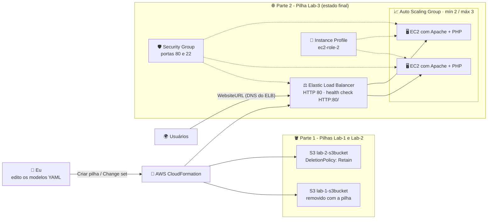

<div align="center">

<h1>🧱 Provisionamento e Gerenciamento de Aplicação Web com AWS CloudFormation</h1>

**Laboratório prático: infraestrutura como código, do bucket S3 a uma aplicação web com Auto Scaling e balanceamento de carga**


-2E7D32?style=flat-square)

</div>

---

## 📑 Sumário

- [📖 Sobre o Projeto](#-sobre-o-projeto)
- [🎯 Objetivos](#-objetivos)
- [🧩 Cenário](#-cenário)
- [🏗️ Arquitetura](#%EF%B8%8F-arquitetura)
- [✅ Pré-requisitos](#-pré-requisitos)
- [📊 Resultado](#-resultado)
- [🔍 Validação](#-validação)
- [💡 Principais Aprendizados](#-principais-aprendizados)
- [☁️ Serviços Abordados](#%EF%B8%8F-serviços-abordados)
- [👤 Autor](#-autor)

---

## 📖 Sobre o Projeto

Neste laboratório, eu usei o AWS CloudFormation para provisionar e evoluir uma aplicação web inteira a partir de modelos YAML. Comecei pelo mais simples, um bucket do Amazon S3, para entender como uma pilha cria e remove recursos. Depois estudei como a política de retenção muda o que acontece com um recurso quando a pilha é excluída.

Na segunda metade, subi uma aplicação PHP em uma instância EC2 com Apache e fui reaplicando modelos sobre a mesma pilha: troquei o tipo da instância por um parâmetro, adicionei uma tag e uma regra de segurança, troquei o perfil do IAM e, por fim, transformei a instância única em uma aplicação com Auto Scaling atrás de um balanceador de carga, sem recriar a pilha do zero.

> 💬 *Aprendi na prática que, com infraestrutura como código, mudar a arquitetura vira editar um arquivo e revisar um conjunto de alterações, com o CloudFormation cuidando da ordem e das dependências.*

---

## 🎯 Objetivos

1. 🪣 Criar um bucket do Amazon S3 com acesso público bloqueado usando o CloudFormation.
2. 🗑️ Excluir uma pilha e confirmar que os recursos dela também foram removidos.
3. 🔒 Aplicar o atributo `DeletionPolicy: Retain` e comprovar que o bucket sobrevive à exclusão da pilha.
4. 🌐 Provisionar uma aplicação web PHP simples em uma instância Amazon Linux com Apache.
5. 🔁 Alterar propriedades de uma pilha existente por parâmetro e por modelo atualizado, usando *change sets*.
6. 🏷️ Adicionar tag e regra de entrada a recursos que já existiam na pilha.
7. ⚖️ Evoluir a aplicação para Auto Scaling com Elastic Load Balancing e um perfil do IAM com permissões de leitura do EC2.

---

## 🧩 Cenário

Eu precisava mostrar como o CloudFormation permite criar e, principalmente, modificar uma aplicação ao longo do tempo. O desafio era evoluir a mesma pilha em etapas: de um recurso isolado até uma aplicação multi-AZ, com balanceamento de carga e escalabilidade automática, entendendo o impacto de cada mudança nos recursos.

| Parâmetro | Valor |
|---|---|
| Plataforma | AWS Skill Builder (SPL-10) |
| Região AWS | A definida pelo ambiente do laboratório (não alterada) |
| Pilhas criadas | `Lab-1`, `Lab-2` e `Lab-3` |
| Modelos usados | `lab1.yaml` a `lab5.yaml` |
| Recurso da Parte 1 | Bucket S3 com `PublicAccessBlockConfiguration` totalmente ativo |
| Retenção | `DeletionPolicy: Retain` na pilha `Lab-2` |
| Parâmetro `ENV` | `dev` (`t3.micro`) e `prod` (`t3.small`), definido no mapeamento `EC2TypeConfig` |
| Outros parâmetros | `VPCId`, `VPCPublicSubnetId` e `VPCPublicSubnetAZ` (fornecidos pelo ambiente) |
| Aplicação | PHP com Apache, instalada via `cfn-init` e atualizada via `cfn-hup` |
| Tag adicionada | `Name` = `Web server - port 80 and 22` |
| Grupo de segurança | Entrada TCP 80 e TCP 22, ambas de `0.0.0.0/0` |
| Perfil do IAM (Tarefa 7) | Role `ec2-role-2` (somente leitura das APIs do EC2) |
| Balanceador | Elastic Load Balancer, listener HTTP 80, health check `HTTP:80/` |
| Auto Scaling | Mínimo 2, máximo 3 instâncias |

---

## 🏗️ Arquitetura



Eu estruturei o diagrama em duas partes que refletem o laboratório. Na primeira, o CloudFormation cria os buckets das pilhas `Lab-1` e `Lab-2`, e a diferença entre eles é a política de retenção: o primeiro desaparece junto com a pilha, o segundo permanece. Na segunda parte, mostro o estado final da pilha `Lab-3`. O CloudFormation provisiona o balanceador, o grupo de Auto Scaling com instâncias rodando Apache e PHP, o grupo de segurança e o perfil de instância. Os usuários entram pelo DNS do balanceador, que distribui as requisições entre as instâncias saudáveis. As linhas pontilhadas indicam recursos associados (grupo de segurança e perfil do IAM), e não fluxo de tráfego.

---

## ✅ Pré-requisitos

- Acesso ao laboratório SPL-10 na plataforma AWS Skill Builder (iniciado com *Start Lab* e aberto com *Open Console*).
- Um editor de texto para ler e examinar os modelos YAML.
- Conhecimento básico de edição de scripts.
- Os valores de `VPCId`, `VPCPublicSubnetId` e `VPCPublicSubnetAZ`, exibidos no painel do próprio laboratório.
- Uso restrito aos serviços liberados pelo ambiente (CloudFormation, S3, EC2, IAM, Auto Scaling e Elastic Load Balancing).

---

## 📊 Resultado

Eu documentei este laboratório com base nos pontos de verificação do próprio roteiro, já que não anexei capturas de tela. A tabela mostra o que executei em cada tarefa e o resultado esperado e confirmado em cada checkpoint.

### Código que trabalhei nos modelos

Abaixo estão os trechos que considerei mais importantes, reescritos de forma resumida. Os modelos completos são os `lab1.yaml` a `lab5.yaml` do laboratório.

**1. Retenção do bucket (Tarefa 3):** o atributo `DeletionPolicy: Retain` faz o bucket sobreviver à exclusão da pilha.

```yaml
Resources:
  S3BucketForWebsiteContent:
    Type: AWS::S3::Bucket
    DeletionPolicy: Retain          # mantém o bucket mesmo se a pilha for excluída ou revertida
    Properties:
      PublicAccessBlockConfiguration: # bloqueio total de acesso público
        BlockPublicAcls: true
        BlockPublicPolicy: true
        IgnorePublicAcls: true
        RestrictPublicBuckets: true
Outputs:
  BucketName:
    Value: !Ref S3BucketForWebsiteContent
```

**2. Parâmetro e mapeamento (Tarefa 5):** trocar `dev` por `prod` na atualização muda o tipo da instância sem editar o modelo.

```yaml
Parameters:
  ENV:
    Type: String
    Default: dev
    AllowedValues: [dev, prod]
Mappings:
  EC2TypeConfig:
    dev:  { InstanceType: t3.micro }
    prod: { InstanceType: t3.small }
```

**3. Tag e regras de entrada (Tarefa 6):**

```yaml
# Na instância EC2
Tags:
  - Key: Name
    Value: Web server - port 80 and 22

# No grupo de segurança
SecurityGroupIngress:
  - { IpProtocol: tcp, FromPort: 80, ToPort: 80, CidrIp: 0.0.0.0/0 }
  - { IpProtocol: tcp, FromPort: 22, ToPort: 22, CidrIp: 0.0.0.0/0 }
```

**4. Auto Scaling com balanceador (Tarefa 7):** a instância virou um Launch Template, o IP elástico saiu e entraram o ELB e o grupo de Auto Scaling.

```yaml
ElasticLoadBalancer:
  Type: AWS::ElasticLoadBalancing::LoadBalancer
  Properties:
    Subnets: [!Ref VPCPublicSubnetId]
    SecurityGroupIds: [!Ref WebServerSecurityGroup]
    Listeners:
      - { LoadBalancerPort: 80, InstancePort: 80, Protocol: HTTP }
    HealthCheck:
      Target: HTTP:80/
      HealthyThreshold: 3
      UnhealthyThreshold: 5
      Interval: 30
      Timeout: 5

WebServerGroup:
  Type: AWS::AutoScaling::AutoScalingGroup
  Properties:
    MinSize: 2
    MaxSize: 3
    VPCZoneIdentifier: [!Ref VPCPublicSubnetId]
    AvailabilityZones: [!Ref VPCPublicSubnetAZ]
    LoadBalancerNames: [!Ref ElasticLoadBalancer]
    LaunchTemplate:
      LaunchTemplateId: !Ref WebServerConfig            # antes era a instância WebServerHost
      Version: !GetAtt WebServerConfig.LatestVersionNumber

Outputs:
  WebsiteURL:
    Value: !Sub 'http://${ElasticLoadBalancer.DNSName}'  # agora é o DNS do balanceador
```

### Execução das tarefas

| Teste / Ação Realizada | Resultado Observado | Status |
|---|---|---|
| **Tarefa 1:** criei a pilha `Lab-1` com o `lab1.yaml`, com rollback desabilitado | A pilha passou de `CREATE_IN_PROGRESS` para `CREATE_COMPLETE` e a guia Saídas mostrou o nome do bucket | ✅ |
| **Tarefa 1.2:** conferi o bucket no console do S3 | Bucket com prefixo `lab-1-s3bucket` visível, além de um bucket `cf-templates-xxx` criado automaticamente para guardar os modelos | ✅ |
| **Tarefa 2:** excluí a pilha `Lab-1` e voltei ao S3 | A pilha passou por `DELETE_IN_PROGRESS` e sumiu da lista; o bucket `lab-1-s3bucket` deixou de existir | ✅ |
| **Tarefa 3:** criei a pilha `Lab-2` com o `lab2.yaml` (`DeletionPolicy: Retain`) | `CREATE_COMPLETE`; bucket com prefixo `lab-2-s3bucket` listado nas Saídas e acessível pelo link da guia Recursos | ✅ |
| **Tarefa 3.4/3.5:** excluí a pilha `Lab-2` e revisei a lista de buckets | O bucket `lab-2-s3bucket` continuou existindo no S3, mesmo sem a pilha | ✅ |
| **Tarefa 4:** criei a pilha `Lab-3` com o `lab3.yaml` (`ENV=dev`, `VPCId`, `VPCPublicSubnetId`, capacidade IAM reconhecida) | Em cerca de 5 minutos, `CREATE_COMPLETE`; o `WebsiteURL` abriu a página "AWS CloudFormation sample PHP application" | ✅ |
| **Tarefa 4:** abri a instância `WebServerHost` pela guia Recursos | Tipo de instância `t3.micro` | ✅ |
| **Tarefa 5:** criei um *change set* mudando `ENV` para `prod` e executei | `UPDATE_COMPLETE`; a instância passou de `t3.micro` para `t3.small` | ✅ |
| **Tarefa 6:** atualizei a pilha com o `lab4.yaml` por *change set* | A página passou a exibir "Updated version via UpdateStack" | ✅ |
| **Tarefa 6:** abri a instância pela guia Recursos | Tag `Name` com o valor `Web server - port 80 and 22` | ✅ |
| **Tarefa 7:** atualizei a pilha com o `lab5.yaml`, informando `VPCPublicSubnetAZ`, e aguardei 3 minutos após o `UPDATE_COMPLETE` | O `WebsiteURL` virou o nome DNS do balanceador e exibiu "Highly available, load balanced stack updated version via UpdateStack" | ✅ |
| **Tarefa 7:** revisei a guia Recursos da pilha | Perfil de instância do IAM, grupo de segurança, balanceador ELB e Launch Template com grupo de Auto Scaling | ✅ |

> 📷 *[Imagem pendente: Envie prints do status das pilhas, do site (WebsiteURL) e da lista de recursos da pilha Lab-3 se quiser evidências visuais]*

---

## 🔍 Validação

| Status | Item Testado | Resultado Observado |
|---|---|---|
| ✅ | Criação de bucket via CloudFormation | Pilha `Lab-1` em `CREATE_COMPLETE` com o bucket visível no S3 |
| ✅ | Exclusão em cascata de recursos | Bucket `lab-1-s3bucket` removido junto com a pilha |
| ✅ | Política `DeletionPolicy: Retain` | Bucket `lab-2-s3bucket` preservado após excluir a pilha `Lab-2` |
| ✅ | Aplicação PHP provisionada | Página "AWS CloudFormation sample PHP application" acessível no `WebsiteURL` |
| ✅ | Alteração por parâmetro | `ENV` de `dev` para `prod` trocou a instância de `t3.micro` para `t3.small` |
| ✅ | Alteração de propriedades existentes | Tag `Name` aplicada e conteúdo da página atualizado via `UpdateStack` |
| ✅ | Evolução para Auto Scaling + ELB | Site respondendo pelo DNS do balanceador com a mensagem de alta disponibilidade |
| ✅ | Recursos finais da pilha `Lab-3` | Instance profile, grupo de segurança, ELB e Launch Template com Auto Scaling |
| ⚠️ | Evidências visuais | Sem prints nesta documentação; resultados baseados nos checkpoints do roteiro |

---

## 💡 Principais Aprendizados

- 🧱 **Aprendi na prática a anatomia de um modelo:** apenas a seção `Resources` é obrigatória, e `Parameters`, `Mappings` e `Outputs` tornam o modelo reutilizável e legível.
- 🔒 **Compreendi a importância do `DeletionPolicy`:** sem `Retain`, excluir a pilha apaga o bucket; com ele, os dados sobrevivem, o que é essencial para conteúdo de usuários ou resultados de processamento.
- 🔁 **Entendi o valor dos *change sets*:** revisar o que será adicionado, modificado ou substituído antes de executar reduz o risco de uma atualização destrutiva.
- 🧩 **Analisei a diferença entre mudanças mutáveis e imutáveis:** algumas propriedades são atualizadas no próprio recurso, outras exigem criar um novo recurso e remover o antigo, e durante essa troca a aplicação pode ficar indisponível por um tempo.
- 🔄 **Percebi o papel do `cfn-init` e do `cfn-hup`:** o primeiro instala pacotes e arquivos a partir dos metadados e o segundo detecta mudanças nos metadados para reaplicá-los, o que permitiu atualizar a página sem recriar a instância.
- ⚖️ **Vi como transformar uma instância única em alta disponibilidade:** removi o IP elástico, converti a instância em Launch Template e adicionei ELB e Auto Scaling (mínimo 2, máximo 3), mudando o endereço de acesso para o DNS do balanceador.
- 🛡️ **Observei um ponto de atenção de segurança:** nas regras do laboratório, as portas 80 e 22 ficam abertas para `0.0.0.0/0`; em produção eu restringiria a porta 80 ao grupo de segurança do balanceador e a porta 22 a origens confiáveis.
- 🧠 **Relevância para a prova:** o SAA-C03 cobra arquiteturas resilientes e operacionalmente excelentes; entender infraestrutura como código com CloudFormation, políticas de retenção, atualização de pilhas e a combinação Auto Scaling + Elastic Load Balancing para alta disponibilidade multi-AZ aparece com frequência em questões de design de soluções.

---

## ☁️ Serviços Abordados


| Serviço | Papel no Laboratório |
|---|---|
| AWS CloudFormation | Provisiona e atualiza todos os recursos a partir de modelos YAML, usando pilhas e *change sets* |
| Amazon S3 | Bucket criado pelas pilhas `Lab-1` e `Lab-2` para demonstrar exclusão e retenção; também guarda os modelos enviados |
| Amazon EC2 | Hospeda a aplicação PHP com Apache e, ao final, passa a ser lançado por Launch Template |
| EC2 Auto Scaling | Mantém entre 2 e 3 instâncias da aplicação na sub-rede pública |
| Elastic Load Balancing | Distribui o tráfego HTTP entre as instâncias e faz health check em `HTTP:80/` |
| AWS IAM | Perfil de instância com a role `ec2-role-2`, que dá acesso somente leitura às APIs do EC2 |

---

## 👤 Autor

**Lucas Barretto**

[](https://www.linkedin.com/in/lucaspimentabarretto)
[](https://github.com/lbarretto)

---

<p align="center">Laboratório opcional realizado na plataforma AWS Skill Builder 🚀</p>
