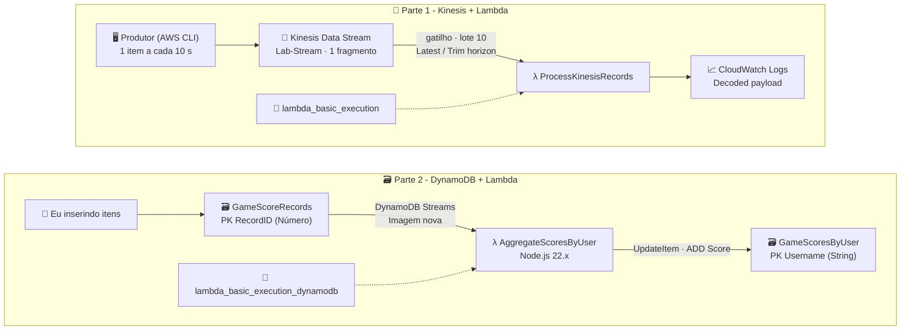

<div align="center">

<h1>⚡ Arquiteturas Serverless com Amazon DynamoDB e Amazon Kinesis Streams com AWS Lambda</h1>

**Laboratório prático: programação orientada a eventos com Kinesis Data Streams, DynamoDB Streams e funções Lambda**


-2E7D32?style=flat-square)

</div>

---

## 📑 Sumário

- [📖 Sobre o Projeto](#-sobre-o-projeto)
- [🎯 Objetivos](#-objetivos)
- [🧩 Cenário](#-cenário)
- [🏗️ Arquitetura](#%EF%B8%8F-arquitetura)
- [✅ Pré-requisitos](#-pré-requisitos)
- [📊 Resultado](#-resultado)
- [🔍 Validação](#-validação)
- [💡 Principais Aprendizados](#-principais-aprendizados)
- [☁️ Serviços Abordados](#%EF%B8%8F-serviços-abordados)
- [👤 Autor](#-autor)

---

## 📖 Sobre o Projeto

Neste laboratório, eu explorei dois modelos de programação orientada a eventos com funções AWS Lambda. Na primeira parte, criei um fluxo de dados no Amazon Kinesis e conectei uma função Lambda a ele, acompanhando como os registros chegam, são decodificados e aparecem nos logs do CloudWatch. Também comparei os pontos de partida de leitura do gatilho, *Latest* e *Trim horizon*.

Na segunda parte, trabalhei com o Amazon DynamoDB: criei duas tabelas, ativei o DynamoDB Streams na primeira e escrevi uma função Lambda em Node.js que, a cada nova pontuação de jogo, atualiza a tabela de pontuações por usuário. Foi uma forma prática de enxergar o padrão "algo muda, uma função reage" sem nenhum servidor para gerenciar.

> 💬 *Aprendi na prática que o gatilho decide o que a função enxerga: o ponto de partida no Kinesis e o stream no DynamoDB determinam quais dados chegam e quando.*

---

## 🎯 Objetivos

1. 📡 Criar um fluxo de dados do Amazon Kinesis em modo provisionado com 1 fragmento.
2. λ Criar uma função Lambda a partir de um esquema (*blueprint*) e conectá-la ao fluxo com um gatilho.
3. 🧪 Testar a função com um evento simulado e com dados reais de um produtor externo.
4. 🔀 Comparar os pontos de partida `Latest` e `Trim horizon` do gatilho do Kinesis.
5. 🗃️ Criar duas tabelas do DynamoDB e ativar o DynamoDB Streams com tipo de visualização *Imagem nova*.
6. 🔁 Criar uma função Lambda em Node.js acionada pelo stream da tabela e que agrega pontuações por usuário.
7. 📈 Monitorar as execuções com métricas e logs do Amazon CloudWatch.

---

## 🧩 Cenário

Eu precisava demonstrar duas arquiteturas serverless reativas: uma que processa um fluxo contínuo de mensagens e outra que mantém uma tabela agregada atualizada automaticamente a partir de mudanças em outra tabela.

| Parâmetro | Valor |
|---|---|
| Plataforma | AWS Skill Builder (SPL-51) |
| Região AWS | A definida pelo ambiente do laboratório (não alterada) |
| Fluxo do Kinesis | `Lab-Stream`, modo provisionado, 1 fragmento |
| Função Lambda 1 | `ProcessKinesisRecords`, criada pelo esquema do Kinesis em Python |
| Role da função 1 | `lambda_basic_execution` (role existente) |
| Gatilho do Kinesis | Lote de 10 registros; posição inicial `Latest` e depois `Trim horizon` |
| Produtor | AWS CLI já configurado pelo ambiente, enviando 1 item numerado a cada 10 segundos |
| Tabela 1 | `GameScoreRecords`, chave de partição `RecordID` (Número) |
| Tabela 2 | `GameScoresByUser`, chave de partição `Username` (String) |
| DynamoDB Streams | Ativado em `GameScoreRecords`, tipo de visualização *Imagem nova* |
| Função Lambda 2 | `AggregateScoresByUser`, runtime Node.js 22.x, escrita do zero |
| Role da função 2 | `lambda_basic_execution_dynamodb` (role existente) |
| Evento de teste 2 | `score`, simulando a pontuação 100 do usuário `Jane Doe` |

---

## 🏗️ Arquitetura



Eu organizei o diagrama em duas partes independentes, mas com a mesma lógica de gatilho. Na Parte 1, um produtor externo envia mensagens ao `Lab-Stream`; o gatilho do Kinesis lê os registros em lotes de até 10 e entrega a `ProcessKinesisRecords`, que decodifica cada mensagem e a grava nos logs do CloudWatch. Na Parte 2, cada item inserido em `GameScoreRecords` gera um evento no DynamoDB Streams, que aciona `AggregateScoresByUser`; a função soma a pontuação ao usuário correspondente na tabela `GameScoresByUser`. As linhas pontilhadas mostram as roles de execução que dão a cada função as permissões de que ela precisa.

---

## ✅ Pré-requisitos

- Acesso ao laboratório SPL-51 na plataforma AWS Skill Builder (iniciado com *Start Lab* e aberto com *Open Console*).
- Roles do IAM `lambda_basic_execution` e `lambda_basic_execution_dynamodb` já provisionadas pelo ambiente.
- Produtor do Kinesis com AWS CLI já configurado pelo ambiente.
- Noções básicas de Lambda, streams de dados e tabelas NoSQL.
- Uso restrito aos serviços liberados pelo ambiente (Kinesis, Lambda, DynamoDB, CloudWatch e IAM).

---

## 📊 Resultado

Eu documentei este laboratório com base nos pontos de verificação do próprio roteiro, já que não anexei capturas de tela. As tabelas mostram o que executei em cada tarefa e o resultado esperado e confirmado em cada checkpoint.

### Código que trabalhei

**1. Função `AggregateScoresByUser` (Tarefa 5):** resumo em Node.js da lógica que implantei. Para cada registro do stream, a função lê a imagem nova do item e soma a pontuação ao usuário correspondente na tabela de agregação.

```javascript
import { DynamoDBClient, UpdateItemCommand } from "@aws-sdk/client-dynamodb";

const dynamodb = new DynamoDBClient();

export const handler = async (event) => {
  // Processo todos os registros do lote em paralelo
  const atualizacoes = event.Records.map(async (record) => {
    console.log("Registro do DynamoDB:", JSON.stringify(record.dynamodb));

    // A imagem nova traz o item como ficou depois da inserção
    const itemNovo = record.dynamodb.NewImage;

    const comando = new UpdateItemCommand({
      TableName: "GameScoresByUser",
      Key: { Username: itemNovo.Username },        // chave da tabela de agregação
      UpdateExpression: "ADD Score :pontos",        // soma ao valor atual (ou cria o item)
      ExpressionAttributeValues: { ":pontos": itemNovo.Score },
    });

    try {
      await dynamodb.send(comando);
    } catch (erro) {
      console.error(erro);                          // registro o erro sem derrubar o lote inteiro
    }
  });

  await Promise.all(atualizacoes);                  // espero todas as atualizações terminarem
  return `Registros processados: ${event.Records.length}`;
};
```

**2. Evento de teste `score` (Tarefa 5):** estrutura essencial do registro que simula uma inserção em `GameScoreRecords`.

```json
{
  "Records": [
    {
      "eventName": "INSERT",
      "eventSource": "aws:dynamodb",
      "dynamodb": {
        "Keys": { "RecordID": { "N": "2" } },
        "NewImage": {
          "RecordID": { "N": "2" },
          "Username": { "S": "Jane Doe" },
          "Score": { "N": "100" },
          "Nickname": { "S": "JaneD" }
        },
        "StreamViewType": "NEW_IMAGE"
      }
    }
  ]
}
```

**3. Gatilho do Kinesis (Tarefa 2 e 3.3):** o esquema em Python do Kinesis percorre os registros, decodifica o conteúdo em Base64 e o escreve no log. Minha configuração do gatilho foi:

```text
Fluxo:             Lab-Stream
Tamanho do lote:   10
Posição inicial:   Latest        (Tarefas 2 e 3.2)  ->  Trim horizon (Tarefa 3.3)
Estado inicial:    desativado até concluir o teste manual da função
```

### Parte 1: Kinesis e Lambda

| Teste / Ação Realizada | Resultado Observado | Status |
|---|---|---|
| **Tarefa 1:** criei o fluxo `Lab-Stream` em modo provisionado com 1 fragmento | Mensagem de sucesso na criação do fluxo de dados | ✅ |
| **Tarefa 2:** criei a função `ProcessKinesisRecords` pelo esquema do Kinesis, usando a role `lambda_basic_execution` | Função criada com gatilho do Kinesis configurado (lote 10, posição `Latest`) e mantido desativado | ✅ |
| **Tarefa 3.1:** executei o evento de teste `stream` na guia Testar | Banner "Função em execução: bem-sucedida"; seção Detalhes com duração, período cobrado, memória máxima e saída de log | ✅ |
| **Tarefa 3.1:** abri a guia Monitor | Métricas `Invocations` e `Duration` do CloudWatch disponíveis após alguns minutos | ✅ |
| **Tarefa 3.2:** ativei o gatilho do Kinesis e acompanhei o Monitor | Novas invocações apareceram no gráfico (às vezes levam até 5 minutos para as métricas surgirem) | ✅ |
| **Tarefa 3.2:** abri os logs no CloudWatch e pesquisei o grupo de logs | Mensagens "Decoded payload": primeiro o evento de teste e depois as mensagens numeradas do produtor, em ordem crescente | ✅ |
| **Tarefa 3.3:** excluí o gatilho e criei outro com posição inicial *Horizonte de corte* | Gatilho recriado, ativo, com lote de 10; as entradas mais recentes do log mudaram em relação à leitura com `Latest` | ✅ |

### Parte 2: DynamoDB e Lambda

| Teste / Ação Realizada | Resultado Observado | Status |
|---|---|---|
| **Tarefa 4:** criei `GameScoreRecords` (`RecordID`, Número) e `GameScoresByUser` (`Username`, String) | Duas tabelas criadas | ✅ |
| **Tarefa 4:** ativei o DynamoDB Streams em `GameScoreRecords` com tipo *Imagem nova* | Stream ativado; cada inserção, atualização ou exclusão passa a gerar um evento | ✅ |
| **Tarefa 5:** criei a função `AggregateScoresByUser` (Node.js 22.x, role `lambda_basic_execution_dynamodb`), colei o código e implantei | Função implantada | ✅ |
| **Tarefa 5:** adicionei o gatilho DynamoDB apontando para `GameScoreRecords` | Gatilho adicionado à função | ✅ |
| **Tarefa 5:** executei o evento de teste `score` | Banner de sucesso e retorno indicando 1 registro processado | ✅ |
| **Tarefa 5:** abri `GameScoresByUser` e usei Ações > Explorar itens | A tabela, antes vazia, passou a ter uma entrada para `Jane Doe` | ✅ |
| **Tarefa 5:** criei manualmente um item em `GameScoreRecords` (`RecordID` 1, `Username`, `Score` inteiro) | O item apareceu na tabela de origem e os dados foram refletidos em `GameScoresByUser` pelo gatilho | ✅ |

### Análise das perguntas do roteiro

Estas são minhas conclusões sobre as perguntas de reflexão do laboratório, baseadas no comportamento dos gatilhos:

- **Primeiro número de mensagem registrado e mensagens anteriores:** com `Latest`, o gatilho começa a ler a partir do registro mais recente no momento em que é ativado. As mensagens enviadas antes disso não são lidas por ele, então o log começa em um número intermediário.
- **Por que os lotes não têm 10 registros:** o tamanho do lote é um limite máximo. Como o produtor envia um item a cada 10 segundos, a função recebe poucos registros por invocação em vez de lotes cheios.
- **Efeito do `Trim horizon`:** a função passa a ler desde o início do que o stream ainda retém, em vez de só os dados novos.
- **Qual ponto de partida usar:** `Trim horizon` para avaliar todos os pontos de dados possíveis; `Latest` quando só interessa tratar rapidamente os dados mais recentes.

---

## 🔍 Validação

| Status | Item Testado | Resultado Observado |
|---|---|---|
| ✅ | Criação do fluxo do Kinesis | `Lab-Stream` criado em modo provisionado com 1 fragmento |
| ✅ | Função Lambda por esquema | `ProcessKinesisRecords` executou com sucesso o evento de teste `stream` |
| ✅ | Monitoramento da função | Métricas `Invocations` e `Duration` visíveis e logs "Decoded payload" no CloudWatch |
| ✅ | Gatilho com dados reais | Invocações disparadas pelo produtor externo após ativar o gatilho |
| ✅ | Ponto de partida do gatilho | Gatilho recriado com `Trim horizon`, mudando o que a função lê do stream |
| ✅ | DynamoDB Streams | Ativado em `GameScoreRecords` com *Imagem nova* |
| ✅ | Função agregadora | `AggregateScoresByUser` processou 1 registro simulado e gravou `Jane Doe` na tabela de destino |
| ✅ | Fluxo ponta a ponta | Item inserido manualmente em `GameScoreRecords` refletido em `GameScoresByUser` |
| ⚠️ | Teste de conhecimento | O laboratório inclui um quiz final; seu resultado não foi documentado aqui |

---

## 💡 Principais Aprendizados

- ⚡ **Aprendi na prática o modelo orientado a eventos:** nas duas partes a função Lambda não roda sozinha, ela é acionada por um gatilho, seja um fluxo do Kinesis ou o stream de uma tabela.
- 🔀 **Compreendi a diferença entre `Latest` e `Trim horizon`:** o primeiro lê só o que chega depois da ativação; o segundo começa do início do stream. E como a posição inicial não pode ser editada depois de criada, precisei excluir e recriar o gatilho.
- 📦 **Entendi que o tamanho do lote é um teto:** com 1 mensagem a cada 10 segundos, as invocações recebem poucos registros, mesmo com lote configurado para 10.
- 🧪 **Analisei a vantagem de testar antes de ativar:** manter o gatilho desativado e validar a função com um evento simulado me deu um ponto de partida seguro antes de receber dados reais.
- 🗃️ **Percebi o papel do DynamoDB Streams:** ele transforma mudanças de uma tabela em eventos, e o tipo *Imagem nova* entrega ao Lambda o item como ficou depois da alteração.
- ➕ **Compreendi a operação `ADD` do `UpdateItem`:** ela soma o valor ao atributo numérico existente (ou cria o item se não existir), o que torna a agregação por usuário simples.
- 🔑 **Observei o uso de roles de execução separadas:** cada função usou uma role com as permissões do seu caso, e a função do DynamoDB precisava de uma role específica para acessar as tabelas.
- 🧠 **Relevância para a prova:** o SAA-C03 cobra arquiteturas desacopladas, serverless e orientadas a eventos; saber quando usar Kinesis Data Streams para ingestão contínua, DynamoDB Streams com Lambda para reagir a mudanças em tabelas, e como funcionam lotes, posição inicial e roles de execução aparece com frequência em questões sobre processamento de dados e desacoplamento.

---

## ☁️ Serviços Abordados

<div align="center">

    

</div>

| Serviço | Papel no Laboratório |
|---|---|
| 📡 **Amazon Kinesis Data Streams** | Recebe o fluxo contínuo de mensagens do produtor no `Lab-Stream` |
| λ **AWS Lambda** | Executa `ProcessKinesisRecords` (decodifica e registra) e `AggregateScoresByUser` (soma pontuações) |
| 🗃️ **Amazon DynamoDB** | Guarda as pontuações em `GameScoreRecords` e o total por usuário em `GameScoresByUser` |
| 🔔 **DynamoDB Streams** | Converte as mudanças de `GameScoreRecords` em eventos que acionam a função |
| 📈 **Amazon CloudWatch** | Exibe as métricas de invocação e os logs com as mensagens decodificadas |
| 🔑 **AWS IAM** | Roles de execução que dão a cada função as permissões necessárias |

---

## 👤 Autor

**Lucas Barretto**

[](https://www.linkedin.com/in/lucaspimentabarretto)
[](https://github.com/lbarretto)

---

<p align="center">Laboratório opcional realizado na plataforma AWS Skill Builder 🚀</p>