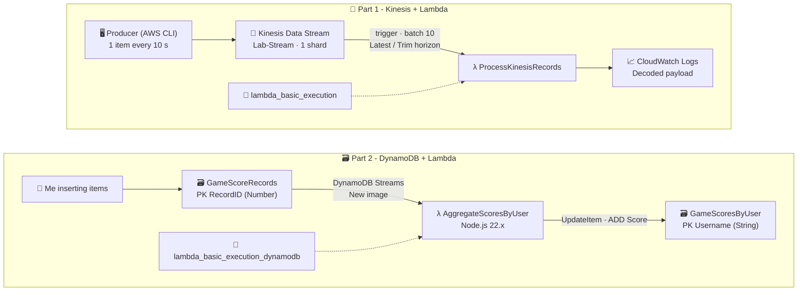

<div align="center">

<h1>⚡ Serverless Architectures with Amazon DynamoDB and Amazon Kinesis Streams with AWS Lambda</h1>

**Hands-on lab: event-driven programming with Kinesis Data Streams, DynamoDB Streams and Lambda functions**


</div>

---

## 📑 Table of Contents

- [📖 About the Project](#-about-the-project)
- [🎯 Objectives](#-objectives)
- [🧩 Scenario](#-scenario)
- [🏗️ Architecture](#%EF%B8%8F-architecture)
- [✅ Prerequisites](#-prerequisites)
- [📊 Results](#-results)
- [🔍 Validation](#-validation)
- [💡 Key Takeaways](#-key-takeaways)
- [☁️ AWS Services Covered](#%EF%B8%8F-aws-services-covered)
- [👤 Author](#-author)

---

## 📖 About the Project

In this lab, I explored two event-driven programming models with AWS Lambda functions. In the first part, I created an Amazon Kinesis data stream and connected a Lambda function to it, following how records arrive, get decoded and show up in the CloudWatch logs. I also compared the trigger's reading starting points, *Latest* and *Trim horizon*.

In the second part, I worked with Amazon DynamoDB: I created two tables, enabled DynamoDB Streams on the first one and wrote a Node.js Lambda function that, for every new game score, updates the per-user scores table. It was a hands-on way to see the "something changes, a function reacts" pattern with no servers to manage.

> 💬 *I learned firsthand that the trigger decides what the function sees: the starting position in Kinesis and the stream in DynamoDB determine which data arrives and when.*

---

## 🎯 Objectives

1. 📡 Create an Amazon Kinesis data stream in provisioned mode with 1 shard.
2. λ Create a Lambda function from a blueprint and connect it to the stream with a trigger.
3. 🧪 Test the function with a simulated event and with real data from an external producer.
4. 🔀 Compare the `Latest` and `Trim horizon` starting positions of the Kinesis trigger.
5. 🗃️ Create two DynamoDB tables and enable DynamoDB Streams with the *New image* view type.
6. 🔁 Create a Node.js Lambda function triggered by the table stream that aggregates scores per user.
7. 📈 Monitor the executions with Amazon CloudWatch metrics and logs.

---

## 🧩 Scenario

I needed to demonstrate two reactive serverless architectures: one that processes a continuous stream of messages and another that keeps an aggregate table updated automatically from changes in another table.

| Parameter | Value |
|---|---|
| Platform | AWS Skill Builder (SPL-51) |
| AWS Region | The one set by the lab environment (not changed) |
| Kinesis stream | `Lab-Stream`, provisioned mode, 1 shard |
| Lambda function 1 | `ProcessKinesisRecords`, created from the Python Kinesis blueprint |
| Function 1 role | `lambda_basic_execution` (existing role) |
| Kinesis trigger | Batch of 10 records; starting position `Latest` and then `Trim horizon` |
| Producer | AWS CLI already set up by the environment, sending 1 numbered item every 10 seconds |
| Table 1 | `GameScoreRecords`, partition key `RecordID` (Number) |
| Table 2 | `GameScoresByUser`, partition key `Username` (String) |
| DynamoDB Streams | Enabled on `GameScoreRecords`, view type *New image* |
| Lambda function 2 | `AggregateScoresByUser`, Node.js 22.x runtime, written from scratch |
| Function 2 role | `lambda_basic_execution_dynamodb` (existing role) |
| Test event 2 | `score`, simulating a score of 100 for user `Jane Doe` |

---

## 🏗️ Architecture



I organized the diagram into two independent parts that share the same trigger logic. In Part 1, an external producer sends messages to `Lab-Stream`; the Kinesis trigger reads records in batches of up to 10 and hands them to `ProcessKinesisRecords`, which decodes each message and writes it to the CloudWatch logs. In Part 2, every item inserted into `GameScoreRecords` produces an event in DynamoDB Streams, which triggers `AggregateScoresByUser`; the function adds the score to the matching user in the `GameScoresByUser` table. The dotted lines show the execution roles that give each function the permissions it needs.

---

## ✅ Prerequisites

- Access to lab SPL-51 on the AWS Skill Builder platform (started with *Start Lab* and opened with *Open Console*).
- IAM roles `lambda_basic_execution` and `lambda_basic_execution_dynamodb` already provisioned by the environment.
- Kinesis producer with AWS CLI already set up by the environment.
- Basic notions of Lambda, data streams and NoSQL tables.
- Use restricted to the services the environment allows (Kinesis, Lambda, DynamoDB, CloudWatch and IAM).

---

## 📊 Results

I documented this lab based on the checkpoints in the guide itself, since I did not attach screenshots. The tables show what I ran in each task and the result expected and confirmed at each checkpoint.

### Code I worked with

**1. `AggregateScoresByUser` function (Task 5):** Node.js summary of the logic I deployed. For each stream record, the function reads the item's new image and adds the score to the matching user in the aggregate table.

```javascript
import { DynamoDBClient, UpdateItemCommand } from "@aws-sdk/client-dynamodb";

const dynamodb = new DynamoDBClient();

export const handler = async (event) => {
  // I process every record of the batch in parallel
  const updates = event.Records.map(async (record) => {
    console.log("DynamoDB record:", JSON.stringify(record.dynamodb));

    // The new image carries the item as it looks after the insert
    const newItem = record.dynamodb.NewImage;

    const command = new UpdateItemCommand({
      TableName: "GameScoresByUser",
      Key: { Username: newItem.Username },          // key of the aggregate table
      UpdateExpression: "ADD Score :points",         // adds to the current value (or creates the item)
      ExpressionAttributeValues: { ":points": newItem.Score },
    });

    try {
      await dynamodb.send(command);
    } catch (error) {
      console.error(error);                          // I log the error without failing the whole batch
    }
  });

  await Promise.all(updates);                        // I wait for every update to finish
  return `Records processed: ${event.Records.length}`;
};
```

**2. `score` test event (Task 5):** essential structure of the record that simulates an insert into `GameScoreRecords`.

```json
{
  "Records": [
    {
      "eventName": "INSERT",
      "eventSource": "aws:dynamodb",
      "dynamodb": {
        "Keys": { "RecordID": { "N": "2" } },
        "NewImage": {
          "RecordID": { "N": "2" },
          "Username": { "S": "Jane Doe" },
          "Score": { "N": "100" },
          "Nickname": { "S": "JaneD" }
        },
        "StreamViewType": "NEW_IMAGE"
      }
    }
  ]
}
```

**3. Kinesis trigger (Tasks 2 and 3.3):** the Python Kinesis blueprint walks through the records, decodes the Base64 content and writes it to the log. My trigger configuration was:

```text
Stream:            Lab-Stream
Batch size:        10
Starting position: Latest        (Tasks 2 and 3.2)  ->  Trim horizon (Task 3.3)
Initial state:     disabled until the manual function test is done
```

### Part 1: Kinesis and Lambda

| Test / Action Performed | Observed Result | Status |
|---|---|---|
| **Task 1:** I created the `Lab-Stream` stream in provisioned mode with 1 shard | Success message when the data stream was created | ✅ |
| **Task 2:** I created the `ProcessKinesisRecords` function from the Kinesis blueprint, using the `lambda_basic_execution` role | Function created with the Kinesis trigger configured (batch 10, `Latest` position) and kept disabled | ✅ |
| **Task 3.1:** I ran the `stream` test event on the Test tab | "Function running: succeeded" banner; Details section with duration, billed duration, max memory and log output | ✅ |
| **Task 3.1:** I opened the Monitor tab | CloudWatch `Invocations` and `Duration` metrics available after a few minutes | ✅ |
| **Task 3.2:** I enabled the Kinesis trigger and watched the Monitor tab | New invocations showed up in the graph (metrics sometimes take up to 5 minutes to appear) | ✅ |
| **Task 3.2:** I opened the logs in CloudWatch and searched the log group | "Decoded payload" messages: first the test event and then the producer's numbered messages, in increasing order | ✅ |
| **Task 3.3:** I deleted the trigger and created another with the *Trim horizon* starting position | Trigger recreated, enabled, with batch of 10; the latest log entries changed compared to reading with `Latest` | ✅ |

### Part 2: DynamoDB and Lambda

| Test / Action Performed | Observed Result | Status |
|---|---|---|
| **Task 4:** I created `GameScoreRecords` (`RecordID`, Number) and `GameScoresByUser` (`Username`, String) | Two tables created | ✅ |
| **Task 4:** I enabled DynamoDB Streams on `GameScoreRecords` with the *New image* type | Stream enabled; every insert, update or delete now produces an event | ✅ |
| **Task 5:** I created the `AggregateScoresByUser` function (Node.js 22.x, `lambda_basic_execution_dynamodb` role), pasted the code and deployed | Function deployed | ✅ |
| **Task 5:** I added the DynamoDB trigger pointing to `GameScoreRecords` | Trigger added to the function | ✅ |
| **Task 5:** I ran the `score` test event | Success banner and a return indicating 1 record processed | ✅ |
| **Task 5:** I opened `GameScoresByUser` and used Actions > Explore items | The table, previously empty, now had an entry for `Jane Doe` | ✅ |
| **Task 5:** I manually created an item in `GameScoreRecords` (`RecordID` 1, `Username`, integer `Score`) | The item showed up in the source table and the data was reflected in `GameScoresByUser` by the trigger | ✅ |

### Analysis of the guide's questions

These are my conclusions on the lab's reflection questions, based on how the triggers behave:

- **First message number logged and earlier messages:** with `Latest`, the trigger starts reading from the most recent record at the moment it is enabled. Messages sent before that are not read by it, so the log starts at an intermediate number.
- **Why batches do not hold 10 records:** the batch size is a maximum. Since the producer sends one item every 10 seconds, the function receives few records per invocation instead of full batches.
- **Effect of `Trim horizon`:** the function reads from the beginning of what the stream still retains, rather than only new data.
- **Which starting position to use:** `Trim horizon` to evaluate every possible data point; `Latest` when only the most recent data needs to be handled quickly.

---

## 🔍 Validation

| Status | Item Tested | Observed Result |
|---|---|---|
| ✅ | Kinesis stream creation | `Lab-Stream` created in provisioned mode with 1 shard |
| ✅ | Lambda function from a blueprint | `ProcessKinesisRecords` ran the `stream` test event successfully |
| ✅ | Function monitoring | `Invocations` and `Duration` metrics visible and "Decoded payload" logs in CloudWatch |
| ✅ | Trigger with real data | Invocations fired by the external producer after enabling the trigger |
| ✅ | Trigger starting position | Trigger recreated with `Trim horizon`, changing what the function reads from the stream |
| ✅ | DynamoDB Streams | Enabled on `GameScoreRecords` with *New image* |
| ✅ | Aggregator function | `AggregateScoresByUser` processed 1 simulated record and wrote `Jane Doe` to the destination table |
| ✅ | End-to-end flow | Manually inserted item in `GameScoreRecords` reflected in `GameScoresByUser` |
| ⚠️ | Knowledge check | The lab includes a final quiz; its result was not documented here |

---

## 💡 Key Takeaways

- ⚡ **I learned the event-driven model in practice:** in both parts the Lambda function does not run on its own, it is invoked by a trigger, either a Kinesis stream or a table stream.
- 🔀 **I understood the difference between `Latest` and `Trim horizon`:** the first reads only what arrives after activation; the second starts from the beginning of the stream. And since the starting position cannot be edited after creation, I had to delete and recreate the trigger.
- 📦 **I realized the batch size is a ceiling:** with 1 message every 10 seconds, invocations receive few records even with the batch set to 10.
- 🧪 **I analyzed the advantage of testing before enabling:** keeping the trigger disabled and validating the function with a simulated event gave me a safe starting point before real data arrived.
- 🗃️ **I noticed the role of DynamoDB Streams:** it turns table changes into events, and the *New image* type hands Lambda the item as it looks after the change.
- ➕ **I understood the `ADD` operation of `UpdateItem`:** it adds the value to the existing numeric attribute (or creates the item if it does not exist), which makes per-user aggregation simple.
- 🔑 **I observed the use of separate execution roles:** each function used a role with the permissions for its case, and the DynamoDB function needed a specific role to access the tables.
- 🧠 **Relevance for the exam:** SAA-C03 tests decoupled, serverless, event-driven architectures; knowing when to use Kinesis Data Streams for continuous ingestion, DynamoDB Streams with Lambda to react to table changes, and how batches, starting position and execution roles work comes up often in data processing and decoupling questions.

---

## ☁️ AWS Services Covered

<div align="center">

    

</div>

| Service | Role in the Lab |
|---|---|
| 📡 **Amazon Kinesis Data Streams** | Receives the producer's continuous stream of messages in `Lab-Stream` |
| λ **AWS Lambda** | Runs `ProcessKinesisRecords` (decodes and logs) and `AggregateScoresByUser` (adds up scores) |
| 🗃️ **Amazon DynamoDB** | Stores scores in `GameScoreRecords` and the per-user total in `GameScoresByUser` |
| 🔔 **DynamoDB Streams** | Turns `GameScoreRecords` changes into events that trigger the function |
| 📈 **Amazon CloudWatch** | Shows the invocation metrics and the logs with the decoded messages |
| 🔑 **AWS IAM** | Execution roles that give each function the permissions it needs |

---

## 👤 Author

**Lucas Barretto**

[](https://www.linkedin.com/in/lucaspimentabarretto)
[](https://github.com/lbarretto)

---

<p align="center">Optional lab completed on the AWS Skill Builder platform 🚀</p>